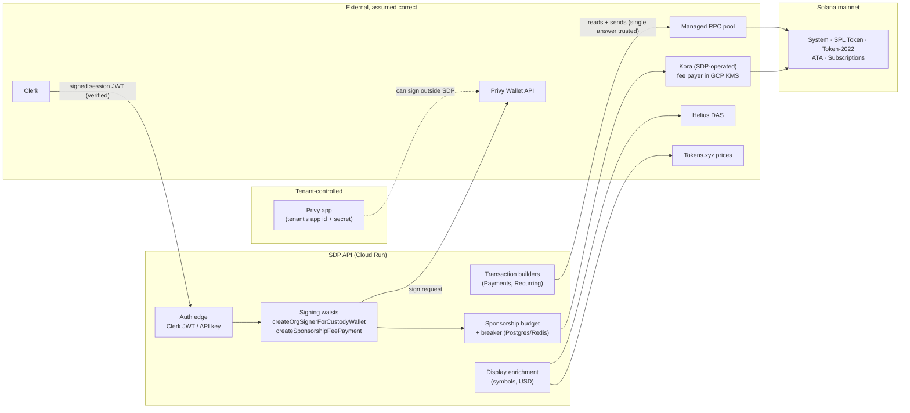

# External dependency and trust-boundary map

Every service and on-chain program the hosted SDP API relies on to move or
report money, what SDP checks about each, what it takes on trust, and what
happens when one lies, goes stale or disappears. It answers the Asymmetric
Research STRIDE gap analysis (28 Oct 2026) controls **E1.1** (dependencies and
trust assumptions enumerated), **E1.2** (failure mode per dependency) and
**E1.3** (trust boundaries drawn), and records the containment facts behind
**E4.1** (no single dependency failure drains the protocol). The incident
response scenario runbooks (M3.2) start from the "Failure modes" and
"Monitoring" rows here.

Hand-authored, unlike the generated [module map](module-map.md). Facts that
live in infrastructure configuration are cited by their path in the
`sdp-infra` repository (`main` on 2026-10-28) and re-confirmed at each review.
Operational detail that lives in neither repository (runbooks, key holders)
belongs on the ops Notion page, not here. On-chain facts were read from mainnet on 2026-10-28 (slot
~462,625,700) and are re-read at each review.

## Scope

The hosted deployment on the `stable` release channel (stage and prod; see
`SDP_MODULE_MATURITY` in
[`release-channels.ts`](../../packages/sdp-types/src/release-channels.ts)):
Payments and Recurring Payments, custody through Privy, fee sponsorship
through Kora, the managed RPC pool, and the dashboard. Dependencies only
`beta` or `experimental` modules reach (other custody providers, ramps, Earn
providers) are listed under [Outside this map](#outside-this-map) with where
they are covered. Package supply chain (npm dependencies) is a separate
control: exact-version pinning
([`check-pinned-dependency-versions.mjs`](../../scripts/check-pinned-dependency-versions.mjs))
and GitHub dependency review failing on `high`
([`dependency-review.yml`](../../.github/workflows/dependency-review.yml)).

## Trust boundaries at a glance

The two value boundaries are the **signing waists** (ADR
[0007](../decisions/0007-money-admission.md); every custody signature and
every sponsor signature passes one, enforced by
[`check-value-movement.mjs`](../../scripts/check-value-movement.mjs)) and
the **chain itself**. Everything SDP knows about balances, history and
confirmation comes through the RPC pool and is not cross-checked.

## Summary

| # | Dependency | Value-bearing? | Lies | Goes stale | Disappears | Capped today? |
|---|---|---|---|---|---|---|
| 1 | Privy (custody) | Yes: holds tenant wallet keys | Signs for tenant wallets SDP never asked for | n/a | Custody signing stops; funds safe on chain Not SDP's to cap: the tenant owns the Privy app and its wallets. SDP's share is the secret it stores |
| 2 | Kora (sponsorship) | Yes: spends SDP's fee-payer SOL | Bounded by SDP budget + Kora policy + fee-payer balance | Budget fails closed | Sponsored flows refuse; non-sponsored unaffected | Yes: 0.01 SOL/tx, 1 SOL/day global; ≤2 SOL at risk |
| 3 | Managed RPC pool (prod: Triton, Alchemy, QuickNode) | Yes: SDP's view of the chain | Misreported balances, history, confirmation | Stale reads, expired blockhashes | Failover to next provider; all down = reads and sends fail | No cross-provider check |
| 4 | Helius DAS | No: display only; **not configured in prod** | Wrong token symbols | Stale symbols (1 h cache) | Symbols omitted | n/a |
| 5 | Tokens.xyz (display prices) | No: display only | Wrong USD estimates | Stale-snapshot filter | Balances unpriced | n/a |
| 6 | Clerk (dashboard identity) | Indirectly: a session can act as a user | Forged session = act as any dashboard user | n/a | Dashboard sign-in fails; API keys unaffected | Membership/roles held in SDP, not Clerk |
| 7 | On-chain programs | Yes: execute every movement | Upgraded program behaves differently | n/a | n/a | Subscriptions: 3-of-5 Squads multisig, no timelock |

## 1. Privy (tenant custody provider)

| Field | Detail |
|---|---|
| **What it is** | Hosted wallet custody. On `stable`, Privy is the only custody provider offered, in both modes (`SDP_MANAGED_CUSTODY_PROVIDER_MATURITY`, `SDP_BYOK_CUSTODY_PROVIDER_MATURITY` in [`release-channels.ts`](../../packages/sdp-types/src/release-channels.ts)). A Production project may only use BYOK, a Privy app the tenant supplied (`CUSTODY_MODES_BY_ENVIRONMENT` in [`custody.ts`](../../packages/sdp-types/src/custody.ts); [ADR 0006](../decisions/0006-production-custody-byok-only.md)). Sandbox projects may also use Managed (SDP's own Privy app). |
| **Where SDP touches it** | Credential check on setup: [`privy-credential.ts`](../../apps/sdp-api/src/services/custody/privy-credential.ts) (`GET /wallets` with the app id + secret). Credential storage: [`credential-secret-store.ts`](../../apps/sdp-api/src/services/credential-secret-store.ts) (GCP Secret Manager backend). Signing: [`keychain-privy.adapter.ts`](../../packages/sdp-custody/src/keychain/keychain-privy.adapter.ts) wraps `@solana/keychain-privy`'s `PrivySigner`, reached only through `createOrgSignerForCustodyWallet` ([`signer.ts`](../../apps/sdp-api/src/services/solana/signer.ts)) → [`signing.service.ts`](../../apps/sdp-api/src/services/domain/signing.service.ts). |
| **What SDP verifies** | Before every signature, at the waist: the organization's live status and production entitlement for `start` movements ([`money-admission.ts`](../../apps/sdp-api/src/lib/money-admission.ts)), the live credential and its wallet scope for every movement including exits ([`money-principal.ts`](../../apps/sdp-api/src/lib/money-principal.ts)), the movement's allowed actions and wallet purposes (`MOVEMENTS` in [`movements.ts`](../../packages/sdp-types/src/movements.ts)). SDP builds the transaction Privy signs, so it decides the instructions. At setup it verifies the credential authenticates and lists wallets. |
| **What SDP assumes** | Privy signs only what SDP's request carries and only for the requested wallet; Privy's HSM/enclave key custody is sound; the tenant keeps its Privy app secret secret. The app id + secret alone authorize a signature. SDP does not and cannot co-sign: in production the wallets belong to the tenant's own Privy app, so any extra signer or policy on them is the tenant's to configure. **SDP's position:** if an app secret is lost, SDP relies on the custody provider's own controls and policies, and on the tenant having set them up. **Contracts:** with BYOK the tenant owns the Privy account, so the contract and Privy's assurances are between the tenant and Privy; SDP holds no Privy contract for production wallets. The same holds for every BYOK custody provider. |
| **Lies** | A compromised Privy, or anyone with a tenant's app secret (leaked from the tenant, from Secret Manager, or from the API's memory), can sign any transaction for that tenant's wallets **entirely outside SDP**: no waist, no admission, no audit row. Blast radius: every wallet in that tenant's Privy app (BYOK) or every Managed sandbox wallet (Managed app). A Privy-wide compromise reaches every tenant. |
| **Goes stale** | Not applicable to signing. The wallet id and address Privy returns at provisioning are stored on SDP's custody wallet row and not re-read from Privy. |
| **Disappears** | Every custody signature fails; payments, recurring collections and authority revocations stop. Funds stay on chain under the tenant's keys; nothing SDP holds can move them, and nothing is lost. Recurring collections that miss a period are skipped, not double-charged (ADR 0007, decision 2). |
| **Containment today** | Production holds no SDP-owned mainnet keys (ADR 0006): a breach of SDP's own Managed Privy app reaches sandbox wallets only. Tenant secrets sit in GCP Secret Manager, read per org. The waists, CI-pinned constructors and per-key wallet scopes contain misuse **through SDP**. What a stolen app secret can sign **outside SDP** is bounded by the tenant's own Privy configuration, not by SDP: the tenant already holds that secret and could do the same without SDP, so this is the tenant's custody risk. **SDP's part of the risk is the copy it stores.** A leak from Secret Manager or from the API's memory would be SDP's failure, contained by per-org secret storage and access to the secret store (infra access review). Revoking or rotating a leaked secret is done by the tenant in Privy's console. Planned: where the provider's API exposes them, the provider connection screen will show the policies configured on the tenant's account, so a tenant can see whether any limits are in place. Nothing displays them today. For E4.1: SDP holds no production funds in Privy, so no Privy failure drains an SDP-held balance. |
| **Monitoring** | Refused signatures log `sdp_money_refused`; Privy failures log `sdp_api_vendor_call` with `outcome: failed` ([`vendor-calls.ts`](../../apps/sdp-api/src/runtime/vendor-calls.ts)). Signatures made outside SDP are not observed. They are the tenant's to watch, but a watcher comparing custody-wallet activity with SDP's signing records would be the only way to notice a leak of SDP's stored copy (see [open gaps](#open-gaps)). |

## 2. Kora (fee sponsorship)

| Field | Detail |
|---|---|
| **What it is** | Kora, run by SDP per cluster, co-signs as fee payer so tenants' transactions need no SOL. The mainnet fee-payer key is non-exportable in GCP KMS (`sdp_mainnet_fee_payer`) and only Kora's service account may use it, gated by `roles/cloudkms.signer` on the key (sdp-infra `kora/cloud-run/signers.mainnet.toml`; rotation in `kora/OPERATIONS.md`). Kora reads and sends through its own RPC (`KORA_MAINNET_RPC_URL`). |
| **Where SDP touches it** | Adapter: [`kora.adapter.ts`](../../packages/sdp-fee-payment/src/kora.adapter.ts) (`signTransaction`, `getConfig`). The only sponsor that can sign: `createSponsorshipFeePayment` in [`sponsorship.service.ts`](../../apps/sdp-api/src/services/sponsorship.service.ts), which wraps it in admission ([`sponsorship-admission.ts`](../../apps/sdp-api/src/services/sponsorship-admission.ts)) and the budget ([`sponsorship-budget.service.ts`](../../apps/sdp-api/src/services/sponsorship-budget.service.ts)). Reconciliation: cron `reconcile-sponsorship-budgets`, every minute ([`sponsorship-budgets.ts`](../../apps/sdp-api/src/cron/sponsorship-budgets.ts)). Local harness policy (mirrors devnet, not mainnet): [`infra/kora/kora.toml`](../../infra/kora/kora.toml). |
| **What SDP verifies** | Per signature: the organization and credential are admitted for the movement; a reservation fits the per-transaction, hourly and daily budget at global, organization and project scope; Kora's `getConfig` returns a `max_allowed_lamports` (missing or negative fails), and the reservation books the worst case `network fee + max_allowed_lamports`; Kora's response is signed by the expected fee payer **over the same message SDP sent** (`assertSponsorSignedSameMessage` in [`sponsorship-integrity.ts`](../../apps/sdp-api/src/services/sponsorship-integrity.ts)); a substituted message is treated as ambiguous spend. Reconciliation settles actual lamports from chain. |
| **What SDP assumes** | Kora enforces its own validation config (program allowlist, `max_allowed_lamports`, signature count, usage limit); Kora's RPC (`KORA_MAINNET_RPC_URL`) reports chain state honestly; KMS IAM keeps the key to Kora's service account. |
| **Lies** | A compromised Kora or KMS identity could sign drains of the fee-payer account. Spend through SDP is capped by the budget; spend outside SDP (direct Kora or KMS misuse) is capped only by the fee-payer balance. |
| **Goes stale** | Budget accounting that cannot be read or written trips the global breaker and refuses (`sdp_api_sponsorship_accounting_unavailable`, `sdp_api_sponsorship_breaker_tripped`). The breaker fails closed even when it cannot sync to Redis. |
| **Disappears** | Sponsored flows return `PROVIDER_NOT_AVAILABLE`; nothing is signed. Flows that may fall back to signer-paid fees check `isKoraSponsorshipConfigured` first. No tenant funds are at risk. |
| **Containment today (E4.1 evidence)** | **SDP budget** (`sponsorship_budget_policies`, seeded in [`0055_sponsorship_budgets.sql`](../../apps/sdp-api/src/db/migrations/postgres/0055_sponsorship_budgets.sql), mainnet enabled by [`0140_enable_mainnet_sponsorship.sql`](../../apps/sdp-api/src/db/migrations/postgres/0140_enable_mainnet_sponsorship.sql)): mainnet global 0.01 SOL/tx, 0.5 SOL/hour, 1 SOL/day; organization default 0.25/hour, 0.5/day; project default 0.1/hour, 0.25/day (all 0.01/tx). Fail-closed breaker as above. **Kora policy** (sdp-infra `kora/cloud-run/kora.mainnet.toml`): `max_allowed_lamports` = 3,000,000 (0.003 SOL/tx of rent; the largest sponsored flow, recurring setup, needs 2,677,160), asserted at deploy by `kora/cloud-run/check.sh`; usage limit 1,000 transactions per 24 h per Kora user, `fallback_if_unavailable = false` (fail-closed); `max_signatures = 10`; durable nonces refused; program allowlist. The repo's local `kora.toml` uses 9,900,000 and is not the mainnet value. `user_id` is server-derived per org/project/actor (`buildKoraUserId`), never caller input. **Fee-payer balance ceiling**: approved operating band 1–2 SOL, excess moved to a treasury-controlled wallet (sdp-infra `kora/alert-rules/kora-fee-payer-balance-high.json`), so at most ~2 SOL is exposed to a Kora or KMS compromise. |
| **Monitoring** | Breaker and accounting events above; `sdp_api_vendor_call` for Kora calls. Grafana alert rules in sdp-infra `kora/alert-rules/`: `kora-fee-payer-balance-high` (above 2 SOL), `kora-fee-payer-balance-low` (below 1 SOL, one day of the global cap), `kora-fee-payer-balance-unreadable`, `kora-balance-metrics-absent`, plus devnet and stage variants. |

## 3. Managed RPC pool

| Field | Detail |
|---|---|
| **What it is** | A per-cluster pool of commercial RPC providers. The pool reads one env key per provider and cluster, `SOLANA_RPC_<PROVIDER>_<CLUSTER>_API_KEY_URL`, in the fixed failover order of `MANAGED_RPC_ENV_KEYS` ([`managed-rpc-env-keys.ts`](../../packages/sdp-rpc/src/managed-rpc-env-keys.ts)): Triton, Helius, Alchemy, QuickNode, Validation Cloud, Nodit, default. **Prod mounts** (sdp-infra `terraform/envs/prod/terraform.tfvars`, `app_secret_keys`): mainnet **Triton → Alchemy → QuickNode**; devnet **Triton only** (no failover). Stage adds Helius devnet and Alchemy/QuickNode devnet. These are the keys mounted; whether each secret holds a value was not checked. **No contract or SLA is in place with any of them.** SDP hosts this pool and shares it with every tenant, so unlike BYOK custody these are SDP's own vendor relationships. Scored Mature for availability (STRIDE I5.1–I5.3). |
| **Where SDP touches it** | Pool and failover: [`factory.ts`](../../packages/sdp-rpc/src/factory.ts) (tests: [`failover.test.ts`](../../packages/sdp-rpc/src/failover.test.ts)). Egress guard: [`blocked-address.ts`](../../packages/sdp-rpc/src/blocked-address.ts), [`rpc-egress.ts`](../../apps/sdp-api/src/services/rpc-egress.ts). Landing check: [`verified-confirmation.ts`](../../packages/sdp-rpc/src/verified-confirmation.ts). Every balance read, transaction build, send, confirmation and reconciliation. |
| **What SDP verifies** | Each endpoint proves it serves the configured cluster (`getGenesisHash`, re-proved on a TTL) before it is used; a mismatch is non-transient and stops failover (`RPC_CLUSTER_MISMATCH`). Endpoints that resolve to private, loopback, link-local or metadata addresses are refused. A caller-supplied signature must be confirmed, the expected account must exist, and the fetched transaction must show the expected operation before SDP records state from it. |
| **What SDP assumes** | **SDP trusts a single RPC answer with no cross-provider validation, and does not rebroadcast a dropped transaction.** Whichever provider answers is taken as the chain's state. (Earn vault reconciliation has its own rebroadcast path; Payments does not.) |
| **Lies** | A manipulated provider can misreport balances, history, or confirmation status. Consequences: wrong balances shown to tenants; a payment reported confirmed that never landed, or failed when it landed; a reconciliation that settles on false history. It cannot forge signatures, so it cannot move funds by itself; the worst value outcome is SDP acting on a false confirmation (for example marking a payment request paid). |
| **Goes stale** | A lagging node returns old balances and blockhashes; sends with a stale blockhash expire. Never-landed verdicts settle only on lag-proof history (#2600). |
| **Disappears** | Failover and cooldown move to the next provider (`sdp_rpc_failover`, `sdp_rpc_cooldown`). If every provider for a cluster is down, reads and sends fail and nothing is signed into the void. A dropped transaction is not rebroadcast; the caller retries. |
| **Containment today** | Multi-provider failover; genesis proof per endpoint; verified-landing checks; idempotent money routes (ADR [0009](../decisions/0009-idempotency-keys.md)) so a caller retry after a false failure does not double-send. Nothing limits the impact of a provider that answers wrongly but plausibly. |
| **Monitoring** | `sdp_rpc_attempt`, `sdp_rpc_failover`, `sdp_rpc_cooldown` ([`telemetry.ts`](../../packages/sdp-rpc/src/telemetry.ts)). No alert compares answers across providers. |

## 4. Helius DAS (asset metadata)

| Field | Detail |
|---|---|
| **What it is** | Helius Digital Asset Standard API (`getAssetBatch`), for token symbols on balance responses. **Inert in prod today:** it needs `SOLANA_RPC_HELIUS_MAINNET_API_KEY_URL`, which prod does not mount, so `isHeliusDasConfigured()` is false and balances keep the mint as their label unless the token is well known. Uses the cluster's Helius endpoint from the managed pool config. |
| **Where SDP touches it** | [`helius-das.ts`](../../packages/sdp-rpc/src/helius-das.ts) (the only sender) and [`helius-das.service.ts`](../../apps/sdp-api/src/services/helius-das.service.ts); called from wallet-balance and custody wallet handlers. |
| **What SDP verifies** | Response shape. |
| **What SDP assumes** | Symbols are correct. **No value-bearing decision reads DAS**: balances and amounts come from RPC; DAS only labels them. |
| **Lies** | A wrong symbol on a balance (a spoofed "USDC"). Display only; payments name mints by address. |
| **Goes stale** | Symbol cache TTL one hour. |
| **Disappears** | Balances returned without symbols; failure logged. |
| **Containment today** | Not on any signing or admission path. |
| **Monitoring** | `sdp_api_vendor_call` with `vendor: "helius-das"`. |

## 5. Display prices: Tokens.xyz (formerly Jupiter)

USD estimates no longer come from Jupiter: Tokens.xyz supplies every wallet
USD estimate and Jupiter's price endpoint is not called
([`display-prices.md`](../ops/display-prices.md)). Jupiter's **Swap** API is
used only by Earn (`beta`, not on `stable`; see
[Outside this map](#outside-this-map)).

| Field | Detail |
|---|---|
| **What it is** | Tokens.xyz price snapshots for USD values on balance responses. |
| **Where SDP touches it** | [`display-price.service.ts`](../../apps/sdp-api/src/services/display-price.service.ts), called only through `attachUsdValuesToBalances` / `attachDisplayValuesToBalances` in [`helius-das.service.ts`](../../apps/sdp-api/src/services/helius-das.service.ts). |
| **What SDP verifies** | Fixed HTTPS endpoint, no redirects, 1 MiB cap; only requested mints with positive finite prices and `hasMarket: true`; duplicates, future-dated and >2-hour-old snapshots dropped (details in [`display-prices.md`](../ops/display-prices.md)). |
| **What SDP assumes** | Prices are honest. **No value-bearing decision reads them.** |
| **Lies** | Wrong USD estimates shown. No movement, cap or admission depends on them. |
| **Goes stale** | 60 s cache; snapshots older than two hours excluded. |
| **Disappears** | Balances returned unpriced; shared cooldown on 401/403/429. |
| **Containment today** | Display only; rate-limited per key across replicas. |
| **Monitoring** | `sdp_api_vendor_call` with priced/unpriced/stale counts. |

## 6. Clerk (dashboard identity)

| Field | Detail |
|---|---|
| **What it is** | Identity and session for dashboard users. Clerk proves who the person is; SDP holds membership and roles ([ADR 0012](../decisions/0012-sdp-owns-organization-membership.md)). |
| **Where SDP touches it** | JWT verification against Clerk's JWKS: [`clerk-token.ts`](../../apps/sdp-api/src/lib/clerk-token.ts); session middleware: [`clerk-auth.ts`](../../apps/sdp-api/src/middleware/clerk-auth.ts); human-only routes: [`human-session.ts`](../../apps/sdp-api/src/middleware/human-session.ts); Clerk webhooks: [`webhooks/handlers.ts`](../../apps/sdp-api/src/routes/webhooks/handlers.ts). |
| **What SDP verifies** | JWT signature against Clerk's published keys and issuer; organization status read fresh per request; role from SDP's `organization_members`, never from Clerk's role claim. Webhooks are signature-checked (`verifyWebhook` from `@clerk/backend/webhooks`, `CLERK_WEBHOOK_SECRET`). |
| **What SDP assumes** | Clerk's signing keys and session issuance are not compromised; Clerk's email verification is honest (invitations match on verified primary email). |
| **Lies** | A compromised Clerk (or a stolen session) acts as that dashboard user, with that user's SDP role: create API keys, move funds the role allows, manage members if admin. It cannot grant a role SDP did not record. |
| **Goes stale** | Session revocation in Clerk takes effect when the short-lived JWT expires. |
| **Disappears** | JWKS unreachable → 503 (`ClerkKeysUnavailableError`), not a silent accept. Dashboard sign-in stops; API keys and jobs are unaffected. |
| **Containment today** | Clerk cannot change membership (everyone is `org:member` in Clerk, ADR 0012). API keys cannot administer keys, members or the organization (`requireHumanSession`), so a leaked key cannot escalate; but a dashboard session can. No step-up for money movement from the dashboard. |
| **Monitoring** | Audit rows for dashboard actions ([`audit.service.ts`](../../apps/sdp-api/src/services/audit.service.ts)); dashboard rate limit per actor. No anomaly alert on session behaviour. |

## 7. On-chain programs

SDP builds transactions against these and Kora allows them
([`kora.toml`](../../infra/kora/kora.toml) `allowed_programs`). Authorities
read from mainnet on 2026-10-28; audits from
[anza-xyz/security-audits](https://github.com/anza-xyz/security-audits/tree/master/spl)
and each program's repo; build verification from
[verify.osec.io](https://verify.osec.io).

| Program | Address | Upgrade authority (2026-10-28) | Verified build | Audits |
|---|---|---|---|---|
| **Subscriptions** (recurring payments) | `De1egAFMkMWZSN5rYXRj9CAdheBamobVNubTsi9avR44` | Upgradeable. Authority `DXtFpbPjcn2hxPnw79x1Pfoj35vXh5AsWBkS37YnXMVv`, the vault of Squads v4 multisig `4CxQs26DewQ1KaCHfyyjktkYjndNdUqCJvVdygtJFwcJ`: **3-of-5, time lock 0, no config authority** (autonomous). Last deployed slot 438,440,823. | Yes, commit `364a419` (2026-08-10). Not frozen. | Cantina ×3 ([`audits/`](https://github.com/solana-foundation/subscriptions/tree/main/audits)); current baseline `d6b3a5d`, fixes through `debb4f7`. The verified commit is 8 commits after `debb4f7` with no change under `program/`. |
| **Token-2022** | `TokenzQdBNbLqP5VEhdkAS6EPFLC1PHnBqCXEpPxuEb` | Upgradeable. Authority `AeLmXCbPaQHGWRLr2saFsEVfmMNuKnxRAbWCT9P5twgz`, upgrades executed through Squads Smart Account (`SMPLecH534NA9acpos4G6x7uf3LWbCAwZQE9e8ZekMu`); threshold not yet decoded. Last deployed slot 460,497,271. | Yes, commit `8867f75` (2026-10-23). | Many (Halborn, Trail of Bits, NCC, OtterSec, Zellic, Certora, Asymmetric Research 2026-06, others). |
| **SPL Token** | `TokenkegQfeZyiNwAJbNbGKPFXCWuBvf9Ss623VQ5DA` | **None (immutable).** Last deployed slot 419,472,000. | Yes, frozen. | Kudelski 2020; p-token audits (Neodyme, Zellic, Certora FV) are also listed. Whether the deployed binary is p-token is not confirmed here. |
| **Associated Token Account** | `ATokenGPvbdGVxr1b2hvZbsiqW5xWH25efTNsLJA8knL` | Non-upgradeable (BPF Loader 2). | Not on verify.osec.io. | None found in anza-xyz/security-audits under its own name. |
| **System, Compute Budget** | `11111111111111111111111111111111`, `ComputeBudget111111111111111111111111111111` | Native; changes only through validator releases and feature gates. | n/a | Covered by Agave's audits. |
| **Memo** | `MemoSq4gqABAXKb96qnH8TysNcWxMyWCqXgDLGmfcHr` | Non-upgradeable (BPF Loader 2). | n/a | n/a (no value). |

| Field | Detail |
|---|---|
| **Where SDP touches it** | Builders across Payments; Recurring Payments through `@solana/subscriptions` 0.5.0 ([`apps/sdp-api/package.json`](../../apps/sdp-api/package.json)): [`activation.ts`](../../apps/sdp-api/src/services/payments/recurring-payments/activation.ts), [`collection.ts`](../../apps/sdp-api/src/services/payments/recurring-payments/collection.ts), [`authority-revocation.ts`](../../apps/sdp-api/src/services/payments/recurring-payments/authority-revocation.ts). |
| **What SDP verifies** | SDP pins program addresses through the SDKs it builds with; simulates where the flow does; checks landed transactions (`verifyTransactionLanded`). It does not check program bytecode or upgrade authority at runtime. |
| **What SDP assumes** | Each program behaves as its audited, verified source, and its upgrade authority will not ship a malicious upgrade. |
| **Lies (malicious or buggy upgrade)** | **Subscriptions matters most.** Activation approves the wallet's per-mint subscription-authority PDA as SPL delegate for **u64::MAX** (`authority-revocation.ts`). A malicious upgrade could move the full balance of that mint from every token account with a live delegation, not just the subscribed amounts. 3 of 5 signers suffice and there is no time lock to react in. Token-2022: an upgrade could affect every Token-2022 balance SDP custody holds. SPL Token, ATA, Memo: immutable. |
| **Goes stale / disappears** | Not applicable; a closed or broken program makes its flows fail. |
| **Containment today** | Delegations are revoked and the PDA closed once no subscription needs them (`authority-revocation.ts`, HOO-2210), which bounds exposure to wallets with live recurring payments. Kora refuses programs outside its allowlist. No runtime guard on upgrades. |
| **Monitoring** | None in SDP. Nothing alerts when a program SDP depends on is upgraded or its authority changes. |

## Outside this map

Runtime dependencies not reached on `stable`, or owned by another control.
Each needs a row here before its module is promoted to `stable`.

| Dependency | Why not mapped here | Where it is covered |
|---|---|---|
| Other custody providers (Fireblocks, Coinbase CDP, Para, Turnkey, Dfns, IBM Haven, Anchorage, Utila, local) | `beta` only | [`packages/sdp-custody`](../../packages/sdp-custody/src) |
| Ramp providers (MoonPay, Stripe) | `experimental` | [`ramp-provider-safety.md`](../contributing/ramp-provider-safety.md) |
| Earn providers (Kamino, Veda, Jupiter Lend, Ondo, Hastra, WisdomTree) and **Jupiter Swap API** (value-bearing: response instructions admitted against a closed contract, [`jupiter-swap.service.ts`](../../apps/sdp-api/src/services/earn/jupiter-swap.service.ts)) | Earn is `beta` and held from public surfaces (PRO-2038) | [`earn-v1-data-flow.md`](earn-v1-data-flow.md), [`packages/sdp-earn/CLAUDE.md`](../../packages/sdp-earn/CLAUDE.md) |
| Helius Rings, Private Channels, DvP, Issuance programs | `experimental` | Their module packages |
| GCP Secret Manager, GCP KMS, Cloud Run, Postgres, Redis, Doppler | SDP's own infrastructure, not external trust | Infra access review |

## Open gaps

1. **No detection of a leak of SDP's stored Privy secrets.** If SDP's copy of a tenant's app secret leaked, signatures made with it would leave no trace in SDP. Optional: a watcher that flags custody-wallet activity with no matching SDP signing record. Capping what the secret can sign is the tenant's Privy configuration, not an SDP gap.
2. **Provider policies are not shown.** SDP's position relies on tenants having provider-side policies, but the dashboard doesn't show whether they do. Planned: show configured policies on the provider connection screen where the provider API allows.
3. **No RPC contracts before launch.** Prod depends on Triton, Alchemy and QuickNode on mainnet and on Triton alone on devnet, with no contract, SLA, data-integrity commitment or incident-notice terms. These need setting up before launch.
4. **Single RPC answer trusted.** No cross-provider check on confirmations or balances that drive state changes (payment request paid, reconciliation settled). Candidate: a second-provider confirmation for value-bearing verdicts.
5. **No rebroadcast of dropped Payments transactions.** Recovery is caller retry under Idempotency-Key.
6. **Subscriptions upgrades: 3-of-5, no time lock, while delegations are u64::MAX.** The multisig belongs to the program's maintainers, not SDP, so SDP records it as a dependency fact. SDP-side options: cap the SPL delegation at the schedule's remaining total instead of u64::MAX; alert on upgrade (gap 7).
7. **No program-upgrade monitoring** for Subscriptions or Token-2022.
8. **Token-2022 multisig threshold** not yet decoded.
9. **ATA program** has no verified build and no audit found under its own name.
10. **Mainnet Kora allowlist has no live check.** sdp-infra's deploy check asserts `max_allowed_lamports`, but the mainnet program allowlist is kept in step by hand (the note in [`kora.toml`](../../infra/kora/kora.toml) says so).
11. **No dashboard step-up** for money movement; a stolen Clerk session acts with the user's full role.
12. **Token symbols in prod** come only from the well-known list while Helius DAS is unmounted (display only).

## Open questions

1. Which provider `KORA_MAINNET_RPC_URL` points to, and whether it is covered by the same contracts as the API's pool once they exist.
2. Who signs the RPC contracts before launch, and what they must cover (availability, data integrity, incident notice, sharing with tenants).

## Maintenance

- **Owner (proposed):** Sagar Dhawan, until a security lead is named.
- **Review cadence:** quarterly, with the existing access review; also before
  any module or provider is promoted to `stable`, and whenever a dependency is
  added, replaced or changes trust (for example a module moves to `stable`).
- **Each review:** re-read on-chain authorities and verify.osec.io status;
  re-confirm every sdp-infra fact against its `main`;
  check every code link still resolves; record the review date below.

| Reviewed | By | Notes |
|---|---|---|
| 2026-10-28 | Initial draft | Written for the STRIDE E1.1–E1.3 re-score |
