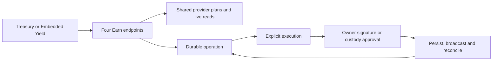

# Earn core API proposal

Status: implemented for review, 18 November 2026. The replacement contract is
documented internally. Public promotion awaits named security sign-off.

Earn aggregates Solana yield strategies behind four core endpoints:
discovery, positions, deposit and withdraw. Treasury and Embedded Yield should
use those same endpoints. Providers supply the underlying strategies; SDP supplies
discovery, consistent execution, custody integration and recovery.

Retire new program creation, allocation configuration and automation. Preserve
existing holdings, history, pending approvals and every outstanding withdrawal.

## Vocabulary

The catalogue contains **strategies**. A strategy can be a provider vault,
lending market or RWA product. New shared code and comments use `Strategy`,
`strategyId` and `strategy_id`. `strategy_reference` is the provider's instrument
reference. A **position** is a wallet's holding; an **operation** is its durable
deposit or withdrawal workflow; an **attempt** is one immutable transaction or
approval action within that workflow.

Provider adapters can retain precise provider terms such as vault, reserve or
redemption order. Those terms do not name the shared catalogue or API.
`vault_address` remains a synchronized database compatibility alias while old
revisions serve traffic. New positions, movements and transaction builds carry
the canonical strategy reference. Removing aliases follows deployment drain.

## Implementation and release boundary

The replacement is always asynchronous. HTTP execution only accepts a reviewed
action and returns `202`; the worker handles fast signers and external approval
providers through the same durable lifecycle. Status reads never advance money
work. Confirmation, finalization and provider delivery remain distinct.

The explicit `nextAction: { type: "refresh" }` advertises a proven unsigned
expiry or definitively refused proposal. Clients request new terms and review
again. Uncertain dispatch or signatures remain `wait`; an error string never
authorizes replacing a possibly executable attempt.

Exposed external unsigned transactions also require outcome reconciliation
before replacement. An absent registered signature or expired blockhash cannot
prove that the owner did not sign and broadcast independently. Refresh refuses
that action with `external_transaction_outcome_unknown`; custody preparations
and nontransaction option reviews remain refreshable under their usual guards.

Workers hold a 180-second fenced lease and reserve time before each external
boundary within a 120-second action budget. Each cron run stops claiming new
work after 120 seconds. A timeout retains the same attempt and its uncertainty;
it does not authorize a replacement proposal. Resolved refusals wait for an
explicit refresh rather than occupying the recovery queue indefinitely.

The `submit` audit event for an `earn_operation` records execution acceptance,
including the action/version and attempt ID. Its stage is `accepted`, its
operation status is `queued`, and `settlementObserved` is false. The event does
not claim that a deposit settled. Verified external bytes, the audit link and
execution acceptance commit atomically for deposits; audit failure cannot leave
signed work eligible for a worker send. Exit auditing keeps its existing
best-effort behavior after durable acceptance.

Treasury and the Embedded Yield example use the core contract. Automated
program creation/configuration returns `410`. Compatibility reads preserve
history; existing obligations retain their recovery paths until drained. Those
paths must not accept transaction builds reserved for operations.

Discovery includes validated catalogue rows beyond the execution shelf and
explicitly labels discovery-only strategies. Position discovery can include
holdings opened outside SDP through the currently integrated adapters. Missing
or failed provider reads remain unavailable, never a zero balance. Imported
holdings have unknown cost basis and earnings.

Discovery performs one adapter call per provider/owner, currently at most four
for one explicitly selected source. Passing every catalogue instrument into
that call previously caused an instrument read per reference; full-wallet
discovery now asks the provider for the owner's holdings once and joins the
validated catalogue locally. This is an adapter-call count, not a promise of
four RPC requests: underlying SDK reads depend on the actual holdings. Tracked
position reads retain their existing batching.

Withdrawal planning quotes each eligible route once and reuses its output
floor when building. Token-sized exits add one cold share-mint precision read;
warm reads cost zero, concurrent reads share the request, and failures are not
cached. Transaction simulation remains required before unsigned bytes are
returned. Provider load testing remains a release check.

The threat model is in
[Earn core operations](../security/earn-core-api-threat-model.md). Provider
sandbox testing, signed-in browser verification and publication sign-off remain
release gates. The baseline inventory below explains the migration scope;
coverage expansion and canonical economic deduplication remain follow-up work.

Implementation is **Critical** because it changes
fund movement, signing authorization and recovery. The linked threat model
documents those boundaries. No new public contract is promoted by
this implementation: the existing 21 partner operations remain compatibility
routes. The four new Earn routes and five lifecycle routes stay outside public
OpenAPI, generated API reference, playground, Postman and AI resources.

Fresh legacy deposit and withdrawal writers, including direct/queued unsigned
builds, return 410. Existing direct positions exit through core `/withdraw`.
Read-only history/quotes, exact already-built legacy signed submissions,
existing queued-request cancellation and program exits remain drain
compatibility. Cancellation and program exits retain their old execution model
until migrated; they cannot open a new position or allocation.

## Verified baseline

Source snapshot: remote `main` at
`d23c61c7e`, refreshed during implementation. The counts below describe that
baseline before this change. No deployment or provider sandbox was exercised.

There are **59 Earn HTTP operations**, counting method/path pairs. The mounted
router and internal OpenAPI agree. Of these, **21 partner operations publish on
beta and experimental; stable publishes none**. The earlier publication hold is
removed on fetched main. Deleting the existing partner contract therefore needs
a consumer migration, even though Earn has not reached stable.

| Current surface | Count | Destination |
| --- | ---: | --- |
| Strategy list and detail | 2 | Discovery, including an ID filter |
| Custody vault actions, positions and reconciliation | 15 | Four core routes, operations, internal reporting |
| Shared deposit preview | 1 | Deposit preparation |
| Shared movement feed | 1 | Shared operation history |
| External-wallet routes | 18 | Same four core routes and operations |
| Programs | 9 | Retire creation/configuration; adapt existing holdings/exits |
| Provider preparation/cancellation actions | 7 | Operation steps and cancellation |
| WisdomTree onboarding | 6 | Eligibility integration outside the core contract |
| **Total** | **59** | |

The database already shares `earn_positions` and `earn_movements` across custody
and external-wallet execution. Provider builders already return common plans.
Reuse these boundaries and the existing reconciliation workers.

Current positions reads enumerate database-known holdings, then refresh their
live balances. They do not discover previously unseen positions opened outside
SDP. A shared positions response alone does not provide wallet-wide coverage.

### The catalogue is narrower than the coverage goal

The registry names nine providers. Four are surfaced: Veda, Kamino, Jupiter Lend
and Ondo. Registration does not establish live strategies or execution readiness.
The API further limits Kamino to five mainnet vaults and filters Aave/Morpho
terms. Provider ingestion also applies asset, deployment and execution-support
filters. Removing the API allowlist alone cannot produce ecosystem coverage.

Build catalogue coverage as a separate workstream. The initial target is the
complete validated strategy shelves of the provider sources we already integrate,
rather than the hand-picked vault lists. Define that release's exact coverage
matrix before release: strategy families, protocols, indexed strategies,
executable routes, exclusions, missing capabilities and owners. Coverage is a
delivery gate; an inventory alone does not satisfy it. New ecosystem sources
remain ongoing integration work, with explicit gaps rather than an "all
strategies" claim.

### Async signing exists in part

Fetched main implements Fireblocks sign-only `PROGRAM_CALL`, durable proposal
tracking, status reads and cancellation. The signing call still waits inside
the request. Its recovery explicitly never resumes a dead request or broadcasts
a recovered signature. Earn's workflow budget remains 20 seconds; shared custody
signing is also bounded, with a 90-second maximum.

[PR #2865](https://github.com/solana-foundation/solana-developer-platform/pull/2865)
is merged in this baseline. It adds shared proposal
authorization/recovery machinery, but its parent rows and worker still target
payment transfers. It does not deliver resumable Earn execution by itself.

Extend these foundations with durable Earn operations. Neither a longer HTTP
timeout nor an endpoint rename closes this gap. Do not assume Privy requires
external approval: select the next action from the wallet's actual capability
and policy.

## Core contract

All routes remain authenticated and scoped to the caller's project and
environment. The replacement paths below are internal until publication review.

| Endpoint | Input | Result |
| --- | --- | --- |
| `GET /v1/earn/discovery` | Strategy/provider/asset filters and pagination | Strategies, rates, terms and supported actions |
| `GET /v1/earn/positions` | Wallet/owner filters and pagination | Unified holdings and optional portfolio totals |
| `POST /v1/earn/deposit` | Strategy ID, funding wallet, token amount | Prepared operation with unsigned transaction or next action |
| `POST /v1/earn/withdraw` | Position ID, amount or all | Prepared operation with unsigned transaction or next action |

Preparation performs live quotes, simulation and required provider planning.
It records an operation but never signs, broadcasts or opens a custody approval
request. The UI presents its economic terms before explicit execution. A new
preparation returns `202` with an operation ID after its build is stored.

### Discovery: strategies first

Each row describes a specific strategy, rather than a protocol-level APY.
Keep the existing stable `strategyId` as the deposit reference. Display the
protocol, strategy name, curator where relevant, supported assets, liquidity,
withdrawal timing, fees and risk/source information. A protocol can have many
strategies with different rates and terms.

Support filters for `id`, provider, deposit mint, source kind, liquidity,
execution availability and pagination. Preserve existing APY-type and cluster
filters. Provider and mint filtering are additions to today's contract. Add APY
threshold/sorting only with defined handling for missing and stale rates.

Keep APY as a decimal fraction: `"0.062"` means 6.2%. Rates also need a
measurement basis, observation time and source.
Keep APR, APY and reward components distinguishable. An unknown rate is absent
or null, never zero; a generic row update time is not a rate timestamp. Do not
rank unlike yield measures as directly comparable.

Separate catalogue visibility from transaction admission. A discovery-only row
must explicitly say that SDP cannot execute it and why. Existing executable
catalogue safety rules stay intact; broad indexing needs an explicit read-only
capability rather than admitting unsupported rows into the money path.

Model one economic strategy with its available access routes, so the same vault
appearing through multiple integrations does not inflate coverage. Preserve
existing IDs and add canonical links where needed; do not merge distinct share
classes, chains or risk exposures by matching names or APYs. A managed vault
holding another strategy remains a distinct economic claim.

Current `fundable` means cluster compatibility only. Replace or supplement it
with explicit execution capability and caller-admission facts. Per-wallet
eligibility is evaluated when a wallet is supplied or an operation is prepared.
Neither a catalogue listing nor a displayed APY promises that a deposit passes.

Start execution with currently supported assets. Broader SOL, staking or LP
coverage needs the corresponding builders, valuation and exit models. Existing
exposure checks approximate stablecoin units as USD; they must not be reused for
non-stablecoin assets without real pricing.

### Positions: one holding format

Return `positionId`, `strategyId` when available, wallet/owner identity, provider,
assets, live shares, available withdrawal amounts and pending obligations.
Retain exit metadata when a strategy is delisted. Pending queue shares and
intermediate tokens remain visible until their economic outcome is known.

Include pre-existing wallet holdings for the provider/asset combinations in the
release coverage matrix. This needs provider position discovery or import,
beyond today's tracked-position reads. Report unsupported or incomplete coverage
explicitly. Discovery cannot create exclusive wallet-ownership claims or expose
another project's movement history. Imported cost basis and earnings remain
unknown unless history establishes them; never infer profit from the balance.

Allow an exclusive `walletId` or `ownerAddress` filter. An authorized project
query can span its visible holdings. Keep aggregate totals and earned amounts
as optional views on this route, with explicit units, scope and unavailable
counts. Earnings views include closed holdings and historical movements, not
only the current open-position page. Portfolio totals must not require one
HTTP/RPC fan-out per customer.

Include pending operation references and the existing balance-read context so
confirmation refreshes cannot immediately display an older chain snapshot.
Activity and historical operation recovery live in the shared operations feed.

Unification must preserve existing access rules: custody holdings require wallet
visibility; external holdings require exact project/environment scope. An owner
address is a filter, never proof of permission to read another project's data.

### Deposit: strategy ID plus funding source

Proposed request sketch:

```json
{
  "strategyId": "strategy_example",
  "source": { "walletId": "wallet_example" },
  "amount": { "mint": "deposit_mint", "value": "100.00" },
  "slippageBps": 50
}
```

External-wallet callers instead supply `source: { "ownerAddress": "..." }`.
They need no custody-wallet registration. A wallet ID resolves the custody
capability; an owner address requires the owner's actual transaction signature.
Clients cannot select a signing provider to bypass the stored wallet policy.

Amounts are decimal strings in the named token's units. USD valuation is a
separate field. Preserve optional partner fee payment and supported swap-funded
deposits without separate strategy routes. Return quote expiry, fees, enforceable
output floors and any required preparation steps in the operation.

### Withdraw: position ID

Use `positionId` to derive provider, owner, vault and mints. The caller does not
need to rediscover a vault or supply a matching wallet ID. Default payout to the
position owner; arbitrary destination support is outside this change.

The amount is either `{ "kind": "all" }`, exact shares, an underlying-token
amount, or a held intermediate-token amount, with its denomination explicit.
`all` selects an advertised redeemable asset balance. Preserve the Hastra exit
where cancellation leaves wYLDS and no PRIME shares. Resolve underlying-token
requests to bounded share amounts through the live preview. Never treat a USD
amount as shares or tokens.

One endpoint handles instant and delayed exits. Preparation returns executable
options for the requested amount, including fees, estimated proceeds and timing.
Distinguish enforceable output floors from estimates; report unsupported floors
explicitly rather than imply guaranteed proceeds. If two options have a
meaningful trade-off, execution selects an advertised option ID/version. It
cannot invent a provider mechanism or change the terms. An expired quote
requires refreshed terms before execution.

## Shared operation lifecycle

Four Earn endpoints still need execution and recovery. Proposed shared routes:

- `GET /v1/operations`: scoped history and pending-operation recovery.
- `GET /v1/operations/{id}`: status, economic terms and current next action.
- `POST /v1/operations/{id}/execute`: require an advertised `actionId` and terms
  version; execute that action or submit its external-wallet signed transaction.
- `POST /v1/operations/{id}/refresh`: rebuild the current unsigned action after
  reconciling prior attempts. Earlier steps can already have completed.
- `POST /v1/operations/{id}/cancel`: request cancellation and expose any required
  signing action. Verified terminal provider/chain evidence determines outcome.

This is **four Earn routes plus five shared lifecycle routes**, before temporary
compatibility routes and internal administration. Keep the operation abstraction
usable by other modules; this project does not migrate every module onto it.
The existing `/v1/transactions` read feed is not an execution API. A single
economic operation may contain several transactions.

The operation holds immutable economic intent, initiating principal, current
terms version, next action and references to attempts, movements, provider
proposals and settlement requests. Those existing records keep their ownership
of signing, chain observations and provider obligations. Avoid a second ledger
or independently writable copies of those states.



Every accepted operation gets a stable ID before external effects. The response
returns an unsigned transaction when one is ready for signing, plus a versioned
action ID and its expiry. Provider prerequisites, separate swap steps and claims
can require multiple transactions; expose the current step under the same
operation rather than promise that every strategy is atomic.

Explicit execute durably queues the current action and returns `202` with
`status: queued`. Every signing call, provider proposal and broadcast runs in
the worker, including fast signers. For custody wallets, the worker opens at
most one provider proposal per executable action/attempt and exposes an approval
next action when required.
Include provider instructions and a verified handoff URL only when the adapter
supplies one. For external wallets, execute verifies the returned signed bytes
against the stored message and signer set. Stale action IDs or versions are
refused, never interpreted as approval of the latest action. Fast signers use
the same asynchronous durable workflow.

Workers recover known proposals by recorded external identity, observe approval,
and resume signing/broadcast/settlement. Webhooks can wake the worker; polling
remains the recovery path. Browser reloads and API timeouts do not own progress.

Signing approval and provider settlement are different waits. Public status
must expose both, plus chain confirmation/finality. Completion requires verified
delivery of the expected shares or payout. Queue escrow, a provider request ID,
chain confirmation and cancellation acknowledgement are different facts.

### Required execution invariants

- Persist a durable `Idempotency-Key` before posting. Same-key retries recover
  the same operation; different intentional deposits may have identical terms.
  Execute, refresh and cancel also need idempotent, versioned transitions.
- Run the shared validate/authorize/idempotent sequence. Replay checks ownership
  and wallet scope before returning a stored response; mutable admission gates
  govern new execution rather than hiding an accepted operation on retry.
- Bind approval to tenant, project, environment, wallet, strategy/position,
  assets, destination, amount/output bounds, fees and terms version. Re-admit
  the recorded principal and current credential authority at execution/resume.
- Keep provider progress separate from SDP authorization. Persist cancellation
  intent and reconcile races; an HTTP cancellation response does not prove that
  signing or payout stopped. Alert when execution wins after authority refusal.
- A refreshed blockhash changes the message and invalidates its signatures.
  Prove provider behavior for long approval waits, preserve economic limits and
  request renewed approval where required. Durable nonces are currently banned.
- Unknown execution remains reconcilable. Expiry, timeout and missing RPC history
  alone do not authorize another economic attempt. Preserve original signed
  bytes, signatures and attempt identity; retry their exact submission.
- Persist an irreversible observation-only restriction before reconciling late
  cancelled or expired signed attempts. A restarted worker must never hand
  unobserved bytes to a ledger path whose reconciler could broadcast them.
- Deposit pauses, delisting and lost production entitlement must preserve the
  existing authorized reads, exits and recovery paths. Generic operation routes
  must derive Earn exit classification from stored intent, not URL alone.
- Cancellation can return shares or leave intermediate tokens. Preserve the
  original provider obligation while its cancellation attempt is unresolved.

## Migration and delivery scope

### Trust boundaries

HTTP callers can queue only the stored action identity and version. They cannot
provide a worker principal, provider binding, settlement status or arbitrary
transaction message. External signatures are checked against the stored build.
Provider signatures are verified over that same message before merging them.

The trusted worker restores the exact scoped attempt's recorded principal only
while holding its fenced lease, then rechecks live authority through the existing
signing and sponsorship waists. It never restores grants from a snapshot. A
separately authenticated cancellation actor owns only its cancellation action;
the original operation initiator and economic intent remain immutable.

Retained provider account binding permits cleanup after authority withdrawal.
It cannot create a new proposal. Provider acknowledgment cannot authorize a
replacement attempt. Existing Earn movements and provider request rows remain
the economic ledger; generic operations coordinate them without overwriting
their settlement evidence.

Late external signed registration still requires the recorded action principal.
A rotated or revoked key can leave an unknown external signature pending until
operator reconciliation. Cross-principal signature registration needs its own
authority review; cancellation never grants another actor broadcast permission.

### Delivery sequence

1. **Contract and retirement map.** Lock the four routes, amount semantics,
   identity union, operation actions and error contract. Inventory current
   partner traffic and all nonterminal legacy resources. Set the initial
   catalogue coverage matrix as a release gate. Stop offering new program
   configuration; define historical position mappings before removal.
2. **Catalogue coverage.** Add filters, rate provenance/freshness and explicit
   read-only versus executable coverage. Inventory the intended Solana providers
   and strategy families. Broaden ingestion independently of safe execution.
   This can run alongside the operation foundation.
3. **Durable execution.** Extend existing custody proposal and movement recovery
   to an Earn operation parent. Prove long approval, expiry, cancellation,
   restart and duplicate-request behavior before enabling that custody path.
4. **Core Earn routes.** Share discovery/positions serializers and deposit/exit
   planners. Add existing-wallet position discovery/import for the agreed
   coverage, using bounded provider reads. Existing routes become compatibility
   adapters onto the same application services, not a second execution
   implementation.
5. **Consumer cutover.** Move Treasury, Embedded Yield, dashboard proxies,
   integration snippets and Northstar onto one typed client and operation
   tracker. Keep existing pending-operation recovery and aggregate reporting.
6. **Contract retirement.** Remove old partner routes after active consumers
   migrate. Remove program writers and program-only allocation configuration.
   Preserve legacy readers/exits until mapped, and reconciliation until
   obligations settle. Financial history and IDs remain readable.

Stages 3 and 4 change Critical boundaries. Prefer several reviewable changes
over one rewrite. New strategy/provider integrations are independently enabled
after end-to-end execution and recovery evidence.

Provider KYC/KYB is an eligibility concern, not a fifth money primitive. Keep
existing onboarding adapters internal or use a provider handoff. Unsupported
eligibility can leave a strategy discoverable without accepting a deposit. A new
unified onboarding product, automatic allocation, recurring deposits, leverage
and a whole-platform operations migration are outside this first delivery.

### Concrete affected surfaces

- API: Earn routers/schemas/handlers, onboarding/provider-action adapters,
  custody proposal integration, operation persistence/workers and exit/action
  classification.
- Packages: `sdp-types` wire contracts, `sdp-earn` capabilities/catalogue,
  existing provider execution packages and shared custody interfaces.
- Dashboard: Earn data client and proxy tree, Treasury deposit/exit trackers,
  Embedded portfolio aggregates and integration snippets.
- Example: `examples/embedded-yield-bank` client, signing and recovery flow.
- Docs: OpenAPI source, current `content/docs/earn` guides, Embedded Yield guide,
  internal architecture, generated reference/playground/Postman/AI resources.
  The local checkout's unpublished guide path is older than fetched main.

Do not rename the existing financial tables merely to match route terminology.
Any schema changes are additive and compatible with the previously serving
revision. Update public-contract publication review and release-channel tests;
unifying custody routes does not automatically authorize publishing them.

## Acceptance criteria

- Both products and Northstar use the same four Earn endpoints and shared
  operation lifecycle; external wallets need no custody registration.
- The agreed initial coverage matrix ships, including complete validated
  provider shelves rather than only featured vaults. Discovery filters and
  pagination describe that coverage accurately. Missing or stale rates and
  non-executable strategies are explicit. An unavailable provider cannot erase
  other providers' catalogue or misstate freshness.
- Custody and external-wallet deposits/withdrawals preserve exact amount units,
  output floors, fee funding, wallet scope and tenant/project isolation.
- Approval can outlive an HTTP request and process restart. Duplicate execute
  requests create one provider proposal and one economic action. Rejection,
  revocation, account rotation and cancellation races have durable outcomes.
- Expired signatures, lost responses and ambiguous broadcasts recover the same
  attempt. Refresh cannot create a duplicate economic action.
- Instant, queued, provider-operated and multi-step paths keep pending holdings
  visible. Completion reflects actual settlement; cancellation reports residual
  assets accurately. Delisted strategies remain withdrawable.
- Legacy positions, IDs, historical activity and pending exits survive cutover.
  Pre-existing wallet holdings appear for the agreed provider coverage, with
  unknown history left unknown. Aggregate portfolio reads retain bounded fan-out
  and explicit unavailable data.
- Route/OpenAPI parity, action/exit classification, value-movement guards,
  migration compatibility, affected provider/recovery tests, API/web typechecks
  and generated-doc drift checks pass. Record RPC counts for changed live paths.

## Dependencies and source anchors

- [Async custody decisions, PRO-2435](https://linear.app/solana-fndn/issue/PRO-2435):
  extend the shared proposal lifecycle rather than build an Earn-only signer.
- [Fireblocks sandbox evidence, PRO-2474](https://linear.app/solana-fndn/issue/PRO-2474):
  backlog at inspection; verify long-wait signing, expiry and cancellation.
- [Amount semantics, PRO-2292](https://linear.app/solana-fndn/issue/PRO-2292):
  absorb into the new amount contract.
- [Runtime route definitions](../../apps/sdp-api/src/routes/earn/index.ts),
  [request schemas](../../apps/sdp-api/src/routes/earn/schemas.ts) and
  [current wire types](../../packages/sdp-types/src/earn.ts).
- [Provider surfacing](../../packages/sdp-types/src/provider-access.ts),
  [curation](../../apps/sdp-api/src/routes/earn/handlers/curation.ts) and
  [catalogue ingestion](../../apps/sdp-api/src/cron/earn-catalogue-sync.ts).
- [Tracked-position queries](../../apps/sdp-api/src/db/repositories/earn-movements.repository.ts).
- [Existing recovery invariants](../decisions/0005-earn-intent-recovery.md).
  Its publication-hold paragraph is stale relative to fetched main.
- [Current public operation pin](https://github.com/solana-foundation/solana-developer-platform/blob/f5805e3c7571aedb97bc40be1af13826bef3b4a7/apps/sdp-api/src/openapi/spec.test.ts#L283-L362).
- [Current Fireblocks sign-only adapter](https://github.com/solana-foundation/solana-developer-platform/blob/f5805e3c7571aedb97bc40be1af13826bef3b4a7/apps/sdp-api/src/services/domain/signing/provider-adapter-factory.ts#L387-L443)
  and [status-only recovery](https://github.com/solana-foundation/solana-developer-platform/blob/f5805e3c7571aedb97bc40be1af13826bef3b4a7/apps/sdp-api/src/services/custody/fireblocks-proposal-reconciliation.ts#L65-L74).
