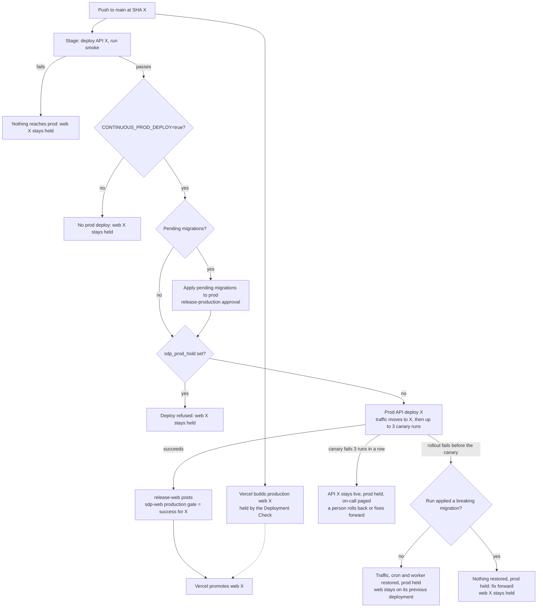

# Release Operations

> **Maintainers only.** This guide covers releases, Cloud Run deployment, and rollback for the hosted SDP API.

## Deployment Model

| Event | Target | Result |
| --- | --- | --- |
| Push to `main` | Stage | Builds a SHA-tagged image, runs migrations, updates the stage service, worker, and cron job, then runs the stage smoke |
| Push to `main` with repo variable `CONTINUOUS_PROD_DEPLOY=true` | Production API | After the stage smoke passes, runs migrations and promotes the signed per-merge image. When `main` carries migrations production has not applied yet, the merge deploy is held instead and dispatches `Apply pending migrations to prod`, which deploys that commit once a `release-production` reviewer approves it |
| `chore(main): release X.Y.Z` commit on `main` | Release publication | Creates the `vX.Y.Z` tag, publishes the GitHub release, and triggers release-image/checksum workflows. Deploys nothing itself: the commit reaches production through the per-merge pipeline like any other push |
| Push to `main` | Production web | Vercel's git integration builds sdp-web from that commit and holds it until the `sdp-web production gate` commit status passes, which the production API deploy of that same commit posts once it serves traffic |
| Manual dev workflow dispatch | Dev | Rebuilds and deploys the selected workflow revision |
| Manual production workflow dispatch from `main` | Production API | Resolves an existing 40-character Git SHA image tag and redeploys its immutable digest without running migrations. Holds merge and approval deploys afterwards unless `clear_hold` is checked |
| Manual dispatch of `Roll back sdp-api prod to the previous build` | Production API | Moves traffic, cron and worker back to the revision that served before the last promotion, then holds production |
| Vercel dashboard redeploy, instant rollback, or force promote | Production web | Redeploys, restores, or releases an sdp-web production deployment |

Vercel's git integration builds previews for pull-request branches and a production build for every merge to `main`. The sdp-web project requires the `sdp-web production gate` status under Settings → Deployment Checks, so each production build waits. Every push to `main` runs the stage and production pipeline, and the `release-web` job in [`deploy-sdp-api-gcp-prod.yml`](../../.github/workflows/deploy-sdp-api-gcp-prod.yml) posts the status for the deployed commit after a per-merge or approved-migration deploy succeeds, on the run's first attempt only. Web therefore goes live only for a commit whose API production already serves, seconds after it. No GitHub workflow deploys sdp-web, and no Vercel token is involved.



**Goal: sdp-api stays backwards compatible with the web already in production.** The API for X always goes live before web X: for the seconds until Vercel promotes web X, and for as long as a web build stays held, the previous web runs against the new API. Additive, expand-then-contract API changes keep that safe; never remove or rename a field or endpoint that production web still uses.

A held build stays held until a later push releases a newer one: a failed or rolled-back deploy, a failed canary, a failed status post, a GitHub-superseded pending run, or the kill switch being off. That is the safe direction, since web lags the API instead of leading it. When web must move without a deploy, a Vercel Owner or project admin force-promotes the production deployment for the commit the production API serves, never a newer one.

Rollout prerequisite: configure the `sdp-web production gate` Deployment Check before the first merge that relies on it; without it, Vercel promotes every `main` build immediately. If the check picker only lists contexts GitHub has seen, post the status once on a pull-request commit, which has no production deployment to release.

The hosted API runs as a Node.js container on Cloud Run. Dev and production use separate GCP projects, Artifact Registry repositories, services, migration jobs, and cron jobs.

## GitHub and GCP Setup

### GitHub environments

The `production` environment is attached to the production deployment job. Configure required reviewers there only if production needs an approval in addition to the generated release pull request.

### GitHub variables

Configure these deployment values as repository variables so the dev workflow can read them. The production environment may override them when it uses a different identity:

- `DEPLOY_WIF_PROVIDER` — Google Workload Identity provider
- `DEPLOY_SA` — Google service account used by the deployment workflows

The deploy identity needs the least-privilege permissions required to push to the target Artifact Registry repository and update/execute the named Cloud Run services and jobs.

Release automation also reads these repository variables:

- `TRANSLATION_AGENT_URL` — required when a release has missing UI translations
- `TRANSLATION_AGENT_MODEL` — optional model name included in the release summary; the translation agent defaults to `deepseek/deepseek-v4-flash`
- `TRANSLATION_AGENT_BATCH_SIZE` — optional request batch size; defaults to `50`; all missing keys are processed in batches of this size
- `TRANSLATION_AGENT_MAX_RETRIES` — optional retry count; defaults to `2`

### Repository secrets

- `DOPPLER_CI_IDENTITY_ID` (repository variable) — Doppler service-account identity for OIDC-based secret-aware CI
- `RELEASE_APP_ID` — GitHub App ID used by release automation
- `RELEASE_APP_PRIVATE_KEY` — corresponding GitHub App private key
- `TRANSLATION_AGENT_USERNAME` and `TRANSLATION_AGENT_PASSWORD` — HTTP Basic credentials required when a release has missing UI translations

The release GitHub App needs `contents: write` and `pull_requests: write`, and it must be allowed to maintain the generated release branch and enable auto-merge.

### Cloud Run resources

| Environment | Project | Artifact repository | Service | Migration job | Cron job |
| --- | --- | --- | --- | --- | --- |
| Dev | `solana-developer-platform-dev` | `sdp-dev` | `sdp-dev-api-public` | `sdp-dev-api-public-migrate` | `sdp-dev-api-public-cron` |
| Production | `solana-developer-platform` | `sdp-prod` | `sdp-prod-api-public` | `sdp-prod-api-public-migrate` | `sdp-prod-api-public-cron` |

All resources currently use `us-central1`.

The workflows update images only. Runtime environment variables, Secret Manager references, service accounts, networking, scaling, and scheduler configuration must already exist on the Cloud Run resources.

Configure `PUBLIC_API_ORIGIN` directly on each API service before deployment:

| Environment | Required value |
| --- | --- |
| Dev | `https://api-dev.solana.com` |
| Production | `https://api.solana.com` |

This value is mandatory for hosted services because token deployment embeds metadata URLs permanently on-chain. Do not rely solely on request-derived proxy headers for those URLs. The image-only workflows preserve this service configuration and do not create or update it.

## Normal Change Flow

### 1. Merge a feature pull request

Use a conventional pull request title such as `feat:`, `fix:`, `perf:`, `docs:`, or `refactor:`. Release automation uses the merged history to calculate the next version and changelog.

Merging deploys stage. Dev is deployed on request: label a pull request `deploy-dev` (`deploy-dev-on-label.yml` deploys its head and follows later pushes until the label is removed) or dispatch the dev workflow on `main`:

[`.github/workflows/deploy-sdp-api-gcp.yml`](../../.github/workflows/deploy-sdp-api-gcp.yml)

The workflow:

1. Authenticates to GCP through Workload Identity Federation.
2. Builds the API Docker image and pushes a `GITHUB_SHA` tag.
3. Updates and executes the migration job.
4. Updates the API service.
5. Updates the cron job image.

Verify the dev deployment before approving a release:

```bash
curl --fail-with-body https://api-dev.solana.com/health
```

Also exercise the affected authenticated, webhook, or provider flow; `/health` only proves that the HTTP process is reachable.

### Ramp webhook inbox

Verified ramp deliveries are stored before acknowledgement. The worker parses
and applies them, then clears the body while retaining the discharged outcome
for seven days.
After seven days the row is archived without a delivery ID or outcome. A row
with `status = 'failed'` is parked for operator review; pending unmatched
events retry for up to ten attempts. A terminal park stays parked across
deployments, while a retryable park is rearmed once on a new build.

Before enabling production ramp webhooks, confirm the Cloud Logging alert on
`jsonPayload.event="sdp_api_ramp_webhook_event_exhausted"` covers both the API
and cron services and routes to the money movement on-call. The event includes
the inbox row id, provider, environment, attempt count, and failure reason; it
does not include the signed body. An alert on
`sdp_api_ramp_webhook_event_discarded` is optional for sandbox diagnostics.

For each park, inspect `ramp_webhook_events` by `webhook_event_id` and check
`apply_outcome`, `last_error`, `terminal`, and `parked_app_revision` against the
corresponding transfer. Do not manually mark a transfer settled from the
callback alone. Correct the underlying cause and replay only after confirming
the provider transaction and the transfer match. Keep failed rows until
resolved; the retention job archives only discharged rows.

### 2. Review the generated release pull request

The Release Flow workflow maintains `sdp/release-main` and opens a pull request titled `chore(main): release X.Y.Z`. It updates:

- `package.json`
- `.github/.release-please-manifest.json`
- `CHANGELOG.md`
- missing UI translations, when applicable

Auto-merge is enabled, but branch protection still requires review approval and required checks. The release pull request is the human release gate.

#### Translation sync

`translate-release-strings` runs after the release pull request exists, as a separate `continue-on-error` job.

**This moves the catalog gate off `main`.** `validateCatalogs` has no caller outside this job, so a catalog defect used to fail Release Flow on the push to `main` and now cannot. The signal is the `Eve translation sync` comment on the release pull request, plus the job's own red status inside an otherwise green run. Read that comment before merging a release: the release pull request is the only place a translation problem can still stop anything.

The job queues a key when it is missing from a locale **or** when the value already committed is one the validator would reject: a placeholder set that no longer matches English, forbidden terminology, unparseable ICU. Both sides share one predicate, so the validator can never reject something the collector will not retranslate. That symmetry is the fix for the 2026-08 stall, where an English string gained a placeholder, the collector skipped the key because it was present, and the validator rejected it on every run for sixteen days.

Every run posts or updates one comment, so a missing comment means the job never ran, not that it passed.

| Status | Meaning |
| --- | --- |
| `no-op` | Nothing to translate; catalogs validated clean. |
| `generated` | Every batch succeeded and was committed to the release branch. |
| `partial` | Some batches failed and are deferred to the next run; the batches that succeeded are still committed. Only drift this run *introduced* blocks the commit. |
| `failed` | The run threw before it could finish, most often because a source key changed shape in a way `applyTranslations` cannot write. The comment carries the error and a link to the run. Nothing is lost; the next push to `main` retries. |

### 3. Deploy and publish production

Merging the release pull request creates a `chore(main): release X.Y.Z` commit on `main`. That push runs [`release-please.yml`](../../.github/workflows/release-please.yml), which creates the `vX.Y.Z` tag, publishes the GitHub release, resolves the tag to the exact `main` commit, and stops there: it deploys nothing. The release commit reaches production through the per-merge pipeline in `deploy.yml`, like any other push, and its web through the same gate.

The production deploy workflow:

1. Authenticates to the production GCP project.
2. Refuses a commit that is behind the schema production last applied, and, outside an approved-migration run, one that adds migrations production has not applied. Merge and approval deploys also refuse while `sdp_prod_hold` is set (unless an approval run was dispatched with `clear_hold`), and refuse a `breaking` migration until production serves the commit before its last pending edit.
3. Verifies the signed per-merge image built by `release-images.yml`, copies that digest to Artifact Registry, and resolves it to an immutable digest.
4. Runs the migration job with that image.
5. Captures the current service traffic, cron image and worker image for rollback.
6. Deploys a no-traffic candidate revision and verifies its immutable digest.
7. Polls the candidate's `/health/ready` endpoint until Postgres and Redis are ready and the instance has working egress. A fresh instance reports `checks.egress: "pending"` (503) until it can reach Clerk, which is also its Cloud Run startup probe.
8. Records the revision it is replacing for the quick rollback, sends production traffic to the candidate, verifies `https://api.solana.com/health/ready`, and updates `sdp-prod-api-public-cron` and `sdp-prod-worker` to the same digest.
9. Runs the production canary, up to three times. Three failures in a row hold production on the new revision (see [Production Rollback](#production-rollback)).
10. In `release-web`, confirms `/health/ready` still reports the promoted revision and posts the `sdp-web production gate` status for the commit.

If a step from the candidate deploy through the promotion fails, or the run is cancelled before the canary, the workflow restores the previous traffic, cron image and worker image, as it always has, and holds production. Treat an incomplete restore as an incident and reconcile all three resources immediately.

### 4. Verify production

Check:

1. The production GitHub Actions job completed successfully.
2. The `sdp_schema_sha` label on `sdp-prod-api-public-migrate` is at or ahead of the deployed commit's last migration.
3. The candidate and canonical `/health/ready` checks passed for the deployed revision, including Postgres, Redis and egress. `checks.egress: "unverified"` means the instance stopped waiting for egress and served anyway; look for `sdp_api_egress_unverified` in the API logs.
4. The cron job references the same image as the service.
5. `https://api.solana.com/health` succeeds.
6. Cloud Run error rate, latency, logs, and Sentry remain healthy.
7. At least one representative authenticated API flow succeeds.
8. The sdp-web production deployment in Vercel is for the deployed commit, or Slack reported `web held` and the run summary says why.

## Manual Deployment

Manual dispatch of the production workflow redeploys an image that already exists in Artifact Registry. Run the workflow from `main` and provide:

- `image_sha` — the lowercase 40-character Git SHA tag attached to the intended image

Before dispatch, confirm that the SHA came from a successful, trusted production release workflow and that the resolved digest matches the expected release or incident record. The presence of a tag in Artifact Registry is not sufficient provenance on its own.

The workflow validates the SHA, resolves its tag to an immutable digest, verifies a no-traffic candidate, and then promotes the API service and cron job under the same guard as a normal production release. It does not check out or rebuild source, and it never updates or executes the migration job during a manual deployment. It runs while production is held, and holds production itself (`sdp_prod_hold=<sha>`) before it changes anything, so the next merge cannot replace it. With `clear_hold` checked it does not, and lifts any hold once its canary passes.

## Production Rollback

Production never rolls back on its own after a promotion: going back is a deliberate, manual step.

### When a deploy fails

- **Before the canary** (candidate, readiness, the traffic switch or its health check, the cron or worker update, or a cancel): the run restores the traffic split, cron image and worker image it captured, as it always has, sets `sdp_prod_hold=<sha>` on `sdp-prod-api-public-migrate`, and Slack reports `ROLLED BACK, PROD HELD`. If that restore fails partway, run the quick rollback to finish it.
- **At the canary**: the canary runs up to three times. Three failures in a row, or a cancel during it, leave API X serving and set the hold, and Slack reports `CANARY FAILED, PROD HELD`. The workflow cannot page anyone itself; those runs count toward `sdp-smoke-consecutive-failures-prod`, which pages once production has three failed runs and no passing one in 20 minutes. Then decide: the quick rollback below, or a fix forward.
- **After a `breaking` migration**: nothing is restored, because the previous image cannot run on the contracted schema. The run fails and holds production, and the quick rollback refuses. Fix forward through an approval run with `clear_hold` (below).

The restore and the hold run in their own job under `always()` once the deploy job ends, so a cancel stops the forward deploy at once without cutting them short.

### Quick rollback

Dispatch `Roll back sdp-api prod to the previous build` from `main`. In a couple of minutes it moves traffic, cron and worker back to the revision that served before the last promotion, with no rebuild and no migrations, and keeps production held. It refuses when there is no previous build to return to (a breaking migration ran since, a failed rollout was restored, or a rollback already ran), when traffic is split across revisions, or when that revision is not Ready. If a step fails, run it again: it finishes what is left. Web has the same shape: Instant Rollback on sdp-web in Vercel. Then fix `main` and resume deploys.

### Resuming deploys

While the hold is set, merge and approval deploys refuse, so the next merge cannot redeploy the change. Manual dispatches still run. To resume:

1. Fix `main`, or confirm the held commit is safe after all.
2. Dispatch `Deploy sdp-api to Cloud Run (prod)` from `main` with `clear_hold` checked and `image_sha` set to the commit production should serve, for example the one it serves now (`curl -s https://api.solana.com/health/ready | jq -r .commit`).
3. That run lifts the hold once its canary passes. If its canary fails, production stays on that build and the hold stays.
4. Re-run the refused merge deploy, or merge again. Dispatch a fresh `Apply pending migrations to prod` run for held migrations, since an approved run cannot be re-run.

A restore or rollback moves images, not SQL. When a migration is what broke the canary, a manual dispatch cannot fix it: it never runs migrations. Merge a repair migration and dispatch `Apply pending migrations to prod` for it with `clear_hold` checked. It still needs the `release-production` approval, deploys while production is held, and lifts the hold once its canary passes. Without `clear_hold`, an approval run fails before it asks for approval while production is held.

Every prod deploy and rollback run shares one concurrency group, and GitHub keeps one pending run per group, so a merge deploy that queues behind your dispatch cancels it. Dispatch again if that happens.

Lifting the hold takes a passing canary, so a broken `sdp-prod-canary` job (sdp-infra) keeps production held. There is deliberately no bypass: fix the canary job first.

### Rolling back further

Use the quick rollback for the previous build. For an older one, or when no previous build is recorded, redeploy it by SHA. The dispatch holds production, so the next merge cannot redeploy the change; resume as above once `main` is fixed.

1. Identify the last healthy release's full Git SHA from a successful, trusted production release workflow. Confirm its recorded digest and `sdp-api-public:<sha>` image still match in the production Artifact Registry repository.
2. Pause web first: in Vercel, use Instant Rollback on sdp-web to the production deployment for that SHA, or the newest one older than it. Instant Rollback also stops later builds from being promoted, so nothing releases web against the API you are about to restore.
3. Open `Deploy sdp-api to Cloud Run (prod)` in GitHub Actions and choose **Run workflow** from `main`.
4. Enter the full SHA as `image_sha`.
5. Approve the `production` environment gate if configured.
6. Follow the run until both the service and cron job reference the resolved digest. If it fails, run `gcloud run services describe sdp-prod-api-public --region us-central1 --project solana-developer-platform` to see which revision serves traffic before touching web.
7. Resume web only for the commit the serving API was built from: in Vercel, promote that commit's production deployment (this also undoes the rollback). Later merges release web normally again.
8. Repeat the production verification checklist and record the SHA, digest, reason, and operator in the incident timeline.

Database schema rollback is not automated. If the selected image is incompatible with the current schema, stop and prepare a forward fix instead of improvising a destructive migration.

### Schema compatibility

Migrations must remain backward-compatible across the rollback window:

- Add columns or tables before code depends on them.
- Avoid deleting or renaming data that the previous release reads.
- Separate destructive cleanup into a later change after rollback support expires.
- Test the previous application image against the migrated schema when a change is high risk.

CI enforces this with `pnpm check:migration-compat`: a changed migration that drops an object, renames, retypes, adds NOT NULL without a default, drops a default, adds a UNIQUE, FOREIGN KEY, or EXCLUDE constraint over existing columns, runs dynamic SQL through `EXECUTE`, or rewrites rows fails the pull request. Additions are free, and so is anything that only touches what the same file adds: backfilling a column it adds, deleting from a table it creates, dropping and re-adding a constraint. `IF NOT EXISTS` additions never excuse a later removal, since the object may have existed already. Statements inside `DO` blocks are checked, and a change to a view under `repeatable/` that removes an output column is a contraction too. A deliberate contraction declares `-- sdp:migration-compat: breaking` at the top of the file and ships in a pull request that touches only the migrations directory and test files, after the code that used the old shape is already in production.

Migrations must also not stall live traffic: the migrate job runs while the previous revision still serves users, and DDL waiting on a lock queues every later query on that table behind it. Each migration file and each `repeatable/` file runs in one transaction with `lock_timeout` set to 5 s, so no single lock wait lasts longer than that. A lock timeout rolls the file back and retries it up to four more times, 1 to 8 s apart. A file that still cannot get its locks fails the migrate job, so the deploy stops before a candidate revision exists and production keeps serving the previous revision. The timeout covers waiting only: every lock a file acquires is held until it commits. A file's own `SET LOCAL lock_timeout` wins over the default. A `-- sdp:migration-mode: non-transactional` file (one `CREATE INDEX CONCURRENTLY`) runs without a timeout: a concurrent build never blocks reads or writes, and a timeout during its waits would leave an invalid index.

`pnpm check:migration-compat` also rejects the common statements that hold a blocking lock for a whole scan or build. On any table except one the same file creates (without `IF NOT EXISTS`, which cannot prove the table is new), it fails a changed migration that builds an index without `CONCURRENTLY`, adds a foreign key without `NOT VALID` (an inline `REFERENCES` on a new column included), validates a constraint in the file that adds it (the add's lock is still held for the scan), or sets NOT NULL on an existing column without a validated `CHECK (column IS NOT NULL)` from an earlier migration. The fixes: build the index alone in a non-transactional file; add the constraint `NOT VALID` and `VALIDATE` it in a later migration, as 0100 and 0109 do; for NOT NULL, add the `CHECK` `NOT VALID`, and in a later migration validate it and set NOT NULL as separate statements. Where the lock is harmless, for example on a small table, declare `-- sdp:migration-locks: blocking` and say why in the file. Not checked: `CHECK` constraints added without `NOT VALID`, `UNIQUE` or primary keys added without `USING INDEX`, table rewrites, a backfill in the file that runs DDL on the same table (the `UPDATE` holds that DDL's lock until commit), and long-running statements (there is no `statement_timeout`).

Production records the commit it last migrated with as the `sdp_schema_sha` label on `sdp-prod-api-public-migrate`. A merge deploy whose commit carries migrations past that label is held: prod is untouched, Slack reports `prod held`, and once the stage smoke is green the run dispatches `Apply pending migrations to prod` for that commit. That workflow first lists the pending migrations and commits in its run summary, then waits in the `release-production` environment, so it never blocks stage deploys, releases, or manual redeploys while it waits. Approve once the change has baked on stage long enough to trust. A newer held merge replaces an older waiting approval, and an approval for a commit that is behind what prod already applied is refused, so one approval always deploys the latest held commit. Approvals are skipped while `CONTINUOUS_PROD_DEPLOY` is off.

Migrations reach production only through that approval flow (and through unheld merges, whose migrate step finds nothing pending). Releases and manual redeploys never run the migrate job; both refuse an image that adds migrations production has not applied, and every deploy refuses a commit behind the recorded schema. Keep `release-production` configured with required reviewers, `prevent_self_review`, and a `main` branch policy; the gate depends on it.

A `breaking` migration also waits for the code that stopped using the old shape: a merge or approval run that would apply one is refused unless production already serves the commit before its last pending edit (`git merge-base --is-ancestor <newest pending commit touching the file>^ <serving commit>`), read from `commit` on `https://api.solana.com/health/ready` while all traffic is on one revision; an image that does not report `commit` fails the check. The pending range starts at `sdp_schema_sha`, or at the latest release tag while that label is unknown. When the code change never reached production on its own, for example because it merged seconds before the migration, revert the migration pull request, let the revert deploy, and land it again. A run that applies a `breaking` migration is never restored, and the quick rollback cannot cross it.

The approval run enforces its own integrity because GitHub sees the dispatching bot, not the migration author, as the run's actor: the commit must have a green stage deploy and smoke before the prompt appears, the approver may not have authored or committed any pending migration in the range being applied, a re-run of an approved run is refused (dispatch a fresh one), and the kill switch is re-checked when the deploy starts.

Bootstrap: while the label is unset every merge is held. Seed it with the commit whose migrations production last ran (the latest release deploy):

```bash
gcloud run jobs update sdp-prod-api-public-migrate \
  --region us-central1 --project solana-developer-platform \
  --update-labels sdp_schema_sha=$(git rev-parse v0.80.0)
```

## One-time Cloudflare teardown

This repository no longer contains a Cloudflare runtime or deployment path. The steps below retire only the SDP API Worker runtime resources.

> **Preserve shared DNS.** The authoritative `solana.com` Cloudflare DNS zone, its nameservers, and unrelated records are shared infrastructure and are explicitly out of scope. Do not delete the zone or change its nameservers. Keep the API DNS records pointing at the current GCP ingress; removing an API Worker route must not remove the underlying DNS record.

After this change is merged, a maintainer with access to every historical Cloudflare account and environment must complete the teardown:

1. Open a tracked change with an owner, rollback window, and approvals. Inventory every account and environment, including any legacy QA account. Resolve whether the Workers named `sdp-api`, `sdp-api-dev`, or `sdp-api-production` still exist and enumerate their scheduled triggers, custom-domain routes, `workers.dev` exposure, Hyperdrive configurations, API-key/rate-limit/cache/session KV namespaces, and credentials. Mark every dependency as dedicated or shared before changing it.
2. Verify both Cloud Run environments, migrations, cron jobs, certificates, `https://api.solana.com/health/ready`, `https://api-dev.solana.com/health/ready`, and representative authenticated flows. Confirm the API DNS records resolve to the current GCP ingress, and document any Worker route still associated with those hostnames without changing the DNS records. Record the current production SHA and immutable service/cron digest.
3. Exercise the production rollback before the old platform is removed: deploy a known schema-compatible image from a successful, trusted production release, verify it, then redeploy the recorded current SHA. Do not continue until the service and cron job are healthy and restored to the recorded current digest.
4. Observe the legacy Worker routes and direct `workers.dev` endpoints for the agreed rollback window. That window must cover the longest relevant DNS/client cache TTL plus the team's monitoring period. Confirm that no application traffic reaches the Workers; do not delete them before this observation completes.
5. Remove only the SDP API Worker triggers, custom-domain routes, and `workers.dev` exposure, then delete the inventoried API Workers. Preserve the shared DNS zone, nameservers, API DNS records, and unrelated Cloudflare resources.
6. After a fresh dependency and retention check, delete only the dedicated Hyperdrive configurations and API-key, rate-limit, cache, and session KV namespaces. Those namespaces held transient state; Postgres remains authoritative, so no normal data migration is required.
7. Remove the retired `CLOUDFLARE_*` resource IDs and credentials from Doppler and GitHub. Revoke a token only if the inventory proves it was dedicated to the API Workers; otherwise remove its API Worker access or rotate it with the owners of its remaining consumers. If no external consumer remains, also remove the obsolete production `DOPPLER_TOKEN` secret, `GCP_WORKLOAD_IDENTITY_PROVIDER`, `GCP_SERVICE_ACCOUNT`, and `CLOUD_SQL_INSTANCE_CONNECTION_NAME` variables, and the unused `dev` GitHub environment. Preserve the `production` and `release-production` environments, `DEPLOY_WIF_PROVIDER`, `DEPLOY_SA`, and `DOPPLER_CI_IDENTITY_ID`.
8. Re-run the GCP and application checks, confirm no retired Worker route or runtime remains and no traffic reaches it, and verify that the service and cron job still reference the intended production digest. Record every resource identifier, action, timestamp, operator, and verification artifact in the access-controlled change record.

Do not copy old resource IDs into this repository. Resolve deletion targets from the secret manager and provider dashboards immediately before each action, and store credentials and other sensitive evidence in the approved secret-bearing system.

## Troubleshooting

### GCP authentication fails

Verify `DEPLOY_WIF_PROVIDER` and `DEPLOY_SA`, the GitHub OIDC subject conditions, and the deploy service account's permissions in the target project.

### Image push fails

Verify the Artifact Registry repository exists in `us-central1`, Docker authentication completed, and the deploy identity can upload artifacts.

### Migration job fails

Inspect the Cloud Run job execution and application logs. Do not deploy the service past a failed required migration. Fix forward when possible; do not improvise a schema rollback in the workflow.

`canceling statement due to lock timeout` after the runner's `retrying` warnings means another transaction held a lock that migration needed through every attempt. Nothing from that file was applied. Find the long-running transaction in `pg_stat_activity`, let it finish, then deploy again.

### Service update fails after migrations

In production, a candidate that fails readiness receives no production traffic and leaves the cron image unchanged. Inspect startup logs, required environment and secret references, Cloud SQL/Redis connectivity, and health checks. If promotion fails later, verify that the workflow restored the previous traffic split, cron image and worker image and set `sdp_prod_hold`; escalate immediately if the restore was incomplete. A failed canary leaves the new revision serving and held for a deliberate rollback. In dev, inspect the Cloud Run rollout directly and restore the previous revision when the backward-compatible schema permits it.

### Cron job and service use different images

Resolve each resource's image reference, choose the intended release SHA/digest, and update the stale resource. Do not leave reconciliation running on code that is incompatible with the serving revision.

## References

- [Dev Cloud Run workflow](../../.github/workflows/deploy-sdp-api-gcp.yml)
- [Production Cloud Run workflow](../../.github/workflows/deploy-sdp-api-gcp-prod.yml)
- [Release Flow workflow](../../.github/workflows/release-please.yml)
- [Doppler Secrets Operations](./doppler-secrets.md)
