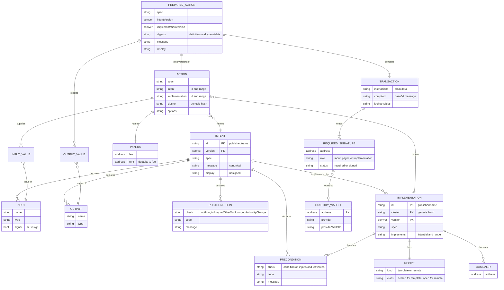
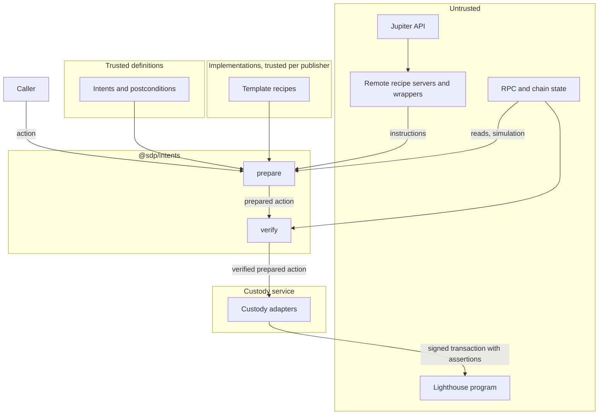

# Intents

Status: draft, prototype. Owner: Noah Prince. Approvers: to be named.

Template: Foundation "Design Document Template", plus SDLC §2, §3.1, §11, §13, and §15. The
prototype does not go to production. Section 9 lists the gates for production.

## 1. Summary

An intent states an operation, for example "deposit 100 USDC into this vault". An implementation
states how one provider does it on Solana. An action names an intent, an implementation, and the
inputs.

`@sdp/intents` turns an action into transactions, a canonical message, and checks. A local playground
shows SOL and token transfers, Kamino and Jupiter Lend deposits and withdrawals, and a Jupiter swap.

Question: can SDP build transactions from declarative definitions, with the same bytes and the same
safety checks as today?

## 2. Problem

1. SDP stores customer custody credentials. A compromised SDP API can drain every customer wallet.
2. Each custody provider wants a different input. Fireblocks takes transfer parameters for SOL and
   USDC (`apps/sdp-api/src/services/payments/fireblocks-transfer.ts`). Other signers take a
   message. Each route has its own branch, and batches have no Fireblocks branch.
3. Each module builds transactions its own way. Payments uses `@solana-program/*`
   (`routes/payments/token-accounts.ts`). Earn wraps one SDK per provider. Each provider repeats
   the safety checks: `assertPlanTargetsCluster`, `sponsoredPrograms`, and `requireAcceptedPlan`.
4. An approver sees bytes or a simulation. No checked statement says what the transaction does.

Users: SDP engineers, custody providers, customers with their own custody, and approvers.

Constraints:

1. Some operations are static, such as a SOL transfer. Some are dynamic, such as a swap route from
   an API. The caller must not see which kind an implementation is.
2. A definition that builds transactions is as dangerous as code. The publisher of the definitions
   is the trust root.
3. Chain state can change between a simulation and the landed transaction. Assertions in the
   transaction close this gap for postconditions (4.6).
4. The SDP API names wallets by SDP wallet id (`cwlt_…`). Intents name wallets by address.

## 3. Requirements

| ID | Requirement | Section |
| :-- | :-- | :-- |
| R1 | An intent declares inputs, outputs, a message, a display, preconditions, and postconditions. It names no program or account. | 4.1 |
| R2 | An implementation declares the intent versions that it implements, its cluster, its preconditions, and its recipe. One intent can have many implementations. | 4.1 |
| R3 | An action names an intent, an implementation, inputs, payers, and options. It says nothing about how to build. | 4.1 |
| R4 | Each ported flow builds the same bytes as SDP for the same inputs and chain state. | 4.12 |
| R5 | A recipe is a template or a remote API. The caller cannot tell which. Definitions are data only. | 4.2 |
| R6 | The mint sets the token program. The implementation handles each Token-2022 extension or fails a precondition. | 4.4 |
| R7 | Intents and implementations use semver. A prepared action records exact versions and digests. | 4.5 |
| R8 | An action can have many signer inputs. The fee payer and rent payer sign but are not inputs, and postconditions do not protect them. An implementation can add signers. | 4.6 |
| R9 | `verify` checks each transaction by simulation, for every recipe kind. | 4.6 |
| R10 | A custody adapter signs the transaction or consumes the action. The action does not change. | 4.7 |
| R11 | Intents and actions identify wallets by address only. | 4.7 |
| R12 | Reads use the fewest RPC calls that read every value-bearing input live (`AGENTS.md`, "RPC is a budget"). | 4.3 |
| R13 | The playground shows each step, from intent to custody routing. | 4.12 |
| R14 | A program can render the message of an action byte for byte. | 4.8 |
| R15 | Every read and template element has an onchain form. Every template implementation is therefore sealed, and the compiler compiles it for a program like clear-msig. | 4.3, 4.8 |
| R16 | A program can check every postcondition from account state. | 4.8 |
| R17 | The compiler can bind inputs to constants and constrain the other inputs. | 4.8 |
| R18 | Definitions are in lowered form. A verifier needs no IDL and no decoder library. | 4.3 |
| R19 | A checker rejects structural, reference, account, and IDL errors before tests run. | 4.9 |
| R20 | Postconditions compile to assertions in the same transaction. | 4.6 |
| R21 | A spec change leaves published definitions, actions, and messages valid. Every document states its spec version. | 4.5 |
| R22 | Ids are unique across publishers. | 4.5 |
| R23 | Inputs and outputs have value types with no encoding. Implementations map them to layout types in read fields, data, and seeds. Layout types use Codama's vocabulary. | 4.3 |
| R24 | `message` and `display` render amounts as decimals, with the mint's decimals. | 4.8 |

## 4. Design

### 4.1 Model

A caller writes an action. The library combines it with an intent and an implementation, and
returns a prepared action: transactions, a readable message, and checks. The examples are one
complete chain for a USDC transfer.

**Action.**

```json
{
  "spec": "sdp-intents@1.0",
  "kind": "action",
  "intent": "solana.org/token.transfer@^1",
  "implementation": "solana.org/solana-token@^1",
  "inputs": {
    "from": "7xKX…",
    "to": "9aBc…",
    "mint": "EPjFWdd5AufqSSqeM2qN1xzybapC8G4wEGGkZwyTDt1v",
    "amount": "100000000",
    "memo": null
  },
  "payers": { "fee": "KoRa…", "rent": "KoRa…" },
  "cluster": "5eykt4UsFv8P8NJdTREpY1vzqKqZKvdpKuc147dw2N9d",
  "options": { "computeUnitPrice": "1000" }
}
```

The examples shorten wallet addresses, digests, and transaction bytes with "…".

1. The action names the implementation because the provider is part of what the caller wants. It
   never names a recipe kind.
2. `cluster` is the genesis hash. SDP already uses it to prove which cluster an RPC serves.
3. `options` are execution choices that do not change the operation. `prepare` turns them into
   instructions, such as ComputeBudget.

`implementationsFor(intent, inputs, cluster)` returns the implementations for the cluster whose
preconditions hold. A UI uses the failed messages to explain why an option is not available.
`prepare` checks the same preconditions first.

**Intent.**

```json
{
  "spec": "sdp-intents@1.0",
  "kind": "intent",
  "id": "solana.org/token.transfer",
  "version": "1.0.0",
  "inputs": [
    { "name": "from", "type": "address", "signer": true },
    { "name": "to", "type": "address" },
    { "name": "mint", "type": "mint" },
    { "name": "amount", "type": "u64", "display": { "amount": { "mint": "{inputs.mint}" } } },
    { "name": "memo", "type": "string", "optional": true }
  ],
  "outputs": [
    { "name": "symbol", "type": "string" }
  ],
  "message": "transfer {inputs.amount} of {inputs.mint} from {inputs.from} to {inputs.to}",
  "display": "send {inputs.amount} {outputs.symbol} to {inputs.to}",
  "preconditions": [
    { "gt": ["{inputs.amount}", "0"], "code": "zeroAmount",
      "message": "The transfer amount must be greater than zero." }
  ],
  "postconditions": [
    { "outflow": { "from": "{inputs.from}", "mint": "{inputs.mint}", "max": "{inputs.amount}" },
      "code": "outflowTooLarge", "message": "{inputs.from} sends at most {inputs.amount} of {inputs.mint}" },
    { "noOtherOutflows": { "from": "{inputs.from}" },
      "code": "unexpectedOutflow", "message": "nothing else leaves {inputs.from}" }
  ]
}
```

Rules:

1. An input with `"signer": true` must sign.
2. Every implementation derives every output from inputs and `let` values (4.3). A program can derive each
   output again, so postconditions can use them.
3. Derived does not mean trusted. The creator of a token chooses its name and symbol. `message`
   names a token by its mint address. `display` can use the symbol.
4. Each precondition and postcondition is one check, a stable `code`, and a `message`. A failed
   check returns both.
5. Preconditions hold before the build. Postconditions hold after the transaction.
6. Amounts are base units in the action. The REST layer converts decimal strings before it builds
   the action. A recipe must encode the exact amount.
7. An `amount` display on a number names its mint. Every template then renders the number as a
   decimal amount (4.8).

**Implementation.**

```json
{
  "spec": "sdp-intents@1.0",
  "kind": "implementation",
  "id": "solana.org/solana-token",
  "version": "1.0.0",
  "implements": "solana.org/token.transfer@^1",
  "cluster": "5eykt4UsFv8P8NJdTREpY1vzqKqZKvdpKuc147dw2N9d",
  "programs": {
    "system": "11111111111111111111111111111111",
    "token": "TokenkegQfeZyiNwAJbNbGKPFXCWuBvf9Ss623VQ5DA",
    "token2022": "TokenzQdBNbLqP5VEhdkAS6EPFLC1PHnBqCXEpPxuEb",
    "associatedToken": "ATokenGPvbdGVxr1b2hvZbsiqW5xWH25efTNsLJA8knL",
    "memo": "MemoSq4gqABAXKb96qnH8TysNcWxMyWCqXgDLGmfcHr"
  },
  "let": {
    "mint": {
      "read": {
        "address": "{inputs.mint}",
        "owners": ["{programs.token}", "{programs.token2022}"],
        "minSize": 82,
        "idl": { "source": "spl-token-2022", "account": "Mint" },
        "fields": { "decimals": { "offset": 44, "type": "u8" } }
      }
    },
    "tokenProgram": { "owner": "{let.mint}" },
    "source": { "ata": { "owner": "{inputs.from}", "mint": "{inputs.mint}", "tokenProgram": "{let.tokenProgram}" } },
    "destination": { "ata": { "owner": "{inputs.to}", "mint": "{inputs.mint}", "tokenProgram": "{let.tokenProgram}" } },
    "destinationAccount": {
      "read": {
        "address": "{let.destination}",
        "optional": true,
        "owners": ["{let.tokenProgram}"],
        "minSize": 165,
        "fields": {}
      }
    },
    "metadata": { "tokenMetadata": "{inputs.mint}" }
  },
  "outputs": { "symbol": "{let.metadata.symbol}" },
  "preconditions": [
    { "not": { "extension": { "account": "{let.mint}", "type": "nonTransferable" } },
      "code": "nonTransferable", "message": "The mint {inputs.mint} does not allow transfers." },
    { "any": [
        { "not": { "extension": { "account": "{let.destinationAccount}", "type": "memoTransfer" } } },
        { "exists": "{inputs.memo}" } ],
      "code": "memoRequired", "message": "The token account of {inputs.to} requires a memo." }
  ],
  "cosigners": [],
  "recipe": {
    "kind": "template",
    "instructions": [
      {
        "program": "{programs.associatedToken}", "name": "createIdempotent",
        "accounts": [
          { "name": "payer", "address": "{payers.rent}", "writable": true, "signer": true },
          { "name": "associatedToken", "address": "{let.destination}", "writable": true },
          { "name": "owner", "address": "{inputs.to}" },
          { "name": "mint", "address": "{inputs.mint}" },
          { "name": "systemProgram", "address": "{programs.system}" },
          { "name": "tokenProgram", "address": "{let.tokenProgram}" }
        ],
        "data": [{ "name": "discriminator", "type": "u8", "value": "1" }]
      },
      {
        "when": { "exists": "{inputs.memo}" },
        "program": "{programs.memo}", "name": "memo", "accounts": [],
        "data": [{ "name": "memo", "type": { "string": "utf8", "size": "remainder" }, "value": "{inputs.memo}" }]
      },
      {
        "program": "{let.tokenProgram}", "name": "transferChecked",
        "idl": { "source": "spl-token-2022", "digest": "sha256:…", "instruction": "transferChecked" },
        "accounts": [
          { "name": "source", "address": "{let.source}", "writable": true },
          { "name": "mint", "address": "{inputs.mint}" },
          { "name": "destination", "address": "{let.destination}", "writable": true },
          { "name": "authority", "address": "{inputs.from}", "signer": true }
        ],
        "data": [
          { "name": "discriminator", "type": "u8", "value": "12" },
          { "name": "amount", "type": "u64", "value": "{inputs.amount}" },
          { "name": "decimals", "type": "u8", "value": "{let.mint.decimals}" }
        ],
        "append": [
          { "transferHookAccounts": { "mint": "{inputs.mint}", "source": "{let.source}", "destination": "{let.destination}",
                                      "authority": "{inputs.from}", "amount": "{inputs.amount}" } }
        ]
      }
    ]
  }
}
```

1. `cluster` locks the implementation to one cluster, by genesis hash. A devnet version is a separate
   definition with the same id. `programs` names the program addresses on that cluster.
2. `let`, `outputs`, and `preconditions` serve every recipe kind. A remote implementation
   uses them too, and its recipe is `{ "kind": "remote", "url": "…" }`.
3. The memo instruction comes before the transfer, because `MemoTransfer` checks the instruction
   before the transfer.
4. For a mint without a transfer hook, `transferHookAccounts` adds no accounts.

**Prepared action.**

```json
{
  "spec": "sdp-intents@1.0",
  "kind": "prepared-action",
  "action": {
    "spec": "sdp-intents@1.0",
    "kind": "action",
    "intent": "solana.org/token.transfer@1.0.0",
    "implementation": "solana.org/solana-token@1.0.0",
    "inputs": {
      "from": "7xKX…",
      "to": "9aBc…",
      "mint": "EPjFWdd5AufqSSqeM2qN1xzybapC8G4wEGGkZwyTDt1v",
      "amount": "100000000",
      "memo": null
    },
    "payers": { "fee": "KoRa…", "rent": "KoRa…" },
    "cluster": "5eykt4UsFv8P8NJdTREpY1vzqKqZKvdpKuc147dw2N9d",
    "options": { "computeUnitPrice": "1000" }
  },
  "digests": {
    "intent": { "definition": "sha256:3f9a…", "executable": "sha256:81bd…" },
    "implementation": { "definition": "sha256:c21e…", "executable": "sha256:07f4…" }
  },
  "outputs": { "symbol": "USDC" },
  "message": "sdp-intents/1: transfer 100 of EPjFWdd5AufqSSqeM2qN1xzybapC8G4wEGGkZwyTDt1v from 7xKX… to 9aBc… | intent: solana.org/token.transfer@1.0.0 3f9a… | implementation: solana.org/solana-token@1.0.0 c21e…",
  "display": "send 100 USDC to 9aBc…",
  "transactions": [
    {
      "instructions": [
        {
          "programAddress": "ComputeBudget111111111111111111111111111111",
          "accounts": [],
          "data": "A+gDAAAAAAAA"
        },
        {
          "programAddress": "ATokenGPvbdGVxr1b2hvZbsiqW5xWH25efTNsLJA8knL",
          "accounts": [
            { "address": "KoRa…", "role": 3 },
            { "address": "DstA…", "role": 1 },
            { "address": "9aBc…", "role": 0 },
            { "address": "EPjFWdd5AufqSSqeM2qN1xzybapC8G4wEGGkZwyTDt1v", "role": 0 },
            { "address": "11111111111111111111111111111111", "role": 0 },
            { "address": "TokenkegQfeZyiNwAJbNbGKPFXCWuBvf9Ss623VQ5DA", "role": 0 }
          ],
          "data": "AQ=="
        },
        {
          "programAddress": "TokenkegQfeZyiNwAJbNbGKPFXCWuBvf9Ss623VQ5DA",
          "accounts": [
            { "address": "SrcA…", "role": 1 },
            { "address": "EPjFWdd5AufqSSqeM2qN1xzybapC8G4wEGGkZwyTDt1v", "role": 0 },
            { "address": "DstA…", "role": 1 },
            { "address": "7xKX…", "role": 2 }
          ],
          "data": "DADh9QUAAAAABg=="
        }
      ],
      "compiled": "AQAC…",
      "lookupTables": [],
      "signatures": [
        { "address": "KoRa…", "role": "payer:fee", "status": "required" },
        { "address": "7xKX…", "role": "input:from", "status": "required" }
      ]
    }
  ]
}
```

1. The instructions use the `EarnVaultInstruction` shape: base58 addresses, numeric `AccountRole`
   values, and base64 data. A reader needs no `@solana/kit`.
2. `SrcA…` and `DstA…` are the ATAs of `from` and `to`. `KoRa…` holds both payer roles with one
   signature.
3. The example leaves out the Lighthouse instructions (4.6).

**Relations.**



### 4.2 Recipes

| Kind | Form | Use |
| :-- | :-- | :-- |
| `template` | JSON in the definition | Every layout that the template language can express. Always sealed (4.8). |
| `remote` | `{ "kind": "remote", "url": "…" }` | Logic that a template cannot express, such as a swap route or an SDK. Always open. |

1. There is no code recipe. A registry stores data, not code.
2. The remote protocol is one POST. Request: `{ spec, kind, inputs, payers, cluster }`. Response:
   `{ spec, kind, instructions, lookupTables, signedBy }`. A remote response has no outputs. The
   implementation derives them from its own `let` entries. The library rejects an unknown
   spec major version. The model comes from Solana Actions (Blinks).
3. A definition does not map a foreign API response. A wrapper service adapts the API. The
   playground server hosts two wrappers: the Jupiter swap API and the `@sdp/kamino` withdrawal.
4. `verify` treats both kinds the same (4.6).

### 4.3 Template language

The format extends the clear-msig intent format (`github.com/ChewingGlass/clear-msig`). Names
replace account indexes.

A template is in lowered form. Instructions state the program, the accounts in order with flags,
and the exact data. Reads state each field's offset and type. A verifier needs no IDL. An optional
`idl` annotation lets the checker compare the template with the IDL (4.9).

The spec version sets which elements exist and what they mean (4.5). Only `name`, `idl`, and
`annotations` carry no meaning. A reader rejects any other key that it does not know. An ignored
check is a loosened check.

**Types.** Types have two levels.

1. A value type says what a value is. Inputs and outputs use value types. They have no encoding.
2. A layout type says how a program stores the value. Read fields, instruction data, and seeds use
   layout types. The implementation maps inputs to data, so only the implementation states
   encodings.

| Value type | Layout types that decode to it | Codama node |
| :-- | :-- | :-- |
| `"u8"` to `"u128"`, `"i8"` to `"i128"` | The same name, little-endian. A `be` suffix, such as `"u64be"`, is big-endian. `"shortU16"` decodes to `"u16"`. | `numberTypeNode` |
| `"bool"` | `"bool"`, one byte | `booleanTypeNode` |
| `"address"`, `"mint"` | `"address"`. A `"mint"` is an address that the checker and renderer treat as a mint. | `publicKeyTypeNode` |
| `"bytes"` | `{ "bytes": size }` | `bytesTypeNode` |
| `"string"` | `{ "string": "utf8", "size": size }` | `stringTypeNode` |
| Optional value | `{ "option": type, "prefix": "u8", "fixed": false }`, or `{ "zeroable": type }` when all zeros means absent. SPL `COption` uses `"prefix": "u32"`. | `optionTypeNode`, `zeroableOptionTypeNode` |
| `{ "array": type }` | `{ "array": type, "count": count }` | `arrayTypeNode` |
| `{ "struct": [{ "name": "…", "type": type }] }` | The same, with layout types for the fields | `structTypeNode` |
| `{ "enum": [variants] }` | `{ "enum": [variants], "size": "u8" }` | `enumTypeNode` |

An optional input or output states `"optional": true`. A `size` is a byte count,
`{ "prefix": "u32" }`, or `"remainder"`. A `count` is a number, `{ "prefix": "u32" }`, or
`"remainder"`. These match Codama's fixed-size, size-prefix, and count nodes. The layout types copy
Codama's names and shapes, so an IDL compares node for node (4.9). The library has no Codama
dependency.

A value fits a layout slot when the layout type decodes to the value's type. The checker does not
widen or narrow a value.

A value in JSON is a string for every integer, so a u64 keeps full precision. An address is
base58. Bytes are base64. An absent option is `null`.

| Element | Form | Meaning |
| :-- | :-- | :-- |
| Reference | `"{inputs.x}"`, `"{payers.fee}"`, `"{programs.system}"`, `"{let.mint.decimals}"` | A path. No operators. |
| `let` | `{ "name": expression }` | Named values. The library orders them by their references. The checker rejects a cycle. |
| `static` | `{ "static": "1111…" }` | A fixed address |
| `pda` | `{ "pda": { "program": ref, "seeds": [{ "type": layout, "value": ref }] } }` | A program derived address. Each seed has a layout type, so a u64 seed has one byte order. A constant seed is a literal value. |
| `ata` | `{ "ata": { "owner": ref, "mint": ref, "tokenProgram": ref } }` | Short for the `pda` of the associated token program with the seeds owner, token program, and mint |
| `read` | `{ "read": { "address": ref, "owners": [ref], "discriminators": [..], "minSize": 82, "optional": true, "fields": { "decimals": { "offset": 44, "type": "u8" } } } }` | An account read. An optional read allows a missing account. A discriminator is `{ "constant": [..], "offset": 0 }` or `{ "size": 82 }`, as in Codama. |
| `owner` | `{ "owner": "{let.mint}" }` | The owner program of a read account |
| `extension` | `{ "extension": { "account": "{let.mint}", "type": "transferHook" } }` | A Token-2022 extension, by TLV type |
| `transferHookAccounts` | `{ "transferHookAccounts": { "mint": ref, "source": ref, "destination": ref, "authority": ref, "amount": ref } }` | The accounts that a transfer hook needs (4.4) |
| `tokenMetadata` | `{ "tokenMetadata": "{inputs.asset}" }` | The name and symbol of a mint, from the Token-2022 metadata extension or the Metaplex metadata account |
| `when` | `{ "when": condition, ...instruction }` | Emit the instruction only when the condition holds |
| `each` | `{ "each": ref, "as": "name", "max": 25, "accounts": [...] }` | Expand an array field into accounts, up to `max` |
| Instruction | `{ "program": ref, "name": "…", "accounts": [...], "data": [...], "append": [...] }` | `append` adds accounts that a built-in resolves |
| Account | `{ "name": "source", "address": ref, "writable": true, "signer": false }` | One account, in order |
| Data segment | `{ "name": "amount", "type": "u64", "value": ref }` | Instruction data, in order. A constant value is a literal. |

A condition is `eq`, `lt`, `gt`, `exists`, `extension`, `not`, `all`, or `any`.

**Every query has an onchain form.** A program must be able to do each read and evaluate each
element, so that a clear-msig-like program can run any template.

1. A read's address comes from an input, a constant, a PDA, or a field of an earlier read. No read
   searches by owner or by filter. `getProgramAccounts`, `getTokenAccountsByOwner`, and other
   RPC-only queries are not in the language. SDP's choice of the largest token account is an
   example that a template cannot express.
2. A field has a fixed offset. A field after a variable-length region cannot be read. Only the
   `extension` and `tokenMetadata` built-ins read variable-length data.
3. `each` has a `max`. A program runs it as a bounded loop.
4. An optional read of a missing account is an account with no data that the system program owns.
5. Onchain, each read account is an account of the transaction and counts against the account
   limit.
6. A program cannot read the cluster's genesis hash. The implementation's `cluster` field states it,
   and `{programs.*}` are constants for that cluster.

Other rules:

1. No expression language and no arithmetic. The built-ins are `owner`, `extension`,
   `transferHookAccounts`, `tokenMetadata`, and the conditions. Each has a test and an onchain form. They change
   only with the spec version.
2. A read checks the owners, discriminators, and minimum size before it uses a field. A program
   upgrade that moves a field then fails a check. It does not read the wrong bytes.
3. A definition can also pin the program's last deploy slot in `ProgramData`. Then every program
   upgrade needs a new implementation version.
4. `read` entries run in dependency levels, one `getMultipleAccounts` per level. A Kamino deposit has two
   levels.

The implementation in 4.1 is a complete template. Three more `let` entries show a generic PDA and
the other field types.

The Metaplex metadata account of a mint, as a generic PDA with a constant seed and two address
seeds:

```json
"metadataAccount": {
  "pda": {
    "program": "metaqbxxUerdq28cj1RbAWkYQm3ybzjb6a8bt518x1s",
    "seeds": [
      { "type": { "string": "utf8", "size": "remainder" }, "value": "metadata" },
      { "type": "address", "value": "metaqbxxUerdq28cj1RbAWkYQm3ybzjb6a8bt518x1s" },
      { "type": "address", "value": "{inputs.mint}" }
    ]
  }
}
```

A token account, with options that use SPL's 4-byte tag:

```json
"sourceAccount": {
  "read": {
    "address": "{let.source}",
    "owners": ["{programs.token}", "{programs.token2022}"],
    "minSize": 165,
    "fields": {
      "mint": { "offset": 0, "type": "address" },
      "owner": { "offset": 32, "type": "address" },
      "amount": { "offset": 64, "type": "u64" },
      "delegate": { "offset": 72, "type": { "option": "address", "prefix": "u32", "fixed": true } },
      "closeAuthority": { "offset": 129, "type": { "option": "address", "prefix": "u32", "fixed": true } }
    }
  }
}
```

An SPL multisig, with a fixed array in which an all-zero entry is empty:

```json
"multisig": {
  "read": {
    "address": "{inputs.multisig}",
    "owners": ["{programs.token}"],
    "discriminators": [{ "size": 355 }],
    "minSize": 355,
    "fields": {
      "m": { "offset": 0, "type": "u8" },
      "signers": { "offset": 3, "type": { "array": { "zeroable": "address" }, "count": 11 } }
    }
  }
}
```

The element type sets the stride of an array. `each` skips an empty `zeroable` entry.

### 4.4 Token-2022

The mint's owner sets the token program. All token accounts of a mint use that program. The program
is also an ATA seed, so it changes the destination address.

`token.transfer` inputs: `from`, `to`, `mint`, `amount`, and optional `memo`. All are wallet or mint
addresses, not token accounts.

| Effect | Extensions | Handling |
| :-- | :-- | :-- |
| Adds accounts | `TransferHook` | `transferHookAccounts` |
| Adds an instruction | `MemoTransfer` on the destination account | `when` on an optional read |
| Changes the amount received | `TransferFeeConfig` | Nothing. `transferChecked` works with a fee. `outflow` still holds. The display shows the amount after the fee. |
| Stops the transfer | `NonTransferable`, paused `Pausable`, confidential-only, `InterestBearingConfig`, `ScaledUiAmountConfig` | A precondition. SDP refuses the last two today (`services/payments/token-amount.ts`). |
| None | `PermanentDelegate` | The display warns that the delegate can move the tokens. |

**Transfer hooks.** The hook's accounts are in an `ExtraAccountMetaList` PDA, with the seeds
`"extra-account-metas"` and the mint. Each entry is a fixed address or a PDA. Seeds come from
literals, instruction data, account keys, or account data. `spl-tlv-account-resolution` resolves the
list offchain and onchain, so a transfer with a hook can be sealed. The template uses the same seed
types.

A program that transfers a hooked mint by CPI needs the hook accounts too. A Kamino deposit of
PYUSD or USDG is such a case. `append` therefore works on any instruction.

SDP uses the owner's largest token account as the source (`findSourceTokenAccount`). The template
uses the owner's ATA. The parity test records the difference.

### 4.5 Versions and compatibility

**Content versions.** Intents and implementations use semver. An action can name a range.
`prepare` pins the exact version and records two SHA-256 digests:

1. The definition digest covers the JSON with labels. The registry, review, and audit log use it.
2. The executable digest covers the binary form, which has no labels. A program uses it (4.8).

The binary form is a deterministic function of the JSON. A registry refuses a second publish of a
version with different content. An implementation's registry key is its id, its cluster, and its
version. An intent has no cluster.

| Change | Intent | Implementation |
| :-- | :-- | :-- |
| Major | Input or output removed or retyped, precondition added, postcondition loosened | Different bytes for inputs that it handled, or a precondition that refuses them |
| Minor | Optional input added, precondition removed, postcondition tightened | A precondition removed |
| Patch | Display or precondition message only | Same bytes for the same inputs |

Golden fixtures enforce the implementation column. Each holds inputs, a chain snapshot, and the
expected instructions.

**Ids.** An id is `{publisher}/{name}`. The publisher is a domain or a registry authority address.
A rename later would break every action, audit record, and message.

**Spec version.** Every document states `"spec": "sdp-intents@major.minor"` and its `kind`:
intent, implementation, action, prepared action, remote request, or remote response. One version
covers every kind, the elements, the types, the JSON value encoding (4.3), and the rendering rules
(4.8). Intents and implementations therefore always agree on what an element means.

1. A minor version only adds: an element, a condition, a postcondition kind, a type, a built-in,
   an option, or a field. A new meaning gets a new name.
2. A major version can change meanings. A change to a rendering is a major version, because it
   changes `message` bytes.
3. A reader supports every major version that is still published. It refuses a newer minor version
   than it supports.
4. The binary header (4.8) and the message prefix, such as `sdp-intents/1:`, carry the spec major
   version.

Expected minor additions: array inputs for batches, composed actions such as swap then deposit,
new execution options such as expiry or a durable nonce, new extensions, new postcondition kinds,
and new message formats.

The unknown-key rule (4.3) also applies to `options`. An old reader cannot drop an option.

**Stored bytes.** The registry stores the bytes that the publisher sent and never writes them
again. Digests use those bytes. A new serializer would otherwise change a digest.

**Messages.** The renderer of every spec major version stays available. A message in an old audit record must render
the same, and so must a message that a later layer signs.

**Compatibility corpus.** `fixtures/corpus/` holds definitions, actions, prepared actions, and
messages for every version. Nothing is removed. CI checks that each item still parses,
renders, builds, and hashes to the same bytes.

### 4.6 Signers and verification

There are three kinds of signer. Each kind has its own checks.

| Kind | Declared in | Checked by |
| :-- | :-- | :-- |
| Signer input, `input:<name>` | Intent input with `"signer": true` | Postconditions |
| Payer, `payer:fee` or `payer:rent` | Action `payers`. `rent` defaults to `fee`. | Rules 4 and 5 |
| Implementation, `implementation` | `cosigners`, or a fresh keypair from the recipe | A cosigner must be declared. A fresh keypair must have no account before the transaction. |

The fee payer signs every transaction. The rent payer signs each instruction where it funds an
account. One address can hold both roles with one signature.

`verify` simulates each transaction with account snapshots and checks:

1. Each postcondition holds. `verify` derives each output itself.
2. `noOtherOutflows`: no balance of an signer input goes down, except as a postcondition or
   the input's payer role allows.
3. No delegate, close authority, or owner of an signer input's accounts changes.
4. The fee payer loses at most the fee plus capped rent. It signs only as fee payer or as funder of
   a new account.
5. Every invoked program is in the implementation's program list. `prepare` also
   adds ComputeBudget for options and Lighthouse for assertions.

Rules 4 and 5 replace Kora's sponsorship checks, `sponsoredPrograms`, and `assertPlanTargetsCluster`.

**Assertions.** `prepare` adds Lighthouse instructions (`github.com/Jac0xb/lighthouse`):

1. First, assertions check each precondition on account state. `MemoryWrite` copies the mint,
   owner, and amount of each token account of an signer input.
2. Last, `AssertAccountDelta` checks outflows and inflows against the copy. `AssertTokenAccount`
   checks delegate, close authority, and owner.
3. The final instruction closes the memory account.

The transaction fails if a precondition or postcondition does not hold when it lands. A custody
adapter checks that the assertions are present before it signs. A compromised SDP API cannot remove
them without a change to the transaction that the custodian signs.

A custody adapter in action mode builds its own transaction and cannot carry assertions. Only
`verify` applies there.

### 4.7 Custody routing

Each required signature goes to the adapter that holds its address. One transaction can use two
custodians.

```ts
type CustodyMode = "action" | "transaction";

interface CustodyAdapter {
  readonly id: string;
  holds(address: Address): Promise<CustodyWalletRef | null>;
  modeFor(prepared: PreparedAction, signature: RequiredSignature): CustodyMode;
}
```

SDP has one Solana address per custody wallet. The custody record maps it to a provider id, such as
`fb_<vaultAccountId>` (`packages/sdp-custody/src/provider-wallet-ids.ts`). The custody service owns
that lookup. The REST layer can still accept `cwlt_…` ids and convert them to addresses.

The mock Fireblocks adapter uses action mode for SOL and USDC transfers. It sends the same
`POST /v1/transactions` body as `createFireblocksTransfer`. Fireblocks pays its own fee in this
mode, so the adapter uses transaction mode when the fee payer is not the source wallet.

### 4.8 Onchain verification

The design must allow a clear-msig-like program to check an action. In clear-msig, the program
stores the definition, renders the signed string from it, verifies the ed25519 signature, and builds
the CPI from the same definition. The signer reads the operation that executes.

**Two strings.**

| | `message` | `display` |
| :-- | :-- | :-- |
| Signed | Not yet. A later layer can sign it. | Never |
| Rendered by a program | Yes, byte for byte | Yes |
| Tokens | Mint addresses | Symbols and names |
| Prefix and suffix | Spec major version first. Ids, versions, and digests last. | None |

Both strings use only inputs and outputs. Symbols and names stay out of `message`, because anyone
can name a token "USDC". A wallet shows `message` as the approval and `display` as context.

**Rendering.** Each type has one rendering, so a program produces the same bytes:

| Type | Rendering |
| :-- | :-- |
| Integer with an `amount` display | The value divided by 10 to the power of the mint's decimals. The point is omitted when nothing follows it. Trailing zeros after the point are removed. No thousands separator. `100000000` with 6 decimals is `100`, and `1500000` is `1.5`. |
| Other integer | Decimal digits, with `-` for a negative value |
| Boolean | `true` or `false` |
| Address | Base58 |
| Bytes | Lowercase hex |
| String | The string. `message` accepts only restricted ASCII. |
| Absent option | `none` |

The mint's decimals come from a fixed-offset read, so a program can render an amount. The
rendering rules are part of the spec version.

Today `message` serves the approval screen and the audit log. Nothing signs it. A later layer, such
as a clear-msig-like program, can sign it, and this format keeps that possible.

A later signing layer uses a Solana offchain message, version 0, restricted ASCII, so a Ledger can
show it.
Expiry and replay data come from the executing system, not the intent.

**Sealed and open.** The recipe kind sets the class. The action does not show it.

1. Sealed: a template. Every element has an onchain form (4.3), so a program builds the
   instructions itself.
2. Open: a remote recipe. The proposer supplies the instructions, and the program enforces the
   postconditions.

The last column shows what clear-msig's current format lacks.

| Element | Sealed form | In clear-msig |
| :-- | :-- | :-- |
| `static` | Static address | `Static` |
| Input address | Parameter address | `Param` |
| Signer input | The vault | `Vault` |
| `pda`, `ata` | PDA | `PdaDerived` |
| Read at a fixed offset | Address in another account's data | `HasOne` |
| `owner` | Owner of an account in the transaction | No |
| `extension` | TLV lookup | No |
| `transferHookAccounts` | `spl-tlv-account-resolution` | No |
| `tokenMetadata` | Parse of the metadata extension or the Metaplex account | No |
| `when`, preconditions | Conditional instruction or failed proposal | Only input constraints, such as `LessThanU64` |
| `each` with `max` | Bounded loop | No |
| Literal and input data | Bytes and encodings | Yes |
| Optional read | Check for an empty account that the system program owns | No |

**Outputs.** Every output comes from inputs through template elements. Example: the Kamino share
mint, at a fixed offset in the vault account. A program can derive each output again.

**Partial application.** The compiler can bind inputs to constants and constrain the others. A
binding can also fit a template into clear-msig's current format. `token.transfer` with `mint`
bound to USDC needs no `owner` element. Constraints on bound intents are the policy layer, such as
a transfer limit.

**Postconditions onchain.** Lighthouse enforces them today for any custody that signs the
transaction (4.6). A wallet program can enforce them itself for an open implementation:

1. Before the CPIs, it records amount, owner, delegate, and close authority of each wallet token
   account in the transaction, and the wallet's lamports.
2. After the CPIs, it checks the postconditions against the records.
3. A transaction can change only accounts that it lists, so the records are complete.

The check runs in the same transaction, so it is stronger than a simulation. An open action's
message includes the postcondition messages:

```
sdp-intents/1: swap | 7xKX... sends at most 100 of EPjF...; 7xKX... receives at least 95 of DezX...; nothing else leaves 7xKX... | implementation: solana.org/jupiter-swap@1.2.0 open
```

**Inputs onchain.** A program receives the inputs in one encoding that the spec fixes:
little-endian integers, a one-byte tag for an optional value, and a u32 length before a string,
bytes, or an array. No definition chooses this encoding.

**Binary form.** Header: magic value, spec version, digest algorithm. Body:
typed, length-prefixed sections. A reader refuses an unknown section type. Names compile to
indexes, and labels are dropped.

**Limits.**

1. A condition compares inputs, read fields, account owners, and extensions only.
2. A postcondition is an outflow limit, an inflow minimum, `noOtherOutflows`, or no authority
   change. A program cannot check price or oracle conditions from account state alone.
3. A wallet program must not enable CPI Guard on its own token accounts. CPI Guard blocks owner
   transfers through CPI, and a PDA can sign only through CPI.

**Custody risk.** If the custody wallet is such a program, the custodian signs a readable message
and the program enforces it. A compromised SDP API can propose but cannot change what a signature
means. This answers problem 1 better than credential isolation.

### 4.9 Definition checks

An AI or a person writes the JSON. The JSON is what a reviewer reads and the registry stores. Each
stage stops the errors that it can find.

**Stage 1, schema.** A JSON Schema from the `zod` schema checks structure. Editors show the errors.
The schema knows nothing about programs.

**Stage 2, checker.** It runs in CI and in the registry before a publish. Errors name a JSON
Pointer, such as `/instructions/1/data/2`. The checker:

1. Rejects unknown keys and elements outside the declared spec version.
2. Resolves and type-checks every reference. The mint of an `amount` display must have the type
   `mint`.
3. Checks that each output comes from inputs and `let` values, and that `message` and postconditions use
   only inputs and outputs.
4. Rejects a query without an onchain form: a read address from no input, constant, PDA, or
   earlier read, a field without a fixed offset, or an `each` without `max`.
5. Checks that every signer input signs and that account flags agree.
6. Checks that a payer appears only as fee payer or as funder of a new account.
7. Derives the program list.
8. Checks that `message` and postcondition messages are restricted ASCII, and that each `code` is
   unique.
9. Compiles the binary form and decodes it back to the same definition.
10. Compares each `idl` annotation with its IDL.

**IDL comparison.** The checker loads the IDL by digest from `definitions/idls/`. Types use Codama's
node shapes, so a Codama IDL compares node for node. The Anchor adapter maps Anchor types to the
same nodes. It compares the
discriminator, the accounts with their order, names, and flags, and the arguments with their order
and encodings. For a read, it compares field offsets and types and fills or compares the owners,
discriminator, and size. A label at the wrong position is an error.

Own adapters read Anchor and Codama IDLs. Both are plain JSON, so no Codama library is needed. The
registry and the verifier never read an IDL.

**Stage 3, tests.**

1. Golden fixtures per implementation version (4.5).
2. Parity tests (4.12).
3. Surfpool end-to-end runs.
4. `fast-check` property tests: random valid inputs pass `verify`.
5. Mutation tests: one changed account, flag, or byte must fail the checker, parity, or `verify`.
6. The malicious remote fixture (4.12).
7. The compatibility corpus (4.5).

**Review.** A renderer prints a definition as text for reviewers and wallets. It needs no IDL.

### 4.10 Earn precedent

`EarnVaultTransactionPlan` (`packages/sdp-earn/src/types.ts`) already splits building from signing.

| Earn plan | Intent model |
| :-- | :-- |
| `EarnVaultInstruction` | Same shape |
| `assetIdentity`, compared with the catalogue | Input `asset` and output `shareMint`, checked by postconditions |
| `accepted` amounts | Not needed. Amounts are base units. |
| `createsShareAccount` claim | Not needed. Rule 4 caps the rent. |
| `providerTransaction`, signed by the provider | Implementation signatures with status `signed`. Payers are inputs, so the message never changes. |
| `rentPayer` | `payers.rent` |
| `sponsoredPrograms(cluster)` | Program list, rule 5 |
| Capabilities by method presence | Separate intents, such as `vault.deposit` and `vault.withdraw` |

ADR 0002, "money out beats money off", becomes a registry rule. A publisher cannot publish a
`vault.deposit` implementation without a `vault.withdraw` for the same vaults.

The model adds a checked statement of the operation, declared checks, versions with digests, and
many signer inputs.

### 4.11 Package layout

```
packages/sdp-intents/
  DESIGN.md
  src/
    types.ts            Intent, Implementation, Action, PreparedAction
    schema.ts           zod schemas
    resolve.ts          implementationsFor, version ranges
    template.ts         template evaluation
    let.ts              let ordering and read batching
    builtins/           owner, extension, transferHookAccounts, conditions
    remote.ts           remote protocol client
    prepare.ts
    assertions.ts       Lighthouse instructions
    verify.ts
    message.ts          message and offchain message bytes
    display.ts
    compile.ts          binary form and digests
    render.ts           review rendering
    checker/            checker passes and IDL comparison
    idl/                Anchor and Codama adapters
    custody/            adapter interface and mocks
  definitions/
    intents/            sol.transfer, token.transfer, vault.deposit, vault.withdraw, swap
    implementations/    system, solana-token, kamino, jupiter-lend, jupiter-swap
    idls/               pinned IDLs, named by digest
  fixtures/
    golden/             per implementation version
    corpus/             per spec version
apps/intents-playground/
  Vite and React. A local server hosts the Jupiter swap and Kamino withdrawal wrappers.
```

The package follows `docs/decisions/0010-module-boundaries.md`. It uses `@solana/kit` 7 and
`@solana-program/*` from the workspace catalog, and the `zod` version that `@sdp/earn` pins.

### 4.12 Flows, parity tests, and playground

| Intent | Implementation | Recipe | Class | Shows |
| :-- | :-- | :-- | :-- | :-- |
| `sol.transfer` | `system` | template | Sealed | The static case |
| `token.transfer` | `solana-token` | template | Sealed. clear-msig today needs `mint` bound. | Parity with `buildSplTransferInstructions`, both programs, extensions |
| `vault.deposit`, `vault.withdraw` | `jupiter-lend` | template | Sealed | An SDK flow as a template. All accounts are PDAs (`sdk-coupling.test.ts`). |
| `vault.deposit` | `kamino` | template with `each` and `when` | Sealed | The limit of templates |
| `vault.withdraw` | `kamino` | remote, `@sdp/kamino` wrapper | Open | Legs come from live liquidity |
| `swap` | `jupiter-swap` | remote, Jupiter API wrapper | Open | A dynamic route |

**The `vault.deposit` intent.** It shows an inflow and an amount whose mint is an output.

```json
{
  "spec": "sdp-intents@1.0",
  "kind": "intent",
  "id": "solana.org/vault.deposit",
  "version": "1.0.0",
  "inputs": [
    { "name": "owner", "type": "address", "signer": true },
    { "name": "vault", "type": "address" },
    { "name": "asset", "type": "mint" },
    { "name": "amount", "type": "u64", "display": { "amount": { "mint": "{inputs.asset}" } } },
    { "name": "minShares", "type": "u64", "display": { "amount": { "mint": "{outputs.shareMint}" } } }
  ],
  "outputs": [
    { "name": "shareMint", "type": "mint" },
    { "name": "assetSymbol", "type": "string" },
    { "name": "shareName", "type": "string" }
  ],
  "message": "deposit {inputs.amount} of {inputs.asset} into vault {inputs.vault} for at least {inputs.minShares} of {outputs.shareMint}",
  "display": "deposit {inputs.amount} {outputs.assetSymbol} into {outputs.shareName}",
  "preconditions": [
    { "gt": ["{inputs.amount}", "0"], "code": "zeroAmount",
      "message": "The deposit amount must be greater than zero." }
  ],
  "postconditions": [
    { "outflow": { "from": "{inputs.owner}", "mint": "{inputs.asset}", "max": "{inputs.amount}" },
      "code": "outflowTooLarge", "message": "{inputs.owner} sends at most {inputs.amount} of {inputs.asset}" },
    { "inflow": { "to": "{inputs.owner}", "mint": "{outputs.shareMint}", "min": "{inputs.minShares}" },
      "code": "inflowTooSmall", "message": "{inputs.owner} receives at least {inputs.minShares} of {outputs.shareMint}" },
    { "noOtherOutflows": { "from": "{inputs.owner}" },
      "code": "unexpectedOutflow", "message": "nothing else leaves {inputs.owner}" }
  ]
}
```

M2 checks two Kamino facts against the klend SDK:

1. The layout of the vault allocations and their maximum count, for `each`. Every field that the
   template reads must have a fixed offset.
2. The remaining-account layout. The current description comes from
   `packages/sdp-kamino/src/deposit-receipt.ts`.

**Parity tests** compare instruction bytes with current SDP code:

1. Transfers: a test in `apps/sdp-api` calls `buildSplTransferInstructions` and `@sdp/intents`.
   `@sdp/intents` is a `devDependency`. No production file imports it.
2. Earn: tests on a surfpool mainnet fork compare with `@sdp/kamino` and `@sdp/jupiter-lend`.

**Playground.** `apps/intents-playground` runs locally against surfpool and is never deployed.

1. Left: intents and implementations, with their JSON.
2. Center: a form from the intent's inputs, and the implementations that apply.
3. Right: tabs for display, action, instructions, transaction, verification, and custody routing.
   The instructions tab shows each account's source, such as "ATA(owner, USDC)".
4. A switch makes the swap wrapper add a transfer to an attacker. Verification fails on rule 2.

Local keypairs sign. No provider credential is used.

## 5. Security

_SDLC §2 · §3.1 · §11_

**Tier: Low**, while all of these hold:

1. No production file in `apps/sdp-api` or `apps/sdp-web` imports `@sdp/intents`.
2. The playground has no deployment configuration.
3. No mainnet key or provider credential is loaded.
4. The clear-msig program in M7 runs only on local surfpool. It is unaudited.

If one stops being true, the tier is **Critical**: the library builds fund movements. Section 9
lists the gates.

**Touches.** Public addresses, public chain state, and playground inputs. In production: customer
addresses, amounts, and counterparties.

**Trust boundaries.**



| Boundary | Crossing | Authentication |
| :-- | :-- | :-- |
| Caller to library | Action | None in the prototype. Production: SDP API auth and `requireAction`. |
| Registry to library | Definitions | Exact version and digests. Production: a signed registry. |
| Implementation to library | Recipe output | None. `verify` checks it. |
| Remote server to library | Instructions over HTTP | None. `verify` checks it. |
| RPC to library | Accounts and simulation | None. See dependencies. |
| Library to custody | Verified prepared action | None in the prototype. Production: custody runs `verify` again. |

**Dependencies.**

| Dependency | Fails | Lies or goes stale | Disappears |
| :-- | :-- | :-- | :-- |
| RPC reads | `prepare` errors. | A false read builds a wrong transaction. `verify` catches outflows, not a wrong destination that the inputs name. | No builds. |
| RPC simulation | `verify` fails closed. | A false simulation can pass a bad transaction. Production custody must simulate through an RPC that SDP does not control. | Nothing is signed. |
| Jupiter API | Swap errors. | A bad route fails postconditions. A bad price above `minOut` passes. | No swaps. Other intents work. |
| Wrapper service | `prepare` errors. | `verify` checks its output. | That implementation is unavailable. |
| Remote recipe server | `prepare` errors. | `verify` checks its instructions. | That implementation is unavailable. |
| Lighthouse | The transaction fails. Nothing moves. | A bug can pass a bad transaction. `verify` still runs. The program is upgradeable, so an upgrade can change an assertion. | Assertions fail. `prepare` can omit them, and only `verify` applies. |
| Pinned IDLs, check time | The checker errors. | A wrong IDL can pass a wrong definition. IDLs are pinned by digest and reviewed. | IDL comparison is skipped. Other checks run. |
| klend SDK, `@jup-ag/lend`, tests only | Parity tests fail. | Not applicable. | Not applicable. |
| clear-msig, M7, local | The stretch test fails. | Not applicable. | Not applicable. |
| surfpool, local | Local tests fail. | Not applicable. | Not applicable. |

**Worst case.** Prototype: a wrong transaction on a local fork. Production: a malicious intent with
loose postconditions passes `verify` and drains a wallet. `verify` protects against untrusted
implementations, not untrusted intents. The intent registry is the main asset.

**STRIDE.**

| Threat | Where | Control |
| :-- | :-- | :-- |
| Spoofing | False version or name | Publisher ids, exact versions, and digests |
| Tampering | Remote output, RPC data | `verify`, and an independent RPC in production |
| Repudiation | Which definition built a transaction | Digests in the prepared action and audit log |
| Information disclosure | Inputs to a remote server | Only inputs and payers go out. No credentials. |
| Denial of service | Slow remote or RPC | Timeouts. Fail closed. |
| Elevation of privilege | Fee payer as authority | Rule 4 |

**Open findings.** None filed. Known limits: simulation is incomplete, and intent trust has no root
yet (section 12).

## 6. Data classification

_SDLC §13 · §15_

| Data | Class | Why | Where | Access | Retention |
| :-- | :-- | :-- | :-- | :-- | :-- |
| Definitions | Public | Open source | Repository | Everyone | Git history |
| Pinned IDLs | Public | Published by program owners | Repository | Everyone | Git history |
| Golden fixtures and corpus | Public | Public chain state and test inputs | Repository | Everyone | Git history |
| Playground inputs | Internal | Test data on a local fork | Browser and local server | Developer | Browser session |
| Local test keypairs | Internal | No value on any cluster | Test process memory | Developer | Process |

| Requirement | SDLC | Today | Gap |
| :-- | :-- | :-- | :-- |
| Encryption at rest | §13 | Not applicable. No Restricted data. | None |
| Hardware-backed access | §13 | Not applicable. No Restricted data. | None |
| Rotation | §6.4 | Not applicable. No credentials. | None |
| Inventory with owner and last rotation | §6.5 | Not applicable. No keys. | None |
| Named human owner | §4 | Noah Prince | None |
| No credentials shared across environments | §12 | No credentials | None. The keyless Jupiter endpoint is used. |

The prototype is not in the systems inventory (§15). It is not a production system.

## 7. Monitoring

_SDLC §8.1_

Not applicable to the prototype. Production custody must alert on `verify` failures, payer rule
failures, and a rising failure rate for one implementation.

## 8. Platform controls

| Area | Deviation |
| :-- | :-- |
| Build and CI (§3.2, §3.3) | None. Biome, `tsc --noEmit`, and `node --test`, as `@sdp/earn`. Surfpool tests run on demand. |
| New dependencies (§3.2.2) | `vite`, `@vitejs/plugin-react`, and `react-dom` for the playground. `fast-check`. The Lighthouse Kit client, name confirmed in M3. No Codama library. All pinned exactly, with a reason in the PR. |
| Review (§3.4) | Low tier, one reviewer. |
| Deployment (§3.5) | None. Nothing is deployed. |

## 9. Gates before production

Production use is a separate project with its own design document. Minimum gates:

1. Critical tier (§2), internal security review and external audit (§3.4.3).
2. A signed intent registry, with review of each intent and postcondition change.
3. `verify` in the custody service, with an RPC that the SDP API does not control.
4. A threat model for the custody service (§3.1).
5. Monitoring as in section 7 (§8.1).
6. A review of Lighthouse (§11): its audit, its upgrade authority, and an upgrade plan.

## 10. Milestones

| Milestone | Content | Days |
| :-- | :-- | :-- |
| M0 | This document, reviewed | 1 |
| M1 | Types, schemas, the spec version, unknown-key rule, first corpus items, checker passes 1 to 8, template evaluation without reads, message and display, `sol.transfer`, `token.transfer` without extensions, and transfer parity | 5 |
| M2 | `read`, preconditions, `when`, `each`, built-ins, Token-2022, IDL adapters and comparison, Jupiter Lend and Kamino deposit templates, and surfpool parity | 6 |
| M3 | Versions and digests, remote recipes and wrappers, `verify`, Lighthouse assertions and the adapter check, property and mutation tests, Kamino withdrawal, and Jupiter swap | 5 |
| M4 | Custody adapters, mock Fireblocks and Privy, and signature routing | 2 |
| M5 | Playground | 3 |
| M7 | Input binding, binary form, offchain message bytes, clear-msig test vectors. Stretch: run clear-msig on surfpool with `token.transfer` bound to USDC. | 4 |
| M6 | Findings report in `packages/sdp-intents/README.md` | 1 |

M7 runs before M6 so that the report covers it. Each milestone ends with a local commit. Nothing is
pushed before M0 is approved.

**Report criteria.**

1. Parity: flows with identical bytes.
2. Coverage: flows per recipe kind.
3. Size: template lines against the SDP code lines they replace.
4. RPC calls per flow against SDP.
5. Safety: the malicious implementation fails, and each `verify` rule has a test that fails without
   it.
6. Onchain: the elements that each template needs and clear-msig's current format lacks.
7. Checks: the share of mutations that the checker rejects before tests.
8. Compatibility: the corpus passes after each milestone with no new spec major version.
9. Assertions: added size and compute units per flow, and whether the swap still fits.
10. Readability: whether a reviewer can follow the Kamino deposit and the Token-2022 transfer. If
    not, the next step is a dedicated language that compiles to the same JSON.

## 11. Cost

| Driver | Estimate |
| :-- | :-- |
| Engineering | About 28 days, one engineer |
| Infrastructure | None. Everything runs locally. |
| Vendors | None |

## 12. Open questions

1. Who publishes and signs intents? How does a customer pin a trusted set? Who assigns publisher
   names, and how is a domain or authority proved?
2. Which registry stores definitions? The program metadata program fits implementations of one
   program. Intents belong to no single program.
3. How does an intent version change when an implementation needs a new output?
4. Which simulation gaps need their own rule? Known: approvals, authority changes, closed accounts.
5. Extend clear-msig's format with `owner` and conditional instructions, or start a new program?
6. Does wallet-program enforcement fit the CPI depth limit for a swap? Path: wallet, Jupiter, AMM,
   token program, plus one level for a hook. Lighthouse adds no depth.
7. What does the Lighthouse audit cover, and who holds its upgrade authority? Section 9 needs this.
8. Which accounts does a Token ACL thaw add? Does a frozen `DefaultAccountState` need an element?
9. Must an action-mode custodian such as Fireblocks report what it signed, so the audit log can
   compare it with the action?

## 13. Out of scope

1. Changes to SDP routes or production code.
2. Signing `message`. The format keeps it possible (4.8).
3. A real custody service or provider calls.
4. A new onchain program or clear-msig changes. A program change is Critical (§2) and follows
   §3.5.1.
5. A definition marketplace.
6. REST or JSON-RPC interfaces for the library.
