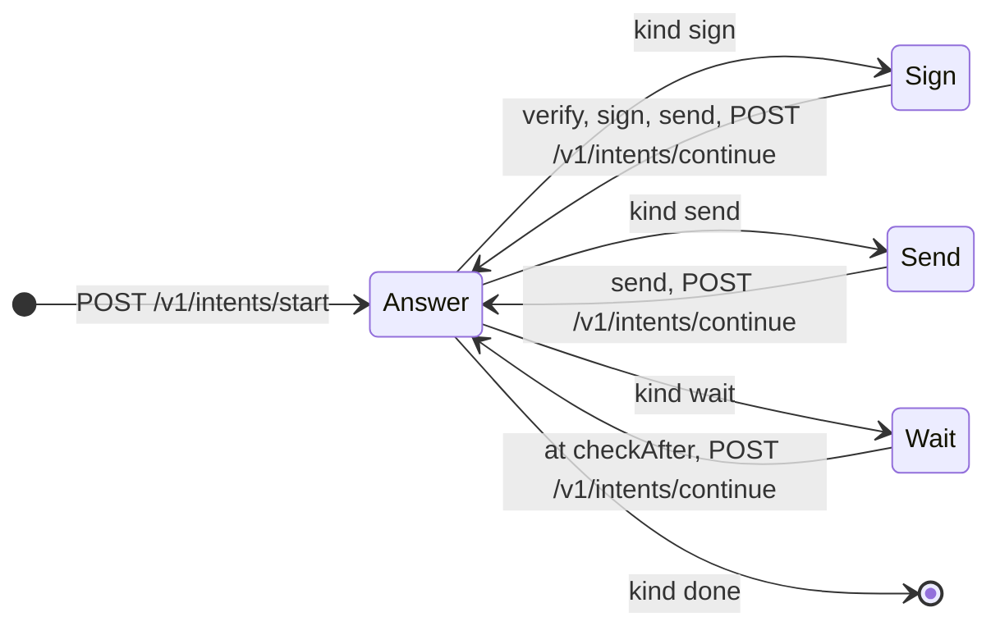
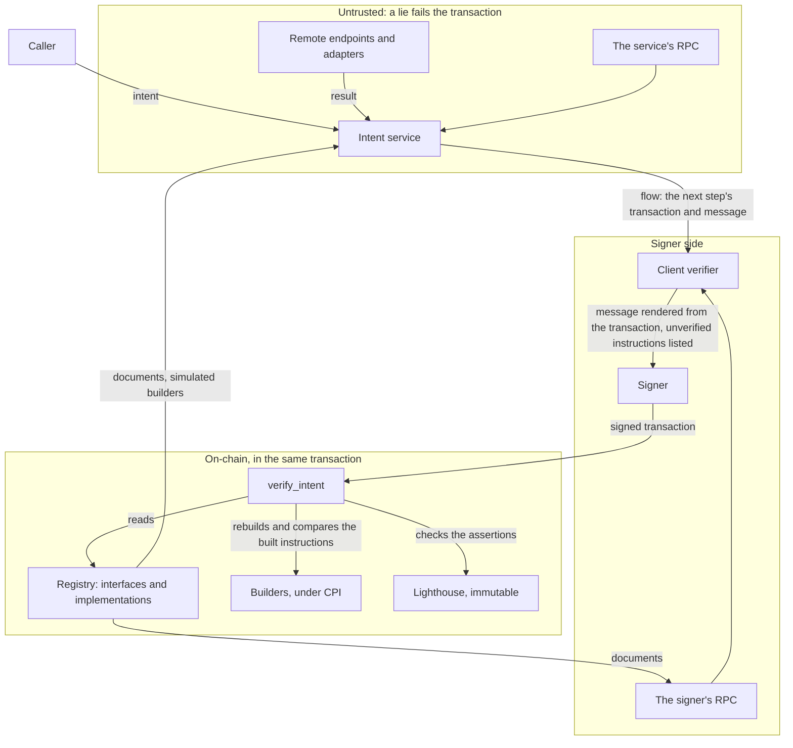

# Intents

Status: draft, working prototype. Owner: Noah Prince. Approvers: to be named.

Template: Foundation "Design Document Template", with SDLC §2, §3.1, §11, §13, and §15. Section 9
lists the gates for production.

## 1. Summary

Intents fix a set of security and convenience problems, in SDP and across Solana.

1. **A transaction is readable, and the transaction proves what it says.** A signer reads one
   message for each transaction, such as `transfer 100 of <mint> from A to B`. `verify_intent` and
   Lighthouse assertions in the same transaction prove that message, and the flow that the
   transaction is a step of (4.6).
2. **A protocol ABI change does not break SDP.** The instruction logic lives onchain, in a builder.
   The goal is a builder in each target program, which upgrades with the program (4.2).
3. **Interfaces cover many protocols.** An interface such as `vault.deposit` names inputs, outputs,
   and postconditions, as an Ethereum interface does. Each protocol implements it (4.1).
4. **SDP is not a kingmaker.** Anyone can publish an implementation. Each interface's approve
   authority keeps the vetted list that UIs show (4.10).
5. **No SDK for each protocol.** One planner builds every implementation from registry data (4.4).
6. **AI agents can discover operations.** The registry lists every interface and its approved
   implementations, with typed inputs, and needs no `getProgramAccounts` (4.10).
7. **Protocols fit the interfaces.** A protocol ships its implementation, so SDP maintains no code
   for each protocol (4.2).
8. **A compromised SDP cannot return a malicious transaction.** By default, `verify_intent`
   rebuilds the instructions onchain from the registry, and Lighthouse asserts each postcondition.
   A transaction that the implementation does not build, or that breaks a bound, fails (4.3, 4.6).

9. **One request for any operation.** One transaction, several, or a privacy ring: the caller
   sends an intent, keeps one `progress` value, and follows `next` (4.19).

**How it works.** An interface declares an operation. An implementation says how one
protocol does it, with one recipe: a builder program, static instructions as data, an HTTP
endpoint, a shielded spend, or steps of other interfaces. An intent names an interface, an
implementation, and inputs. `prepare` returns a flow: ordered steps, each one transaction with one
message. Most intents are one step. The signer verifies each step's message from its transaction
and the registry, and never trusts the service.

## 2. Problem

1. Each SDP module builds transactions its own way. Each Earn provider repeats the checks
   `assertPlanTargetsCluster`, `sponsoredPrograms`, and `requireAcceptedPlan`.
2. An approver sees bytes or a simulation. No checked statement says what the transaction does.
3. Real operations need logic: Token-2022 extensions, reserve walks, and withdrawal legs. A
   template language that expresses them becomes a programming language, and a program already is
   one. So the static language stays small, and builders do the rest.

Custody and signing are out of scope (section 12). A plan that states the operation and its bounds
lets signing move out of SDP later.

## 3. Requirements

| ID | Requirement | Section |
| :-- | :-- | :-- |
| R1 | An interface declares inputs, outputs, a display, and postconditions. It names no program or account. | 4.1 |
| R2 | An implementation has `applies` checks, a message template, added postconditions, a cluster, and one recipe. | 4.1, 4.2 |
| R3 | An intent names an interface, an implementation, inputs, and options. A plan request names the payers, the priority fee, and the cluster. `prepare` refuses an unapproved version unless the intent allows it. | 4.1, 4.10 |
| R4 | A static recipe has no conditions or loops. | 4.2 |
| R5 | A builder returns instructions and outputs, or a refusal, in a zero-copy layout. Onchain it returns a hash. Its accounts are readonly and include no payer. | 4.2 |
| R6 | A remote endpoint returns instructions, or a whole transaction that the provider signed. | 4.16 |
| R7 | The service checks every plan against the postconditions and the payer rules, and adds them as assertions. | 4.5 |
| R8 | A plan reads every value-bearing account live, with the fewest RPC calls (`AGENTS.md`, "RPC is a budget"). | 4.4 |
| R9 | A wallet program can run static and program recipes, and static flows, onchain. | 4.7 |
| R10 | Each document has one canonical zero-copy binary form, within fixed limits. | 4.9 |
| R11 | A spec change leaves published documents and messages valid. | 4.8 |
| R12 | A registry program holds organizations, interfaces, implementations, versions, and approvals. | 4.10 |
| R13 | By default, each transaction proves onchain that its instructions are what the implementation builds. An intent can opt out. | 4.6 |
| R14 | `prepare` returns `{ progress, next }` for every intent. A step to sign holds a v1 transaction, or the instructions alone for a caller that compiles legacy, v0, or v1. | 4.1, 4.19 |
| R15 | The definitions live in this repository as JSON. A CLI lints them and applies them with a key or a Squads proposal. | 4.13 |
| R16 | A playground explores the registry and plans intents from a typed form. | 4.14 |
| R17 | Each stopping point of a flow is recoverable and discoverable by the owner. The last `progress` value alone continues a flow. A step of a static flow proves onchain that it is that flow's step. | 4.6, 4.19 |

## 4. Design

### 4.1 Model

The examples are one chain for a PYUSD transfer. "…" shortens addresses and bytes.

**Intent.**

```json
{
  "spec": "sdp-intents@1.0",
  "kind": "intent",
  "interface": "solana.org/token.transfer@^1",
  "implementation": "solana.org/token-2022-transfer@^1",
  "inputs": { "from": "7xKX…", "to": "9aBc…", "mint": "2b1kV6…", "amount": "100000000", "memo": null }
}
```

An intent is the operation only, in base units. `options` can turn off an onchain check
(`assertions`, `verifyIntent`), set `allowUnapproved` (4.10), or ask for a privacy ring with
`privacy` (4.17). Both checks are on by default. The intent never says how many transactions the
operation takes. The matched implementation decides (4.19).

**Plan request.**

```json
{
  "spec": "sdp-intents@1.0",
  "kind": "plan",
  "payers": { "fee": "KoRa…" },
  "cluster": "mainnet",
  "options": { "priorityFeeLamports": "5000", "output": "transaction", "landing": "auto", "tipLamports": "10000" },
  "intents": [{ "interface": "…", "implementation": "…", "inputs": { … } }]
}
```

1. `payers.rent` defaults to `fee`.
2. `cluster` is `mainnet`, `devnet`, `testnet`, or a genesis hash. Each implementation must be for it.
3. `output` is `transaction`, the default, or `instructions`. With `instructions`, each step's plan
   holds no transaction, and `prepare` reads no blockhash. The caller compiles a legacy, v0, or v1
   transaction. It must keep each segment whole and in order, keep the payers, and set the compute
   budget. `verify_intent` finds its segment after itself in the instructions sysvar, so the
   version does not matter. A provider's signed transaction (4.16) has no instructions, so
   `prepare` refuses `instructions` for it.
4. `landing` is `auto`, `bundle`, or `inOrder`, and says how several steps signed together reach
   the chain (4.19). `tipLamports` is the most that a Jito bundle's tip pays. Without it, `prepare`
   never bundles.

**Interface.**

```json
{
  "spec": "sdp-intents@1.0",
  "kind": "interface",
  "id": "solana.org/token.transfer",
  "version": "1.0.0",
  "inputs": [
    { "name": "from", "type": "address", "signer": true },
    { "name": "to", "type": "address" },
    { "name": "mint", "type": "mint" },
    { "name": "amount", "type": "u64", "display": { "amount": { "mint": "{inputs.mint}" } } },
    { "name": "memo", "type": "string", "optional": true }
  ],
  "outputs": [],
  "display": "Send {inputs.amount} {inputs.mint} to {inputs.to}",
  "postConditions": [
    { "outflow": { "from": "{inputs.from}", "mint": "{inputs.mint}", "max": "{inputs.amount}" },
      "message": "{inputs.from} sends at most {inputs.amount} of {inputs.mint}" },
    { "noOtherOutflows": { "from": "{inputs.from}" }, "message": "nothing else leaves {inputs.from}" }
  ]
}
```

Postconditions in the interface bound every implementation. Inputs have value types and no
encoding. An output, such as a vault's share mint, comes from the recipe, so a postcondition on an
output trusts the recipe (4.3).

**Implementation, builder.**

```json
{
  "spec": "sdp-intents@1.0",
  "kind": "implementation",
  "id": "solana.org/token-2022-transfer",
  "version": "1.0.0",
  "cluster": "mainnet",
  "implements": "solana.org/token.transfer@^1",
  "applies": [{ "account": "{inputs.mint}", "owner": "TokenzQdBNbLqP5VEhdkAS6EPFLC1PHnBqCXEpPxuEb" }],
  "message": "transfer {inputs.amount} of {inputs.mint} from {inputs.from} to {inputs.to}",
  "recipe": {
    "kind": "program",
    "program": "2gMFoKF3p5eB2m72ccjncZH8e5agVYbHBH8A29zDMdBm",
    "accounts": [
      { "name": "mint", "address": "{inputs.mint}" },
      { "name": "from", "address": "{inputs.from}" },
      { "name": "to", "address": "{inputs.to}" },
      { "name": "source", "address": { "ata": { "owner": "{inputs.from}", "mint": "{inputs.mint}", "tokenProgram": "TokenzQd…" } } },
      { "name": "destination", "address": { "ata": { "owner": "{inputs.to}", "mint": "{inputs.mint}", "tokenProgram": "TokenzQd…" } } }
    ],
    "data": [
      { "value": "bd1c9adb8ca2623c", "encoding": "hex" },
      { "value": "{inputs.amount}", "encoding": "u64le" },
      { "value": "{inputs.memo}", "encoding": "borsh" },
      { "value": "{builder.bumps}", "encoding": "borsh" }
    ]
  },
  "postConditions": [
    { "invokesOnly": ["TokenzQd…", "ATokenGP…", "MemoSq4g…"], "message": "only Token-2022, ATA, and Memo instructions run" }
  ]
}
```

1. `message` is the template that the signer reads. A builder returns no message.
2. The implementation derives the ATAs, so the builder gets every account in its first round.
3. An implementation adds postconditions to the interface's, and cannot remove one.
4. An implementation id names the operation, not the recipe. One builder program can serve several implementations.

**Implementation, static.** An SPL Token transfer needs no builder:

```json
"recipe": {
  "kind": "static",
  "accounts": [
    { "name": "rentPayer", "address": "{payers.rent}", "writable": true, "signer": true },
    { "name": "from", "address": "{inputs.from}", "signer": true },
    { "name": "to", "address": "{inputs.to}" },
    { "name": "mint", "address": "{inputs.mint}" },
    { "name": "systemProgram", "address": "11111111111111111111111111111111" },
    { "name": "tokenProgram", "address": "TokenkegQfeZyiNwAJbNbGKPFXCWuBvf9Ss623VQ5DA" },
    { "name": "source", "writable": true, "address": { "ata": { "owner": "{inputs.from}", "mint": "{inputs.mint}", "tokenProgram": "{accounts.tokenProgram}" } } },
    { "name": "destination", "writable": true, "address": { "ata": { "owner": "{inputs.to}", "mint": "{inputs.mint}", "tokenProgram": "{accounts.tokenProgram}" } } }
  ],
  "instructions": [
    { "program": "ATokenGPvbdGVxr1b2hvZbsiqW5xWH25efTNsLJA8knL",
      "accounts": ["rentPayer", "destination", "to", "mint", "systemProgram", "tokenProgram"],
      "data": [{ "value": "01", "encoding": "hex" }] },
    { "program": "TokenkegQfeZyiNwAJbNbGKPFXCWuBvf9Ss623VQ5DA",
      "accounts": ["source", "mint", "destination", "from"],
      "data": [
        { "value": "0c", "encoding": "hex" },
        { "value": "{inputs.amount}", "encoding": "u64le" },
        { "read": { "account": "{accounts.mint}", "owner": "Tokenkeg…", "offset": "44", "length": "1" } }
      ] }
  ]
}
```

The first instruction creates the destination ATA when it does not exist. The second is
`transferChecked`, with the decimals read from byte 44 of the mint.

**Response.** Every call to `start` and `continue` returns the same shape (4.19):

```json
{ "progress": { "…": "a JSON object that the caller stores and sends back" },
  "next": { "kind": "sign", "land": "inOrder", "steps": [{ "signs": "transaction", "message": "…", "transaction": { "…": "…" } }] },
  "rpcCalls": { "getMultipleAccounts": 1, "simulateTransaction": 0, "getLatestBlockhash": 1 } }
```

`start` and `continue` each run `prepare`, which plans the next step. `next` is what the caller does now. `progress` is a JSON object that the caller stores and sends
back unchanged. Each answer replaces it whole, and the caller never edits it (4.19). An intent of one
transaction is a flow of one step, so its first `next` is a sign of that one step. `rpcCalls` counts
the requests of this call only (4.4).

**The loop.** Every caller runs the same loop, for one transaction or many:



| `next.kind` | The caller | Then calls |
| :-- | :-- | :-- |
| `sign` | For each of `steps`: renders `message` from the transaction with its own verifier (4.6), shows it, and signs what `signs` names. Sends the signed transactions as `land` says. | `POST /v1/intents/continue` with `{ progress, signatures: [<one entry for each step, in order>] }` |
| `send` | Sends `transactions` as they are, as `land` says. They need no signature from the caller, such as a spend that the ring proved. | `POST /v1/intents/continue` with `{ progress }` |
| `wait` | Shows `message`. Waits until `until` holds, which it can watch itself, or until `checkAfter` | `POST /v1/intents/continue` with `{ progress }` |
| `done` | Shows `message`, and drops `progress` | Nothing |

```ts
let answer = await post("/v1/intents/start", request);

while (answer.next.kind !== "done") {
  await store.save(answer.progress);             // before the caller acts on next
  const { progress, next } = answer;

  if (next.kind === "sign") {
    for (const step of next.steps) await verifier.check(step);   // over the signer's own RPC
    const signed = await wallet.signAll(next.steps);              // one approval for all steps
    await land(signed.transactions, next.land);                   // the caller's RPC, or a Jito bundle
    answer = await post("/v1/intents/continue", { progress, signatures: signed.signatures });
  } else if (next.kind === "send") {
    await land(next.transactions, next.land);
    answer = await post("/v1/intents/continue", { progress });
  } else {
    await sleepUntil(next.checkAfter);
    answer = await post("/v1/intents/continue", { progress });
  }
}
```

| A step's `signs` | The signer signs | Its entry in `signatures` |
| :-- | :-- | :-- |
| `transaction` | `transaction` | The transaction's signature. It is optional, and only lets the service find the transaction sooner. |
| `digest` | A ring spend's 32-byte digest (4.17) | The signature. The proof needs it, so the next answer is a `send` of the proved spend. |
| `message` | The message itself, for a wallet of 4.7 | The signature. The next answer is a `send` of the wallet's approval, then a `wait` until the wallet's threshold approves. |

1. The service sends nothing. The caller sends through its wallet, its own RPC, Jito, or a fee
   payer service such as Kora.
2. Until a step lands or expires, `continue` returns the same transaction. Signing it again gives
   the same signature, so the step lands at most once (4.19, rule 2).
3. A call that fails changes nothing. The caller sends the same `progress` again.

**Sign.** Every step that the caller can sign now, with how they land. Each step is one
transaction with the message that it proves. The design calls a step's content a plan.

```json
{
  "kind": "sign",
  "land": "inOrder",
  "steps": [{
    "signs": "transaction",
    "message": "sdp-intents/1 on mainnet || 1: transfer 100 of 2b1kV6… from 7xKX… to 9aBc… | interface: solana.org/token.transfer@1.0.0 | implementation: solana.org/token-2022-transfer@1.0.0 | tier 1 | onchain checks: verify_intent, assertions | rent cap 2039280 lamports || fee and rent payer KoRa… | priority fee 5000 lamports",
    "intents": [{ "display": "Send 100 PYUSD to 9aBc…", "digests": { "…": "…" }, "builder": { "program": "2gMF…" }, "verify": 0, "span": { "start": 2, "end": 4 } }],
    "signers": [{ "address": "KoRa…", "role": "payer:fee" }, { "address": "7xKX…", "role": "input:from" }],
    "priorityFeeLamports": "5000",
    "instructions": [{ "programAddress": "…", "accounts": [{ "address": "…", "role": 1 }], "data": "…" }],
    "computeBudget": { "unitLimit": "61000", "loadedAccountsDataSizeLimit": "131072", "heapSize": "32768" },
    "transaction": { "version": 1, "messageBytes": "gQIA…", "lastValidBlockHeight": "289104452", "presigned": [] },
    "simulation": { "unitsConsumed": "62646", "unitsByInstruction": ["28851", "…"] }
  }]
}
```

1. `message` is what the signer reads, and what the transaction proves. The signer signs the
   transaction, not the message. Only a wallet that approves intents (4.7) signs the message
   itself, and a ring spend signs a digest (4.17). The message names the
   cluster, then the flow when it has more than one step, then each intent after `|| <n>:` (the
   implementation's template, the ids, the tier, the onchain checks, and the rent cap), then the
   payers, the priority fee, and a bundle's tip. The flow part is
   `flow: <id>@<version> step <i> of <n>: <the flow's message>`.
2. An id is `organization/name@version`. The registry never publishes a version twice, so an id
   names one document, and the message holds no digest. The guarantees are in the documents, which
   a UI shows, so the message leaves them out.
3. A Ledger signs an offchain message of at most 1,212 bytes. A wallet of 4.7 signs the message,
   so `prepare` refuses a longer one.
4. `instructions` is the `EarnVaultInstruction` shape: base58 addresses, numeric `AccountRole`
   values, and base64 data. `transaction.messageBytes` is Solana's wire form.
5. `verify` is the position of the intent's `verify_intent`, and `span` the positions of its built
   instructions (4.6).
6. `prepare` compiles a v1 transaction (SIMD-0385) and sets the compute unit limit and the loaded
   data size from the simulation. A provider's transaction keeps its own version.
7. When `signs` is `digest`, the step holds `digest` in place of `transaction`. When it is
   `message`, the step holds no transaction.
8. `land` is `inOrder` or `bundle`, with `tipLamports` for a bundle. One step lands `inOrder`.

### 4.2 Recipes and the builder ABI

| Kind | Form | Use |
| :-- | :-- | :-- |
| `program` | A builder instruction, simulated | The preferred kind |
| `static` | Accounts and instructions as data | A stopgap for a program with no builder, for an operation unlikely to change |
| `remote` | An HTTP endpoint (4.16) | Offchain search, such as a swap route, or a provider that must sign |
| `shielded` | The output notes of a privacy ring spend (4.17) | A private transfer |
| `flow` | Steps, each an intent of another interface (4.19) | An operation that takes more than one transaction |

**Preferred recipe.** A builder in the target program ships with the instruction that it builds,
so a protocol upgrade cannot leave its implementations behind. SDP builders and static implementations fill the
gap, and SDP deprecates them when a protocol ships its own.

**Selection.** An intent always names its implementation. A UI picks one with `applies`, at most 4 hints
that all must hold.

| Hint | Form |
| :-- | :-- |
| Owner | `{ "account": "{inputs.mint}", "owner": "…" }` |
| Owner and discriminator | The owner, and data that starts with `"discriminator"`, at most 8 bytes |
| Input present | `{ "value": "{inputs.memo}", "present": false }` |
| Input equals | `{ "value": "{inputs.mint}", "equals": "11111111111111111111111111111111" }` |

`prepare` and `verify_intent` enforce each hint. `implementationsFor` returns each approved implementation
with a status: `applies`, `doesNotApply` (a hint fails), `invalidInputs`, or `unknown`. An implementation
that does not read an optional input refuses one, because it cannot fail on it.

**Values.** A string that is exactly one reference names a value: `"{inputs.memo}"`,
`"{outputs.shareMint}"`, `"{payers.rent}"`, `"{accounts.vault}"`, or `"{builder.bumps}"`. Any other
string is a literal, and `{{` and `}}` are literal braces.

| Address source | Form |
| :-- | :-- |
| Value | `"{inputs.to}"`, `"{payers.rent}"` |
| Static | A base58 literal |
| PDA | `{ "pda": { "program": "…", "seeds": [ segments ] } }` |
| ATA | `{ "ata": { "owner": "…", "mint": "…", "tokenProgram": "…" } }` |
| Has one | `{ "hasOne": { "account": "{accounts.vault}", "owner": "…", "offset": "8" } }`: 32 bytes of an earlier account that `owner` owns |

| Segment | Form |
| :-- | :-- |
| Literal | `{ "value": "02000000", "encoding": "hex" }` |
| Reference | `{ "value": "{inputs.amount}", "encoding": "u64le" }` |
| Account bytes | `{ "read": { "account": "…", "owner": "…", "offset": "44", "length": "1" } }`, at most 32 bytes |

Encodings: `u8` to `u128le`, `i8` to `i128le`, `bool`, `address`, `utf8` (no length), `borsh`
(every type, and the only one for an optional value), and `hex` (literals only). A discriminator
is a literal. The compiler rejects an encoding too small for the type.

**Limit of the static language.** No conditions, loops, variable-length lists, or extension checks.
An implementation that needs more uses a builder. Most drift fails closed: a changed account list or layout
fails the simulation. A reused discriminator with a new meaning passes, within the postconditions.

**Builder instruction.** The ABI is the `no_std` crate `sdp-intents-spec`. `sdp-intents-builder`,
over pinocchio, writes the results. SDP builders use Anchor v2, which reads arguments as borsh.

1. Accounts: the implementation's accounts, then the accounts of earlier `MoreAccounts` rounds. The implementation
   derives every account that its sources can express, so `MoreAccounts` is only for data that
   the static language cannot read, such as a TLV extension.
2. Every account is readonly, and none is a payer. A built instruction names the rent payer with
   `PAYER_RENT_PLACEHOLDER`. No instruction names the fee payer.
3. Data: the implementation's segments. `{builder.bumps}` passes the builder's bumps as a borsh `Vec<u8>`.

| Mode | When | Result |
| :-- | :-- | :-- |
| Staged | Stack height 1: only a simulation sends it | The full result in a scratch account, with a `ResultPointerV1` in return data |
| Hashed | Under CPI from `verify_intent` or a wallet | A `HashedReadyV1` in return data: the SHA-256 of the instruction section, then the outputs |

The simulation creates scratch first, 10,240 bytes owned by the builder. Nothing lands, so scratch
needs no key and no one pays its rent.

**Builder library.** One handler serves both modes:

```rust
pub fn build_transfer_v1(ctx: &mut Context<BuildTransferV1>, amount: u64, memo: Option<String>, bumps: &[u8]) -> Result<()> {
    let remaining = ctx.remaining_accounts();
    let mut build = Build::new(ctx.program_id, <BuildTransferV1 as TryAccounts>::HEADER_SIZE, &remaining, bumps)?;
    let Some(hook_accounts) = build.require_accounts(&hook_addresses)? else {
        return Ok(build.finish()?);
    };
    let destination = build.create_associated_token_account_idempotent(to, mint, &TOKEN_2022)?;
    build.transfer_checked(&TransferChecked { destination: &destination, /* … */ })?;
    Ok(build.finish()?)
}
```

1. `require_accounts` returns `None` when the caller did not pass the accounts, and `finish` then
   writes `MoreAccounts`. In hashed mode a missing account is an error.
2. `refuse(code, message)` writes `Refused` in staged mode and fails in hashed mode.
3. `program_address` and `associated_token_address` derive addresses. In staged mode each searches
   for the canonical bump, and `Ready` returns the bumps in order. In hashed mode each takes the next
   stated bump, with the canonical check of 4.6. A bump that is missing, not canonical, or left over
   fails the builder. The search lives in the library's `offchain` module, which does not compile
   for Solana.

**Result layout.** Every type is alignment-1 pod, read in place.

```rust
pub const RESULT_READY: u8 = 1;
pub const RESULT_MORE_ACCOUNTS: u8 = 2;
pub const RESULT_REFUSED: u8 = 3;
pub const RESULT_HASHED_READY: u8 = 4;
pub const PAYER_RENT_PLACEHOLDER: [u8; 32] = *b"sdp-intents/payer/rent\0\0\0\0\0\0\0\0\0\0";

#[repr(C)] pub struct ResultPointerV1 { pub kind: u8, pub account_index: u8, pub offset: PodU32, pub len: PodU32 }
#[repr(C)] pub struct ReadyHeaderV1 { pub num_instructions: u8, pub num_signers: u8, pub outputs_len: PodU16, pub num_bumps: u8 }
#[repr(C)] pub struct InstructionHeaderV1 { pub program: [u8; 32], pub num_accounts: u8, pub data_len: PodU16 }
#[repr(C)] pub struct AccountMetaV1 { pub address: [u8; 32], pub role: u8 }
#[repr(C)] pub struct HashedReadyV1 { pub kind: u8, pub instructions_hash: [u8; 32], pub num_instructions: u8, pub num_signers: u8, pub outputs_len: PodU16 }
```

| Result | Bytes |
| :-- | :-- |
| `Ready` | Header, the outputs in borsh, 32 bytes for each signer, one byte for each bump, then the instruction section: for each instruction, its header, its `AccountMetaV1` entries, and its data |
| `MoreAccounts` | A count, then 32 bytes for each address. At most 4 rounds and 64 accounts. |
| `Refused` | Code length, message length, the code, and the message |

A signer is a new account that the service signs for. Return data holds 1,024 bytes, so the
signers and outputs of `HashedReadyV1` fit in 987.

**Builder rules.** A builder runs only in simulation and under CPI from `verify_intent`. It gets
every account readonly and unsigned, so it changes nothing. A changed call is a new instruction,
such as `build_deposit_v2`.

### 4.3 Trust

| Recipe | Trusted as |
| :-- | :-- |
| Static | Data in the registry |
| Program | Code, with its upgrade authority |
| Remote | An operator (4.16) |
| Shielded | The spender's client, which builds and proves the spend (4.17) |
| Flow | Each step as its own recipe. A program or remote flow also trusts its builder or endpoint to pick useful steps (4.19). |

The postconditions and the payer rules (4.5) bound the instructions of every recipe. Outputs and
refusals trust the recipe. The message comes from the implementation, and the display from the interface.

**No pins.** Trust in an implementation includes its builder's upgrade authority, so a pin adds nothing, and
would stop `prepare` at each upgrade. A builder in the target program adds no trust. An SDP builder
adds SDP's multisig. A customer that requires fixed code accepts only builders with no upgrade
authority. The plan records each builder for audit.

### 4.4 Simulation and RPC

The planner runs `prepare` with no IO. It returns each fetch, simulation, and remote call, and its
caller answers. The client answers over RPC. The service answers from an account cache in
`intents/crates/chain`, and simulates in LiteSVM over that cache. `--simulate-on-rpc` uses
`simulateTransaction` instead. LiteSVM runs every feature, so a feature that the cluster has not
activated can change a result.

**Plans.** The planner plans one step of a flow at a time, from the state at that moment (4.19).
Within a step, it plans each intent in order, as one segment. Each simulation runs the earlier
segments first, so a builder reads the state that `verify_intent` reads onchain. A segment's
simulation runs with a placeholder rent cap. The planner then writes the measured cap, the only
byte that differs from the landed transaction. The last simulation sets the budget.

**RPC.** Every read goes through the cache. Concurrent reads of one account share one fetch, and
the cache never stores a failure.

1. At start, the service follows the registry's organizations and indexes, and the programs and
   fixed accounts that the implementations name, with their program data. It pins each version account,
   which never changes while it exists.
2. The planner's first fetch asks for what the recipe needs, every account that it already
   resolved, and the clock. The service does not follow the clock, because a cluster need not
   notify each change of a sysvar, and a stale clock fails a program that checks time.
3. Each further `hasOne` level, and each builder round, adds one call.

| Flow | `getMultipleAccounts` | Simulations |
| :-- | :-- | :-- |
| SPL Token transfer | 1 | 1 |
| USDC and SOL transfers in one plan | 2 | 2 |
| Kamino deposit | 2 | 3 |

`simulation.unitsByInstruction` reads each instruction's compute units from the final
simulation's logs. A builtin program logs none, so its entry is `null`.

### 4.5 Signers, payers, and verification

| Signer | Declared in |
| :-- | :-- |
| `input:<name>` | An interface input with `"signer": true` |
| `payer:fee`, `payer:rent` | The plan request |
| `builder` | A builder's `Ready` result: a new account that the service signs for |
| `provider` | A provider's signed transaction (4.16) |

`verify` simulates the final transaction and checks:

1. Each postcondition of the interface and the implementation.
2. `noOtherOutflows`: no balance of a signer input goes down except as a postcondition allows.
3. No owner, delegate, or close authority of a signer input's token accounts changes, with no
   postcondition needed. `delegates` and `noDelegate` (4.15) are the only exceptions.
4. The fee payer loses at most the fee, a bundle's tip, the rent cap, and the SOL that an outflow
   postcondition lets it send, such as a deposit that it shields.
5. No instruction names a payer or a signer input, except as the fee payer, as the funder of a new
   account or an ATA create, or where the interface requires that signer.

Rules 4 and 5 and `invokesOnly` replace Kora's sponsorship checks and Earn's `sponsoredPrograms`.
An implementation's cluster replaces `assertPlanTargetsCluster`.

**Assertions.** Lighthouse (`L2TExMFKdjpN9kozasaurPirfHy9P8sbXoAN1qA3S95`, immutable) checks the
postconditions onchain. `sdp-intents-lighthouse` builds its instructions, so the planner and
`verify_intent` build the same bytes.

1. The guarded accounts are those that a built instruction names writable, and the fee payer.
2. Before the built instructions, `MemoryWrite` copies each bounded value: lamports, a token
   amount, or bytes 32 to 165 of a token account (owner, delegate, close authority).
3. After them, `AssertAccountDelta` fails unless each value moved within its bound. A new ATA gets
   `AssertTokenAccount` on its amount. `MemoryClose` returns memory's rent.
4. The rent cap is the rent-exempt minimum of each account that the simulation shows as new. It is
   in `verify_intent`'s data and in the message.

Lighthouse cannot sum several accounts, so a token flow is bounded on one account of its owner.

**Rendering.** The message is restricted ASCII on one line. It names a token by mint address,
because anyone can name a token "USDC", and renders an amount in decimal units for its mint. The
display can use token symbols. The longest plan in the e2e, two Hastra intents, is about 1,000
bytes, so a plan of three or more intents can exceed the limit of note 3 in 4.1.

### 4.6 Verification in the transaction

Each intent is one segment:

```
[verify_intent] [MemoryWrite × S] [built × N] [assertion × M] [MemoryClose]
```

`verify_intent` is an instruction of the registry program, top-level, before its span. Its accounts,
all readonly, are the instructions sysvar, the payers, both indexes, both version accounts, the
implementation's accounts, a builder's extra accounts, and the guarded accounts. Its data is the intent, the
builder's roles, the outputs, the implementation's bumps, and the builder's bumps, each a borsh `Vec<u8>`,
then the layout: the rent cap and the counts of guarded accounts, snapshots, built instructions,
and checks. It refuses an output or a count that differs from what it derives.

It checks:

1. The registry owns both indexes and version accounts, they name the intent's documents, the
   version is approved unless the intent allows it, and the `applies` hints hold.
2. Each account of the implementation resolves to the account at its place.
3. Static recipe: it builds the instructions once and compares each with its place in the span,
   byte for byte.
4. Program recipe: it calls the builder in hashed mode, serializes the span with the rent payer
   mapped back to the placeholder, and compares the hash.
5. Remote recipe: it checks the assertions and each built program against `invokesOnly` (4.16).
6. It builds the Lighthouse instructions from the postconditions and the guarded accounts as they
   are now, and compares each with its place.
7. Each account's role in the sysvar is the union of its roles in the span, or a role that an
   instruction outside the segment explains.
8. A step of a flow: the intent names the flow implementation, the outer intent's SHA-256, and the
   step. `verify_intent` gets the outer intent, checks its hash, binds the flow's step from it,
   and compares the result with the intent. A value from an earlier step's output is derived again
   when a static recipe binds it, and taken as the step states it when a builder returned it.

A span that runs past the transaction or holds a registry instruction fails. A state change between
`prepare` and landing changes the built instructions, and the transaction fails.

**Bumps.** Only the canonical bump is supported. The plan states each PDA's and ATA's bump.
`verify_intent` derives each address with one SHA-256, and checks that the hash is off the curve
and that the hash of each higher bump is on it. Any other bump derives no address, so the plan
fails, and the signer's verifier refuses it (`NonCanonicalBump`). A bump is off the curve about
half the time, so the check costs about one extra pair. A search costs 1,500 compute units for each
bump that it tries.

**Cost.** `verify_intent` reads the registry's documents without the checks of `parse`, because
`publish` wrote them only after those checks passed. It builds the implementation's instructions once, and
each expected Lighthouse instruction on the stack. For an SPL Token transfer it costs about 27,000
to 29,000 compute units, down from 34,000 to 44,000. The whole transaction costs about 62,600, of
which 18,000 creates the receiver's new ATA and 15,000 is Lighthouse.

**Signer.** A signer renders the message from the transaction and the registry, never from the
service. The flow part comes from the flow implementation and the outer intent. `verify_transaction` in the planner does it with no IO, and `Client::verify_message`
answers over RPC: the lookup tables of a v0 message, the version and organization accounts, and the
accounts that each recipe reads. It takes a message or a transaction of any version.
`@sdp/intents-verifier` runs the same verifier in TypeScript, compiled to WebAssembly, against the
signer's own RPC. It takes a message. A legacy or v0 fee is the unit price times the limit, rounded
up. Each instruction outside every span shows as unverified. An intent with `verifyIntent` off has
no onchain form, and its part says `onchain checks: none`.

**Limits.**

1. Without `verifyIntent`, the signer trusts the service for the instructions. Without
   `assertions`, the postconditions hold only in the simulation.
2. A builder sees no payer, so the rent payer reaches a built instruction only as the placeholder.
   A builder that names the rent payer's own address, such as an owner who also pays the rent,
   fails the hash. `prepare` refuses it with `RentPayerInRecipe`.
3. Outputs trust the builder.
4. A step of a program or remote flow proves its own intent. Its flow part proves only which flow
   picked it (4.19).

### 4.7 Onchain execution

A multisig wallet with a PDA vault can run static and program recipes, and static flows. Here
the signers sign the message itself, not a transaction. They approve it once, and `execute` builds the instructions, as `verify_intent` does,
signs with the vault, and checks the postconditions. The wallet renders the message from the
implementation, so no part comes from a builder. clear-msig (`github.com/ChewingGlass/clear-msig`)
is prior art.

For a static flow, the signers approve the flow's message, and the wallet stores the outer intent.
Anyone then calls `execute_step`. The wallet finds the position as the planner does: it scans the
steps from the end, checks `done` and `ready` against the accounts, builds the next step from the
outer intent, and runs it. Exists, data, and balance conditions read accounts, so a static flow of
those conditions needs no approval after the first. A private balance needs a viewing key, so a
flow with one has no onchain form.

A remote recipe, and a program or remote flow, has no onchain form. A builder upgrade between approval and execution changes what
runs, within the postconditions. The wallet must not enable CPI Guard, because a PDA signs only by
CPI. With such a wallet, a compromised SDP API can propose, and cannot move more than the
postconditions allow.

The ring program of 4.17 needs the same step: check an intent's instructions, then sign them for a
PDA. `verify_intent` reads only top-level instructions, so the registry adds `check_intent`, which
takes the instructions as data. The calling program invokes them after the check, because only it
signs for its PDA.

### 4.8 Versions and compatibility

Interfaces and implementations use semver, and a version is published once. An intent can name a range,
which resolves against the head (4.10). `prepare` pins the exact version.

| Change | Interface | Implementation |
| :-- | :-- | :-- |
| Major | An input or output removed or retyped, or a postcondition loosened | A new builder, call, or endpoint, a changed static instruction or flow step, or a loosened postcondition |
| Minor | An optional input added, or a postcondition tightened | A postcondition tightened, or an optional input handled |
| Patch | Message wording | Message wording |

**Spec version.** Each document states `"spec": "sdp-intents@major.minor"`. A minor version only
adds, and a reader refuses a newer minor than it knows. The message prefix `sdp-intents/1` carries
the major version. A reader rejects an unknown key or code, because an ignored check is a loosened
check.

**Value types.** `u8` to `u128`, `i8` to `i128`, `bool`, `address`, `mint`, `string`, `bytes`, and
arrays of them. In JSON an integer is a string, an address is base58, and an absent value is `null`.

### 4.9 Binary form and limits

The binary form is canonical. JSON is the authoring form, and `sdp-intents-compiler` compiles it.
The registry and onchain readers use only the binary form.

1. Each table is an array of one fixed-size alignment-1 entry type, read in place as `&[T]`.
2. A variant is a tag and a 6-byte payload of indexes. A list is a `RangeV1` into another table.
3. Addresses are in one table and named by 1-byte index. Only names, templates, and literals are
   in the byte pool. There are no optional fields.
4. A view holds references only, allocates nothing, and fits the 4 KB SBF stack frame. `parse`
   checks every table, code, index, and range once. `parse_published` skips those checks for a
   document that the registry published. An accessor still fails on an index out of bounds.

```rust
#[repr(C)] pub struct DocumentHeaderV1 { pub magic: [u8; 4], pub spec_major: u8, pub spec_minor: u8, pub kind: u8, pub body_len: PodU16, pub extension_len: PodU16 }
#[repr(C)] pub struct DocumentIdV1 { pub publisher: [u8; 32], pub name_hash: [u8; 32], pub major: PodU16, pub minor: PodU16, pub patch: PodU16 }
#[repr(C)] pub struct PoolRefV1 { pub offset: PodU16, pub len: PodU16 }
#[repr(C)] pub struct TableRefV1 { pub offset: PodU16, pub count: u8 }
#[repr(C)] pub struct RangeV1 { pub first: u8, pub count: u8 }
#[repr(C)] pub struct ValueRefV1 { pub source: u8, pub index: u8 }

#[repr(C)]
pub struct ImplementationDocV1 {
    pub header: DocumentHeaderV1,
    pub id: DocumentIdV1,
    pub implements: DocumentIdV1,
    pub cluster: [u8; 32],
    pub recipe_kind: u8,
    pub name: PoolRefV1,
    pub message: PoolRefV1,
    pub url: PoolRefV1,
    pub applies: TableRefV1,
    pub post_conditions: TableRefV1,
    pub addresses: TableRefV1,
    pub accounts: TableRefV1,
    pub seeds: TableRefV1,
    pub instructions: TableRefV1,
    pub instruction_accounts: TableRefV1,
    pub segments: TableRefV1,
    pub output_bindings: TableRefV1,
    pub literals: TableRefV1,
    pub pool: PoolRefV1,
}

#[repr(C)] pub struct AppliesV1 { pub kind: u8, pub value: ValueRefV1, pub owner: u8, pub discriminator_len: u8, pub discriminator: [u8; 8] }
#[repr(C)] pub struct PostConditionV1 { pub check: u8, pub args: [ValueRefV1; 3], pub programs: RangeV1, pub message: PoolRefV1 }
#[repr(C)] pub struct AccountV1 { pub name: PoolRefV1, pub flags: u8, pub source: u8, pub payload: [u8; 6] }
#[repr(C)] pub struct SegmentV1 { pub source: u8, pub encoding: u8, pub payload: [u8; 6] }
#[repr(C)] pub struct InstructionV1 { pub program: u8, pub accounts: RangeV1, pub segments: RangeV1 }
#[repr(C)] pub struct OutputBindingV1 { pub output: u8, pub account: u8 }
#[repr(C)] pub struct LiteralV1 { pub value_type: u8, pub bytes: PoolRefV1 }
```

`InterfaceDocV1` holds the id, name, display, inputs, outputs, postconditions, addresses, and a
flag for async settlement (4.15). `IntentDocV1` holds both ids at exact versions, the option flags,
and each input in borsh. A step's intent also holds the flow implementation's id, the outer
intent's SHA-256, and the step's index. A flow implementation is spec 1.1: its extension area
holds `FlowDocV1`, which names a steps table, a step inputs table, and a conditions table in the
body. A document with no extension stays at 1.0, so its bytes do not change.

| Code | Values |
| :-- | :-- |
| `ValueRefV1` source | `0` none, `1` input, `2` output, `3` payer (`0` fee, `1` rent), `4` account, `5` address, `6` literal, `7` builder bumps |
| Account source | `1` value, `2` static, `3` PDA, `4` ATA, `5` has one |
| Segment source | `1` literal, `2` reference, `3` account bytes |
| Check | `1` outflow, `2` inflow, `3` `noOtherOutflows`, `4` `noAuthorityChange`, `5` `invokesOnly`, `6` `delegates`, `7` `noDelegate` |
| Recipe | `1` static, `2` program, `3` remote instructions, `4` remote transaction, `5` shielded, `6` flow (not built) |
| Value type | `1` to `10` integers, `11` bool, `12` address, `13` mint, `14` string, `15` bytes, `0x80` plus a code for an array |

Only a program recipe's builder call can name source `7`. The compiler is deterministic: a
decompile and compile gives the same bytes.

| Limit | Value |
| :-- | :-- |
| Document | 10,000 bytes, so a version account fits a 10,240-byte CPI allocation |
| Byte pool, template | 4,096 and 256 bytes |
| Inputs, outputs, postconditions, literals | 16, 8, 8, 16 |
| `applies` hints | 4 |
| Programs, accounts, seeds, instructions, segments | 16, 32, 32, 12, 48 |
| `hasOne` depth, builder rounds | 4, 4 |
| Flow steps, conditions | 8, 16 |

### 4.10 Registry

The registry is an Anchor v2 program with zero-copy accounts. A deployment serves one cluster,
which the build sets: mainnet by default, devnet or testnet by feature, because a program cannot
read the genesis hash. `sdp-intents-spec` holds the one table of cluster names and hashes, which
programs and offchain code share. `publish` refuses an implementation for another cluster (`WrongCluster`).

An organization owns interfaces and implementations. Anyone can propose an implementation for any
interface, and each interface's approve authority approves the implementations that UIs show.

**Organizations.** A name is not first come at launch. The config's admin creates each
organization, so no one takes a name such as `solana` before its owner. The admin names the
requester's key as the authority, so only one key signs. A request is a pull request that adds
`<organization>/organization.json` to the definitions, and `apply --squads` makes the admin's
multisig vote on it. The admin can open creation to anyone, and close it again.

1. Only the program's upgrade authority creates the config, once, so no one can take it between
   the deploy and its first use. Organizations start gated.
2. `create_organization` refuses until the config exists.

| Account | Seeds | Contents |
| :-- | :-- | :-- |
| `RegistryConfigV1` | `"config"` | The admin, and whether only the admin creates organizations |
| `OrganizationV1` | `"org"`, SHA-256 of the name | Authority and name |
| `VersionIndexV1` | `"index"`, kind, organization, name hash | Authorities, head, versions, and approved implementations |
| `InterfaceV1`, `ImplementationV1` | Kind seed, organization, name hash, version | Publish slot and the document |
| `BufferV1` | `"buffer"`, writer, a `u32` | A document while it uploads |

```rust
#[repr(C)] pub struct VersionEntryV1 { pub version: SemverV1, pub publish_slot: PodU64, pub approved: PodBool, pub removed: PodBool, pub tier: u8 }

#[repr(C)]
pub struct VersionIndexV1 {
    pub kind: u8,
    pub organization: Address,
    pub name_hash: [u8; 32],
    pub update_authority: Address,
    pub approve_authority: Address,
    pub interface: Address,
    pub approve_new_versions: PodBool,
    pub has_head: PodBool,
    pub head: SemverV1,
    pub version_count: PodU32,
    pub approved_count: PodU32,
}
```

1. An index ends with two unbounded lists: its sorted version entries, then the addresses of an
   interface's approved implementations. Discovery needs no `getProgramAccounts`.
2. An authority of `Address::default()` means the organization's authority.
3. A version of an implementation is approved when the interface's list holds the implementation and the version's
   `approved` is set. Only the interface's approve authority changes either.
4. With `approve_new_versions`, `publish` approves a new version of an approved implementation, unless its
   trust tier (4.16) is worse than the highest approved version's.
5. A range resolves to the highest version that is not above the head. A version above the head is
   reachable only by its exact version, so a publisher can test before `set_head`.
6. `remove` closes a version account and keeps its entry, so no one can publish that version again.
   `publish` refuses a version that exists. An id therefore names one document forever.
7. A stolen update authority can publish, move the head, and remove. It cannot change a published
   version, and the approve authority can unapprove at any time.

| Instruction | Signer | Effect |
| :-- | :-- | :-- |
| `initialize_config` | Program upgrade authority | Creates the config with an admin, with organizations gated |
| `set_registry_admin`, `set_organizations_gated` | Admin | Moves the admin, or gates or opens organization creation |
| `create_organization` | The admin while gated, otherwise any key | Creates an organization with an authority that need not sign |
| `set_organization_authority` | Organization authority | Changes it |
| `create_interface`, `create_implementation` | Organization authority | Creates an index |
| `set_update_authority`, `set_approve_authority` | That authority | Changes it |
| `write_buffer`, `close_buffer` | Any key, the buffer's writer | Uploads a document in parts |
| `publish` | Update authority | Checks the buffer's SHA-256, `parse`, the limits, the ids, and the cluster, then creates the version account |
| `set_head`, `remove` | Update authority | Moves the head, or removes a version that is not the head |
| `approve_*`, `unapprove_*`, `set_approval_policy` | Interface's approve authority | Approves implementations and versions |
| `verify_intent` | None | Checks the transaction, and its flow step (4.6) |
| `check_intent` | None | Checks an intent against instructions passed as data, for a program that signs them for a PDA (4.7) |

### 4.11 Token transfers

| Implementation | Recipe | For |
| :-- | :-- | :-- |
| `system-transfer` | Static | Native SOL: the System program as the mint, selected by an `equals` hint |
| `spl-token-transfer` | Static | An SPL Token mint, with no memo |
| `token-2022-transfer` | Builder | A Token-2022 mint |

The `token-2022-builder` handles each extension with `spl-token-2022`. No interface names an
extension.

| Extension | Builder |
| :-- | :-- |
| `TransferHook` | Resolves the extra accounts, in rounds |
| `MemoTransfer` on the destination | Adds the memo, or refuses with `memoRequired` |
| `TransferFeeConfig` | Uses `transferChecked`. The display shows the amount after the fee. |
| `NonTransferable`, paused `Pausable`, `InterestBearingConfig`, `ScaledUiAmountConfig` | Refuses |
| `PermanentDelegate` | The display warns that the delegate can move the tokens |

SDP sends from the owner's largest token account. The implementations use the owner's ATA, because a recipe
cannot search accounts by owner.

### 4.12 Earn precedent

`EarnVaultTransactionPlan` already splits building from signing.

| Earn plan | This design |
| :-- | :-- |
| `EarnVaultInstruction` | The same shape |
| `assetIdentity` against the catalogue | The `asset` input and the `shareMint` output, bounded by postconditions |
| `providerTransaction` | A provider's signed transaction, at tier 3 (4.16) |
| `sponsoredPrograms(cluster)` | `invokesOnly` |
| Capabilities by method presence | Separate interfaces, such as `vault.deposit` and `vault.withdraw` |
| An SDK per provider | A builder per provider, ideally in the provider's program |

ADR 0002, "money out beats money off", becomes a registry rule: no `vault.deposit` implementation without a
`vault.withdraw` implementation for the same vaults.

### 4.13 Definitions and CLI

The definitions live in `intents/definitions/<organization>/` as JSON: `organization.json`, and for
each interface and implementation an `index.json` (authorities, head, approval policy, and approvals) and
one file for each version. The repository is the source of truth, and the registry follows it.

| Command | Effect |
| :-- | :-- |
| `sdp-intents lint` | Checks the schema, the compile and round trip, references, encodings, `implements`, version bumps, and approvals |
| `sdp-intents plan` | Prints the steps that make the registry hold the definitions. It refuses a published version whose bytes differ. |
| `sdp-intents apply [--squads <multisig>]` | Sends those steps. With `--squads`, each step that needs an authority becomes a Squads proposal. `publish` carries the document's SHA-256, so members vote on exact bytes. While the registry gates organizations, the admin must be the keypair or the vault. |
| `sdp-intents init-registry --admin <key>` | Creates the config, signed by the upgrade authority. It changes nothing when the config exists. |
| `sdp-intents set-organizations-gated on\|off`, `set-registry-admin <key>` | Changes the config as the admin, or as a proposal with `--squads` |
| `sdp-intents start <request>`, `continue <progress>` | Runs the loop's calls over RPC from the definitions, with no service, and prints `{ progress, next }` |
| `sdp-intents recover <owner>` | Lists the owner's stopping points, each with its `recover` intent (4.19) |
| `sdp-intents verify <progress>`, `send <progress>` | Renders the message of the step to sign as the signer does, and lists unverified instructions. `send` signs and sends a step that verifies. A plan of instructions alone compiles first, as `--version legacy\|0\|1` and `--lookup-table` say. |

Later, a GitHub workflow runs `lint` and `plan` on each pull request, and `apply --squads` on merge.

**Local run.** `just surfnet` starts surfpool, which forks mainnet. `just e2e` places the programs
with cheatcodes, publishes the definitions through a Squads multisig, then plans, verifies, and
sends every flow of 4.14 with both the service and the CLI (`e2e/run.mjs`).

### 4.14 Prototype

`intents/` holds two Cargo workspaces. The service workspace (`crates/`) holds the libraries and
tools, on Agave 4.3. The programs workspace (`programs/`) holds the onchain programs, the builder
library, and `program-testing`, with its own `Cargo.lock`, so Anchor v2 never unifies with the
service.

| Crate | Holds |
| :-- | :-- |
| `spec` | The binary documents, views, limits, builder ABI, and cluster table. `no_std`, `bytemuck` only. |
| `compiler` | JSON to binary, and the lint checks |
| `engine` | Binds an intent to its implementations, resolves accounts, and builds instructions. `no_std`, no heap. |
| `lighthouse` | The snapshots and assertions of a segment |
| `planner` | `prepare` and the signer's verifier, with no IO |
| `message` | Legacy, v0, and v1 messages, decoded to plan transactions, with no IO |
| `client` | The planner and verifier over RPC, and sending |
| `verifier-wasm` | The verifier as WebAssembly, for `packages/sdp-intents-verifier` |
| `chain` | The account cache, its subscriptions, LiteSVM, and RPC counters |
| `service` | The JSON API over `chain` |
| `cli`, `registry-client` | The CLI, and the registry's instructions and views without Anchor |
| `test-provider`, `adapters/jupiter.mjs` | A provider that signs its own transaction, and the Jupiter swap wrapper |
| `programs/` | `registry`, `token-2022-builder`, `jupiter-lend-builder`, `kamino-builder`, `test-builder`, `test-transfer-hook` |

**Flows.** Each lands in the e2e with every onchain check that its tier allows.

| Interface | Implementations | Recipe |
| :-- | :-- | :-- |
| `token.transfer` | `system-transfer`, `spl-token-transfer`, `token-2022-transfer` | static, builder |
| `vault.deposit`, `vault.withdraw` | `jupiter-lend-*`, `kamino-*` | builder |
| `vault.deposit`, `vault.withdraw` | `ondo-usdy-*`, through the Jupiter wrapper | remote, tier 2 |
| `vault.deposit`, `vault.withdraw`, `vault.requestWithdrawal`, `vault.cancelRequest` | `hastra-*` | static |
| `vault.requestDeposit` | `test-provider-deposit`, as legacy, v0 with a lookup table, and v1 | remote, tier 3 |
| `private.transfer`, `private.shield` | `zolana-transfer`, `zolana-shield`, through Zolana on the surfnet | shielded, tier 3 |
| `private.send` | `zolana-send`: shield when the private balance is short, then transfer | flow |

The e2e also compiles a plan of instructions alone as legacy, v0, and v1, and refuses a remote
endpoint that adds a token approval to an attacker.

**Service.** `sdp-intents-service --rpc <url>` reads every document from the registry. With
`--wallets <folder>` it also signs with local keypairs, for the playground. It serves each document
as the definition JSON that `intents/definitions` uses, decompiled from the registry's bytes, so a
client needs only the service and a verifier. A list reads two filtered `getProgramAccounts` calls.
A single index or version reads only the addresses that its id and version derive.

| Route | Body | Returns |
| :-- | :-- | :-- |
| `GET /v1/registry` | | Every organization, interface, and implementation, in one call |
| `GET /v1/organizations`, `/v1/interfaces`, `/v1/implementations` | | Every one of that kind |
| `GET /v1/{interfaces\|implementations}/{organization}/{name}` | | One index: its head, versions, and authorities |
| `GET /v1/{interfaces\|implementations}/{organization}/{name}/versions/{version}` | | One version, with its document in the definition format |
| `GET /v1/interfaces/{organization}/{name}/implementations` | | The interface's implementations, each with its approval |
| `POST /v1/interfaces/{organization}/{name}/versions/{version}/matches` | `{ inputs, payers, all }` | Each implementation, with its status |
| `POST /v1/intents/start`, `POST /v1/intents/continue` | A plan request, or `{ progress, signatures? }` | `{ progress, next }`, with the RPC calls |
| `POST /v1/intents/recover` | `{ owner }` | The owner's stopping points (4.19). Not built. |
| `POST /v1/verify` | A message or a transaction of any version, and the plan's message | What the transaction proves |
| `GET /v1/wallets`, `POST /v1/send` | A message or a transaction | The local wallets, and a send |
| `GET /v1/ring`, `POST /v1/ring/shield` | An address and lamports | The local wallets' private SOL, and a deposit |
| `GET /metrics` | | Requests, RPC calls, and cache reads |

**Playground.** `apps/intents-playground` explores the registry as an API explorer does: an
interface is an endpoint, an implementation is a provider, and an intent is the request. It runs against a
local surfnet and is never deployed (`apps/intents-playground/README.md`).

1. The left pane lists organizations, interfaces, and implementations, with version, recipe, and approval.
2. The center pane is the interface: a typed form, the guarantees, and each implementation's status.
3. The Intent tab shows the intent, `prepare` snippets, the plan with each instruction's compute
   units, `verify`, and `send`. `verify` runs `@sdp/intents-verifier` in the browser against the
   surfnet's RPC, not on the service. A switch asks for instructions alone. Each signature and address
   links to Solana Explorer.
4. The Implementation tab shows the implementation as the service decompiles it, the cluster, and the
   bytes that the registry holds.
5. Two switches show the checks: a malicious remote endpoint, which the assertions refuse, and a
   tampered plan, which `verify_intent` refuses onchain.

### 4.15 Async settlement

Some providers take the money now and settle later: an order at the next NAV strike, a cross-chain
mint, or a redemption that an operator pays. An interface with `"settlement": "async"` is a request.
The message says "settles later, outside this transaction".

| Interface | Providers |
| :-- | :-- |
| `vault.requestDeposit` | WisdomTree subscription, Plume mint |
| `vault.requestWithdrawal` | Hastra par redemption, WisdomTree and Plume redemptions |
| `vault.cancelRequest` | Hastra `cancel_redeem`, Plume cancellation |

1. A request bounds only what leaves the owner. It never promises an inflow that settles later.
2. `delegates { from, mint, to, max }` lets `to` take at most `max` from the owner's accounts of
   the mint, the one authority change that rule 3 allows. `noDelegate { from, mint }` states that
   no delegate remains. Lighthouse asserts both.
3. An implementation pins where the money goes, such as WisdomTree's standing wallet for each fund and
   currency. A new wallet is a new version, which the approve authority approves.
4. The plan returns the request. A `flow` implementation of the synchronous interface joins the
   request and its claim (4.19), so a caller asks for `vault.deposit` and follows `next`.

Hastra's flows are static, at tier 1. A par redemption is one plan of two intents: an unstake from
PRIME to wYLDS, then a `vault.requestWithdrawal` of that wYLDS. Hastra's program makes the owner pay
the request account's rent, so those plans name the owner as the rent payer.

### 4.16 Remote recipes and trust tiers

A remote implementation names an endpoint. The request is `{ spec: "sdp-intents-remote@1", interface,
implementation, inputs, payers, priorityFeeLamports }`. The answer is one of two forms:

```json
{ "kind": "instructions", "instructions": [ … ], "outputs": { … } }
{ "kind": "transaction", "transaction": "<base64 wire transaction>" }
```

An SDP adapter wraps a provider that does not speak the protocol, and holds the provider's
credentials. The service and the signer check what it returns.

**Instructions** get the Lighthouse assertions, and `verify_intent` checks each built program
against `invokesOnly`, which a remote implementation must state.

**Transaction** is for a provider that must sign, such as Plume. The provider's signatures cover
the whole message, so the plan keeps it as it is:

1. It is the step's only intent, with no `verify_intent` and no assertions.
2. It is legacy, v0, or v1. The verifier reads a v0 transaction's lookup tables, and the simulation
   runs the provider's message as it is.
3. The provider signs only for an account that the implementation lists, or a new account. It never signs
   for a payer or a signer input.
4. The fee payer is the request's. The priority fee is at most the request's, because a unit price
   can round the fee down.
5. The provider picks the blockhash, so a slow signer can miss it.
6. The signer's verifier plans the request again, with the provider's transaction as the answer,
   and checks every postcondition and payer rule in a new simulation.

| Tier | Recipes | Proves |
| :-- | :-- | :-- |
| 1 | Static, program | `verify_intent` rebuilds the instructions, and Lighthouse asserts the postconditions |
| 2 | Remote instructions | Lighthouse asserts the postconditions, and `verify_intent` limits the programs |
| 3 | Remote transaction, shielded | Only a simulation, by the service and by the signer |

The message names each part's tier. `prepare` refuses a tier 3 implementation unless the intent turns both
onchain checks off, so the weaker trust is the caller's explicit choice.

### 4.17 Private intents through privacy rings

This section shows how intents can run inside Helius Privacy Rings (Zolana,
`github.com/helius-labs/privacy-rings`), so that a business can use Earn without showing which of
its customers did what. It assumes no knowledge of shielded pools. Only the private transfer at
the end of the section is built.

**Notes in place of balances.** A token account holds a balance that a payment edits. A shielded
pool holds **notes** (also called UTXOs). A note is a fixed amount of one asset with an owner,
like a banknote. A payment spends whole notes and creates new ones: Alice spends her 20 USDC note
and creates a 10 USDC note for Bob and a 10 USDC change note for herself.

```rust
struct Utxo { owner, asset, amount: u64, blinding, utxo_data: Option<Vec<u8>>, ring_data, ring_program_id }
```

**What the chain stores.** The chain never stores a note. It stores:

1. A **commitment**: the hash of the note, in a Merkle tree. The random `blinding` makes two
   equal notes hash differently, so the hash shows nothing.
2. A **ciphertext**: the note, encrypted to its owner's viewing key. The indexer serves
   ciphertexts, and a wallet decrypts its own.
3. A **nullifier** for each spent note: a hash of the note and the owner's secret key. The
   program accepts each nullifier once, which stops a double spend. Nobody else can compute it, so
   a spend does not show which note it spends.

The real tokens sit in one pool vault for each mint. A spend carries a **ZK proof** that each
spent note is in the tree, that the spender owns it, that each nullifier is correct, and that the
amounts balance for each asset. The program checks the proof without seeing any note. A balance
is the sum of a wallet's unspent notes, and only the wallet computes it.

**What stays public.**

| Step | Public | Hidden |
| :-- | :-- | :-- |
| Deposit (shield) | Everything: the depositor, the amount, the recipient | Nothing. It is a normal transaction with no proof, because it spends no note. |
| Spend in a default ring | The owners | The amounts and assets (confidential) |
| Spend in a policy ring | Only that a spend happened | The owners too (anonymous) |
| Withdraw to a public address | The recipient and the amount | The sender, when a relayer pays the fee |

A policy ring is its own program with rules, an auditor key that decrypts every ring transfer, and
authorities that can freeze funds. SDP brings up one ring for each business.

**Notes carry data.** `utxo_data` holds bytes that the pool commits into the note's hash and
never reads. A program gives the bytes meaning in its own circuit. Helius's swap program keeps
order terms there, and its timelock escrow keeps an unlock time. A program trusts only data in
notes that its own PDA owns, because anyone can write any data into a note that they create.

**How privacy fits intents.** Every private action ends in one generic thing: a pool spend, made
of input notes, output notes with their data, public legs, and a program instruction. Zolana's SDK
turns any spend into the bytes that the user signs. What changes from one action to another is
which output notes, with which data, go to which program. An implementation declares that in a
`shielded` recipe, as a static recipe declares instructions today. The service fills the template
and stays generic.

| Private action | Recipe shape |
| :-- | :-- |
| In-ring transfer, merge, ring entry or exit | One spend inside the pool |
| Withdraw to a public address | One spend with a public leg |
| Deposit into a public protocol, such as Kamino | The escrow strategy below |
| A Helius ZK program, such as the swap | That program's own note layout |

**The escrow strategy, for public protocols.** A public protocol needs public tokens, and it
returns an amount that is known only when it runs. A ring spend uses about 1.4M compute units, the
whole limit, so the public call cannot go in the same transaction. The strategy has four steps.
A Kamino deposit of 100 USDC:

1. **Shield.** The user deposits 100 USDC into the ring. This is public and needs no proof.
2. **Request.** The user spends the 100 USDC note into a request note that the ring program's
   PDA owns. Its `utxo_data` holds `h`, the hash of the intent; `B`, a salted hash of the user's
   shielded identity; and `refund_after`. The user signs once, and a relayer submits. Public: a
   spend happened. Hidden: who, how much, and what for.
3. **Execute.** The ring program spends the request note, checks that the intent hashes to `h`,
   and runs the Kamino implementation from the registry with its PDA as owner. It returns the
   shares to the pool in a note that its PDA owns, tagged `B`. Public: the ring deposited 100 USDC
   for 98 shares. Hidden: for whom.
4. **Settle.** The user proves that they know the identity and salt behind `B`, and moves the
   shares into a note that they own.

Withdrawal runs the same steps in reverse. The user signs only in step 2: step 3 is authorized by
`h`, and step 4 by `B`. Only the user can build the proofs for steps 3 and 4, so no keeper is
needed and no keeper learns what anyone does. After `refund_after`, the user can take the request
back. An interface can use the strategy only when its outflows are bounded, because the outflow
postconditions say what to lock. The inflow postconditions say what comes back.

The position is the protocol's real share token. `vault.deposit` requires a share mint, so every
implementation of it returns an SPL token that a note can hold. A position that is not a token,
such as a loan with borrows, needs a receipt that the ring program issues.

**What the user signs.** The user signs one 32-byte digest:

```
digest = SHA-256(private_tx_hash ‖ external_data_hash)
private_tx_hash    = Poseidon(input note hashes, output note hashes, address nullifiers, blinding)
external_data_hash = SHA-256(instruction, expiry, public legs such as the relayer fee, messages, accounts)
```

A change to any note, amount, data field, or fee breaks the signature. Ring spends authorize in
one of three ways:

| Rail | The user signs | Fee payer |
| :-- | :-- | :-- |
| `ConfidentialSigner` (SDP today) | The Solana transaction | The user, who is then visible |
| `ConfidentialEddsa` | The digest, checked inside the proof | A relayer |
| `AnonymousRingEddsa` | The digest, for a hidden owner | A relayer |

**What a Ledger shows.** A Ledger shows 32 opaque bytes, because the digest covers notes that
only the wallet knows. Three fixes, weakest first: the app recomputes the digest from the intent
and shows the message; a custody policy engine recomputes it before it signs, which fits SDP's
enclave custody; or a dedicated Ledger app recomputes it on the device, as Zcash's Ledger app does
for shielded transactions.

**As a flow.** The escrow strategy is a `flow` implementation (4.19). The caller sends the public
intent with `"options": { "privacy": { "ring": "<ring>" } }`, and an implementation with
`"venue": "ring"` matches only such an intent. The caller names no shield or request.

```json
{
  "id": "solana.org/ring-vault-deposit",
  "implements": "solana.org/vault.deposit@^1",
  "venue": "ring",
  "recipe": {
    "kind": "flow",
    "steps": [
      { "name": "shield", "intent": { "interface": "solana.org/private.shield@^1", "inputs": { "…": "…" } },
        "done": { "privateBalance": { "owner": "{inputs.owner}", "mint": "{inputs.asset}", "min": "{inputs.amount}" } } },
      { "name": "request", "intent": { "interface": "solana.org/ring.request@^1", "inputs": { "inner": "{steps.execute.intent}", "…": "…" } },
        "done": { "spent": "{steps.request.plan.nullifiers}" },
        "recover": { "interface": "solana.org/ring.refund@^1", "inputs": { "note": "{steps.request.plan.notes.0}" } } },
      { "name": "execute", "submitter": "owner",
        "intent": { "interface": "solana.org/ring.execute@^1",
                    "inner": { "interface": "solana.org/vault.deposit@^1",
                               "inputs": { "owner": "{ring.pda}", "vault": "{inputs.vault}", "asset": "{inputs.asset}", "amount": "{inputs.amount}", "minShares": "{inputs.minShares}" } } },
        "done": { "spent": "{steps.execute.plan.nullifiers}" } },
      { "name": "settle", "submitter": "owner", "intent": { "interface": "solana.org/ring.settle@^1", "inputs": { "…": "…" } },
        "done": { "spent": "{steps.settle.plan.nullifiers}" } }
    ]
  }
}
```

The shield is done when the owner already holds the amount privately, so a funded user skips it.

**`inner`.** `inner` is an intent of any public implementation, with the ring's PDA as its owner.
`h` is its hash, and the request commits to `h`. The hash is known before the user signs, because
its inputs come from the outer intent and the PDA alone. The execute step then runs in one
transaction:

1. The ring program spends the request note to a token account of its PDA, because the PDA owns
   the note and the passed intent hashes to `h`.
2. The ring program calls `check_intent` (4.7) with the built instructions, then invokes them as
   the PDA.
3. The ring program checks the inflow and deposits the shares as a note tagged `B`.

If release, call, and return do not fit one transaction, execute becomes three steps. Between them
the funds stay with the PDA, bound by `h`, and `ring.refund` recovers them.

Only the owner knows the notes, so only the owner's client builds the proofs of execute and
settle. Those steps need no approval. The service returns them as a `send` when custody holds the
viewing key, and the client builds them when it builds alone. The request stores the intent
encrypted to the owner, so the viewing key finds an open request and the plan to finish it.

**Approvals.** Zolana's default deposit sets the note's blinding from its leaf, so the request
digest is known only after the shield lands: two approvals. Its ring deposit takes a blinding from
the client, so the shield and the request sign together: one approval. On the anonymous rail, the
proof needs the signature, so the service or the client proves the spend after the signature
returns, and the next answer is a `send` of it. The client recomputes `h`, the notes, and the digest from the plaintext that the step
returns, so the service cannot change what the user signs.

| Mode | SDP sees | SDP can move funds |
| :-- | :-- | :-- |
| The service builds | The user's notes and requests, through the viewing key that custody derives | No. A spend needs the user's signature. |
| The client builds (Rust, compiled to WebAssembly) | Only the public step, as any observer does | No |

**Limits.** The ring's auditor sees everything, by design. The shield and the public step show
amounts and times, so a large odd amount moved soon after a shield links the two. Round amounts,
delay, and batching reduce this.

**The prototype.** `solana.org/private.transfer` has one implementation, `zolana-transfer`, with
a `shielded` recipe (kind 5). Each instruction of the recipe is one output note: the pool program,
the owner as its one account, and the asset, the amount, and the note's data as segments. The
first account is the spender. The planner resolves the notes and asks its caller for the spend. The
service builds and proves the spend with the spender's shielded keys, through the ring's indexer
and prover, and the planner checks the transaction as it checks a provider's transaction. The
spender pays the fee, and `verify_intent` refuses kind 5. The recipe stays tier 3 until the client
recomputes the notes and the digest. A writable spender account marks a deposit: `zolana-shield`
moves public SOL into a note of the spender, with no proof.

`solana.org/private.send` has one implementation, `zolana-send`, a flow of two steps (4.19). The
shield step is done when the sender holds the amount privately, so a funded sender skips it. The
transfer step waits until the ring's indexer shows the deposit, and is done when its notes are
spent, which the indexer answers from the nullifiers.

`just playground` runs Zolana v0.6.0-alpha on the surfnet. The playground shields SOL, sends
it privately, and walks the loop of `private.send` one call at a time. The Zolana crates come from the fork `ChewingGlass/privacy-rings`, which pins
`solana-address`, `solana-hash`, and `wincode` to this workspace's versions.

**Open questions for Helius.**

1. Can a policy ring program also own notes through its PDA?
2. Can `utxo_data` or the transaction's messages carry the intent hash under the user's signature?
3. Do step 3's spend, public call, and deposit fit one transaction?
4. Does each share mint need an SPL interface in the pool, and which Token-2022 extensions work?
5. When does the TypeScript SDK expose the EdDSA and anonymous rails, the relayer, and ZK programs?
   SDP's pinned SDK, 0.1.6-alpha, has none of them.

### 4.18 Coverage of SDP modules (design only)

Each SDP module that writes to the chain fits the model. The table states how, and what the model
still lacks for it.

| Module | Interfaces and recipes | Missing |
| :-- | :-- | :-- |
| Recurring payments, subscriptions | `subscription.authorize` and `subscription.collect`, through a builder that resolves the subscriptions program's transfer-hook accounts. A cron prepares one intent for each collection. | A `delegates` postcondition with no limit, because an authorization approves `u64::MAX`. The message says "unlimited". |
| Compliance | None. Screening is off-chain. | Nothing. A policy can refuse a `prepare`. |
| Issuance | `token.create`, `mint`, `burn`, `freeze`, `pause`, `seize`, `setAuthority`, and list changes, through a Token-2022 builder. The new mint keypair is a `builder` signer. | Postconditions on mint supply, authority changes, freeze, and pause. |
| Earn | The vault interfaces of 4.14. | A Veda implementation. A split swap is a flow (4.19). |
| DvP | A static flow of `dvp.create`, `fund`, and `settle`, with `cancel` and `reclaim` as its `recover` intents. Settlement asserts both parties' balances, although neither party signs. | Flows. |
| Private Channels | The L1 deposit is an intent on L1. Transfers and the withdraw burn are intents on the channel chain, a cluster with its own genesis hash. The operator's release is async settlement. | The registry and Lighthouse on the channel chain, and RPC that sends the gateway's token. |
| Helius Rings | `shielded` implementations, and `flow` implementations for public protocols (4.17). | Flows and `check_intent`. |

Token-2022 confidential transfers fit as Rings do: the client checks the encrypted amounts before
it signs. Their proofs usually take several transactions, so each transfer is a flow.

**Gaps across modules, in order.**

1. **Flows** (4.19). A plan stays one transaction with one message, and a flow orders plans.
2. **Postconditions** on mint supply, authority changes, freeze, pause, and unlimited delegates.
   Lighthouse has these assertions, and `sdp-intents-lighthouse` builds only the deltas so far.
3. **More clusters**: a registry and Lighthouse on each one, and authenticated RPC.
4. **Schedules and policies** stay outside the model. A cron or a policy calls `prepare`.

### 4.19 Flows (design only)

A transaction is atomic, so a plan proves one transaction. Some operations take several: a request
and its claim, a deposit through a privacy ring, or a swap split across transactions. `prepare`
therefore returns a **flow**: ordered steps under one message. Every intent gets the same shape,
and an intent of one transaction is a flow of one step.

**Steps come from a `flow` recipe.** Each step names an interface. The planner plans the step as
an ordinary intent, with its own message, checks, and tier. Implementations of other kinds stay
one transaction. `verify_intent` refuses a `flow` recipe and checks each step's own intent.

```json
{
  "kind": "implementation",
  "id": "acme.xyz/acme-vault-deposit",
  "implements": "solana.org/vault.deposit@^1",
  "message": "deposit {inputs.amount} of {inputs.asset} into Acme by request, then claim the shares",
  "recipe": {
    "kind": "flow",
    "steps": [
      { "name": "request",
        "intent": { "interface": "solana.org/vault.requestDeposit@^1",
                    "inputs": { "owner": "{inputs.owner}", "vault": "{inputs.vault}", "asset": "{inputs.asset}", "amount": "{inputs.amount}" } },
        "done": { "account": "{steps.request.outputs.request}", "exists": true },
        "recover": { "interface": "solana.org/vault.cancelRequest@^1", "inputs": { "owner": "{inputs.owner}", "vault": "{inputs.vault}" } } },
      { "name": "claim",
        "intent": { "interface": "solana.org/vault.claimDeposit@^1",
                    "inputs": { "owner": "{inputs.owner}", "request": "{steps.request.outputs.request}", "minShares": "{inputs.minShares}" } },
        "ready": { "account": "{steps.request.outputs.request}", "data": { "offset": "72", "type": "u8", "equals": "2" },
                   "message": "the vault fulfils request {steps.request.outputs.request}" },
        "done": { "account": "{steps.request.outputs.request}", "exists": false } }
    ]
  }
}
```

| Step field | Meaning |
| :-- | :-- |
| `intent` | The interface, an optional implementation, and the inputs. Without an implementation, the planner matches one with `applies`. |
| `ready` | The step can start. Absent means at once. |
| `done` | The step's effect is on chain. A step is also done when its planned transaction lands. |
| `recover` | The intent that returns the owner's funds when the flow stops after this step |
| `submitter` | For a step that needs no approval: `owner`, which needs the owner's keys, or `anyone`. The service returns it as a `send`, or the client builds it when it keeps the keys (4.17). |

A value can name an earlier step: `{steps.<name>.outputs.*}`, or `{steps.<name>.plan.*}` for facts
that the step's plan fixed, such as a ring spend's nullifiers.

| Condition | Form | Who checks it |
| :-- | :-- | :-- |
| Exists | `{ "account": …, "exists": true }` | Anyone |
| Data | `{ "account": …, "data": { "offset", "type", "equals" } }` | Anyone |
| Balance | `{ "balance": { "owner", "mint", "min" } }` | Anyone |
| Private balance | `{ "privateBalance": { "owner", "mint", "min" } }` | The holder of the viewing key |
| Spent | `{ "spent": "{steps.pay.plan.nullifiers}" }` | Anyone, with the nullifiers |
| Committed | `{ "committed": "{steps.pay.plan.notes.0}" }` | Anyone, with the commitment |
| Landed | `{ "landed": ["<signature>"], "expires": { "blockHeight": "…" } }` | Anyone. Only the planner writes it, for a step in flight. |

A condition can carry a `message` template, as a postcondition does. The planner renders it with
the condition's values.

**Position.** The planner reads the position from the chain. It scans the steps from the last to
the first, and the last step whose `done` holds is the position. The flow is done when its last
step is done. Otherwise the next step plans when its `ready` holds, and the flow waits when it does
not. A scan from the end lets a condition become false later, such as a request account that the
claim closes.

**Kinds.** A static flow has the limits of a static recipe: a fixed list, values from inputs and
earlier steps, and the conditions above. Anything more goes to a builder or an endpoint, as for
recipes. A static flow keeps tier 1's proofs. Each step's `verify_intent` proves the step and its
place in the flow (4.6), and a wallet can run the whole flow onchain after one approval (4.7).

| Flow | The next step comes from |
| :-- | :-- |
| Static | The list and its conditions |
| Program | A builder that the planner simulates against chain state. It returns the next intent, or done. |
| Remote | An endpoint that returns the next intent, or done |

A builder or an endpoint only picks the next step. It signs nothing and moves nothing. The planner
plans each returned intent as any other, and the step must name `recover`.

**Rules.**

1. **Recoverable and discoverable.** At each stopping point, the owner holds the funds, or a
   `recover` intent that only the owner signs returns them. The owner finds each stopping point
   from its keys and the chain alone. The planner checks each step's simulated state against this
   rule, and refuses a flow that breaks it.
2. **In flight.** `progress` keeps each planned transaction until it lands or expires, and
   `continue` returns that same transaction in the meantime. The same bytes give the same
   signature, so a step lands at most once, whoever signs or sends it. A transaction expires at
   its `lastValidBlockHeight`, and a ring spend at its `expiry_unix_ts`. Only then does the step
   plan again, because a new plan can choose other notes or accounts.
3. **Pinned versions.** The flow pins every implementation version when its first step plans.
   An unapproved or removed version stops the flow, and `recover` still works.

**Message and approvals.** The flow's message states the outcome, the number of steps and
approvals, the worst tier of its steps, and each stopping point:
`privately deposit 100 USDC into Kamino USDC through ring Acme | 3 steps, 1 approval | tier 3 |
if stopped after step 1: 100 USDC in a request note, refundable after <time>`. Each step's message
starts with the flow part of 4.1, so a signer of step 2 sees the flow that it continues. A program
or remote flow names its builder or endpoint instead, because its steps are not known at the
start.

**Packing and landing.** A sign holds every step that the caller can sign now, so a wallet
approves them at once and `signatures` holds one entry for each, in order.

1. The planner packs a request's intents into as few transactions as fit, in order, and keeps each
   segment whole. An intent that is a flow adds its own steps. Steps of neighboring intents share
   a transaction when both are ready and fit.
2. A step is ready to sign with the steps before it when its bytes do not depend on their results,
   or when they land as a bundle. The approval count follows from this.
3. Each transaction proves its own message.

| `land` | The steps reach the chain | The planner |
| :-- | :-- | :-- |
| `inOrder` | The caller sends each step after the step before it lands | Plans each step on the state that the earlier steps predict. A step whose state changed fails onchain, and the loop plans it again. |
| `bundle` | The caller sends one Jito bundle: at most 5 transactions, all or none, in order, with nothing between them | Simulates the steps in sequence, and adds the tip to the last transaction, within `tipLamports` |

With `landing: auto`, the planner bundles when the steps depend on each other's state and the
request sets `tipLamports`.

A bundle does not make the steps safe. Each signed transaction is valid alone, so anyone who holds
it can land it without the others. Every stopping point inside a bundle therefore passes the
recoverable rule, as the steps of a flow do. A bundle makes landing reliable, and nothing more.

A batch shares one blockhash, so it expires as one, and `pendingUntil` covers it. A wallet of 4.7
needs no bundle: it runs each step only after it checks the one before.

**`progress`.** Each response holds `progress`: a JSON record of what the chain cannot show about
the flow. Each answer replaces it whole, and the caller never edits it. A planner reads it: the
service, or the Rust client in its own loop. Its fields are public, so a caller can read them to
debug or audit.

```json
{
  "v": 1,
  "request": { "spec": "sdp-intents@1.0", "kind": "plan", "payers": { "…": "…" }, "intents": [{ "…": "…" }] },
  "pins": ["solana.org/ring-vault-deposit@1.0.0", "solana.org/zolana-request@1.0.0", "solana.org/kamino-deposit@1.0.0"],
  "steps": {
    "request": {
      "plan": { "nullifiers": ["…"], "notes": ["…"], "outputs": { "note": "…" } },
      "planned": { "step": { "…": "the sign step, as next returned it" }, "expires": { "blockHeight": "289104452" }, "signatures": ["5Kd…"] }
    }
  }
}
```

| Part | Holds | For |
| :-- | :-- | :-- |
| `request` | The plan request | What the flow does |
| `pins` | The exact implementation versions | Rule 3 |
| `steps.*.plan` | The facts that each planned step fixed | Conditions that the chain cannot show alone |
| `steps.*.planned` | The step's sign step, its expiry, and the signatures that the caller sent, until it lands or expires | Rule 2 |

The value holds no position, because the chain gives it. It holds no key, secret, or note
plaintext. It is a few KB. No one signs it: a changed value can stall or repeat the caller's own
flow, and every step still plans from the chain and passes the signer's verifier.

**API.** The service keeps no flow state.

| Route | Body | Returns |
| :-- | :-- | :-- |
| `POST /v1/intents/start` | A plan request | `{ progress, next }` |
| `POST /v1/intents/continue` | `{ progress, signatures? }` | `{ progress, pendingUntil?, next }` |
| `POST /v1/intents/recover` | `{ owner }` | Each stopping point that the owner's keys find, with its `recover` intent |

```json
{ "kind": "sign", "land": "inOrder", "steps": [{ "signs": "transaction", "message": "…", "transaction": { "…": "…" } }] }
{ "kind": "send", "land": "inOrder", "transactions": ["<base64 wire transaction>"] }
{ "kind": "wait", "step": "claim",
  "until": { "account": "7xQ…", "data": { "offset": "72", "type": "u8", "equals": "2" } },
  "message": "the vault fulfils request 7xQ…", "checkAfter": "2026-11-14T20:00:00Z" }
{ "kind": "done", "message": "the owner holds 98.2 kUSDC shares" }
```

The loop of 4.1 handles each kind. A `wait` names its step, and `until` is that step's `ready`
condition with its values bound, in the language above. A caller can watch `until` itself, such
as with an account subscription, and call `continue` when it holds. A step in flight waits on
`landed` when the caller sent its signatures. Without them, `continue` returns the same
transaction to sign. A step with no `done` condition is done only when its signature lands, so
after it expires with no signature `continue` refuses with `signatureNeeded`, because the service
cannot tell whether it landed. `pendingUntil` is the latest block height at which a planned step
can land.

**Continuity.** The caller keeps the last `progress` and sends it back to continue. Nothing else is
needed, from any device or after any restart.

1. A lost `progress` loses no funds. `POST /v1/intents/recover` finds each stopping point and returns its
   `recover` intent.
2. After a lost `progress`, the caller waits until `pendingUntil` before it starts the same operation
   again, so that an old planned transaction cannot land beside a new one.
3. Without `progress`, the caller can recover but cannot continue. A ring request stores the intent
   encrypted to the owner, so the viewing key finds both the funds and the plan (4.17).

The Rust client runs the same loop over RPC, with no service. `@sdp/intents` keeps `progress` in a
store that the caller chooses: browser storage, a file, or a database.

## 5. Security

_SDLC §2 · §3.1 · §11_

**Tier: Low** while no production file uses the service or its crates, nothing deploys beyond
local surfpool, and no mainnet key or provider credential loads. Otherwise **Critical**, because
builders and `verify_intent` decide fund movements. Section 9 lists the gates.

**Touches.** Public addresses and chain state. In production: customer addresses, amounts, and
counterparties.



The client verifier never trusts the plan. It reads the documents over the signer's own RPC,
renders the message from the transaction, and lists each instruction that no segment holds. The
chain then proves the rest: `verify_intent` rebuilds the built instructions, and Lighthouse asserts
the postconditions.

**Fail closed.** A dependency that fails, lies, or goes stale stops the transaction. The intent
service cannot make a signer approve something that the message does not say. The worst case of an
outage is denial of service. The service is optional: the Rust client and the CLI plan the same
transaction over any RPC.

| Dependency | Fails | Lies or goes stale | Disappears | Recovery |
| :-- | :-- | :-- | :-- | :-- |
| Intent service | No plans | `verify_intent` or the assertions refuse a false plan | No plans | The Rust client plans over any RPC |
| The service's RPC | No plans | A false or stale account builds a transaction that fails onchain | No plans | Another RPC |
| Remote endpoint | That implementation cannot plan | Tier 2: the assertions refuse anything outside the postconditions. Tier 3: only the simulation checks it, and the message says so. | That implementation cannot plan | Another implementation of the interface |
| Builder | That implementation cannot plan | Instructions within the postconditions that the signer approved, and a false output | That implementation cannot plan | Another implementation of the interface |
| Builder or target program upgrade | | A changed layout fails. A new meaning for the same bytes passes, within the postconditions. | | The approve authority unapproves the implementation |
| Registry program | No plans | A `verify_intent` bug can pass a transaction within the assertions | No plans | An audit, and a multisig upgrade authority |
| Registry admin | No new organizations | A stolen admin can create organizations for free names, or open creation. It cannot change an existing organization. | No new organizations | A multisig admin. The upgrade authority can replace the program. |
| Lighthouse | The transaction fails | A bug can pass a bad transaction. It is immutable. | Every guarded transaction fails | An audit |
| Flow builder or endpoint (4.19) | The flow stops at a stopping point | It can pick steps that waste time. Each step still plans and verifies as any intent. | The flow stops at a stopping point | `POST /v1/intents/recover` |
| Jito block engine (4.19) | A bundle does not land, expires, and plans again | It can land part of a bundle. Each stopping point is recoverable. | `landing: inOrder` | `inOrder` |
| The caller's `progress` value | | A changed value stalls or repeats the caller's flow | The caller cannot continue | `POST /v1/intents/recover`, after `pendingUntil` |
| The signer's RPC | The signer cannot verify, so it does not sign | A false document can change the message text. The chain still runs the real implementation within its real postconditions. | The signer cannot verify | A trusted RPC, or a local copy of each document, which never changes |

**Where trust remains.** The intent service alone reaches none of these.

1. The signer's RPC, for the message text.
2. Each builder and its upgrade authority, within the postconditions. Loose postconditions bound less.
3. The code of `verify_intent` and Lighthouse.
4. Outputs, which trust the recipe.
5. Tier 3, and an intent with the onchain checks off. Only the simulation checks them, and the
   message says `onchain checks: none`, so the signer sees the choice.

**Flows.** Each step is a plan with every check above, so a flow adds no trust to a step. A flow
adds two risks. A stop between steps can leave funds in an escrow or a request, so the
recoverable rule makes the owner able to find and recover each stopping point alone. A step that is
planned twice can land twice, so `continue` returns the same transaction until it expires. The
service sends nothing, so it never holds a signed transaction. A Jito bundle
can land in part, because each of its transactions is valid alone, so its stopping points pass
the same rule. The `progress`
value is caller data. A changed value can stall or repeat only that caller's flow.

| STRIDE | Where | Control |
| :-- | :-- | :-- |
| Spoofing | A false builder, version, or name, or a squatted organization name | Organization accounts created only by the admin at launch, approvals, and immutable versions |
| Tampering | Builder, remote, or RPC output, and instructions outside every span | `verify_intent`, the assertions, and the signer's verifier |
| Repudiation | Which code built a transaction | Exact versions and the builder in the plan |
| Information disclosure | Inputs to a remote endpoint | Only inputs and payers go out |
| Denial of service | Slow simulation, RPC, or endpoint | Round and compute limits, and timeouts |
| Elevation of privilege | A payer or signer input in a built instruction | The builder account rule (4.2) and rule 5 (4.5) |

## 6. Data classification

_SDLC §13 · §15_

| Data | Class | Where |
| :-- | :-- | :-- |
| Definitions, builder source, fixtures | Public | Repository |
| Playground inputs, local test keypairs | Internal, with no value on any cluster | Developer machine, process memory |
| The `progress` value of a private flow (4.19) | Internal: it names the amounts and the vault that the ring hides | The caller's store |

| Requirement | SDLC | Today | Gap |
| :-- | :-- | :-- | :-- |
| Encryption at rest | §13 | Not applicable. No Restricted data. | None |
| Hardware-backed access | §13 | Not applicable. No Restricted data. | None |
| Rotation | §6.4 | Not applicable. No credentials. | None |
| Inventory with owner and last rotation | §6.5 | Not applicable. Local program keypairs only. | None |
| Named human owner | §4 | Noah Prince | None |
| No credentials shared across environments | §12 | No credentials | None |

The prototype is not a production system, so it is not in the systems inventory (§15).

## 7. Monitoring

_SDLC §8.1_

`GET /metrics` counts requests by outcome, RPC calls by method, and cache reads. Production alerts on
`verify` failures, payer rule failures, builder upgrades, refusal rates, and simulation latency.

## 8. Platform controls

| Area | State |
| :-- | :-- |
| Toolchain (§3.2.3, §3.2.4) | `rust-toolchain.toml`, a `justfile`, and committed lockfiles in each workspace |
| Rust (§3.2.8) | `rustfmt.toml`, Clippy with `-D warnings`, and workspace lints. No `unwrap`, `expect`, `panic!`, or `unsafe`. |
| Programs (§3.2.1) | Checked arithmetic, and owner, PDA, and discriminator checks on every account read |
| New dependencies (§3.2.2) | Anchor v2 (`otter-sec/anchor`, by git revision), the Squads v4 client, `wincode`, `bytemuck`, `spl-token-2022`, `spl-tlv-account-resolution`, `kvault-interface`, `klend-interface`, `litesvm`, `axum`, `vite`, and `react`. All pinned exactly. |
| Deployment (§3.5) | Local surfpool only |

## 9. Gates before production

Production is a separate project with its own design document.

1. Critical tier (§2), internal security review, and external audit (§3.4.3) of the service, the
   registry with `verify_intent`, and every builder.
2. Builders and the registry deployed per §3.5.1: verified builds, IDLs, and multisig upgrade
   authorities, and a multisig registry admin. With no pins, the multisig is the control on builder code.
3. A threat model for the service and the registry (§3.1).
4. Monitoring as in section 7 (§8.1).
5. A review of Lighthouse: its audit, and how SDP handles an upgrade.
6. An audited Anchor v2 release, or a builder audit that covers it.

## 10. Status

| Built | Measured |
| :-- | :-- |
| The registry, the service, the CLI, the playground, and four builders | Every flow of 4.14 lands on a mainnet fork |
| `verify_intent` with static, program, and remote recipes | About 27,000 to 29,000 compute units for an SPL transfer |
| The warm cache and the first-fetch prefetch | One `getMultipleAccounts` for a cold SPL transfer |
| Every transaction version | Legacy, v0 with lookup tables, and v1 land through the CLI and the provider |
| Flows: spec 1.1, static flows, `start` and `continue`, `progress`, the in-flight rule, and the `exists`, `privateBalance`, and `spent` conditions | `private.send` shields, waits, transfers, and is done, in the e2e and the playground |

The prototype also serves `POST /v1/prepare`, which returns the plan of a request of one step,
without `progress`. The service runs the loop. The Rust client does not run it yet.

Not built:

1. The wallet program of 4.7.
2. A real Plume implementation, which needs a wallet that Plume approves, and WisdomTree implementations.
3. Parity fixtures from SDP's builders, golden fixtures, and a compatibility corpus in CI.
4. A fix for `RentPayerInRecipe`: mark each placeholder account in the builder roles.
5. A LiteSVM feature set that matches the cluster.
6. Private intents other than the transfer, the client's check of a shielded spend, and the
   anonymous rail (4.17).
7. The postconditions and clusters that SDP's other modules need (4.18).
8. Of flows (4.19): program and remote flows, `recover`, step inputs from earlier steps'
   outputs, the `data`, `balance`, and `committed` conditions, the recoverable check, the flow part
   of each step's message, packing several intents into several transactions, Jito bundles,
   `check_intent`, `execute_step`, and `verify_intent`'s check of a step's flow.

## 11. Cost

About 37 engineering days for one engineer. No infrastructure or vendors: everything runs locally.

## 12. Out of scope

1. Changes to SDP routes or production code.
2. Custody and signing: adapters, routing, and provider calls. The registry and the service never
   know which custodian holds a key.
3. Deploying beyond local surfpool.
4. A definition marketplace.
