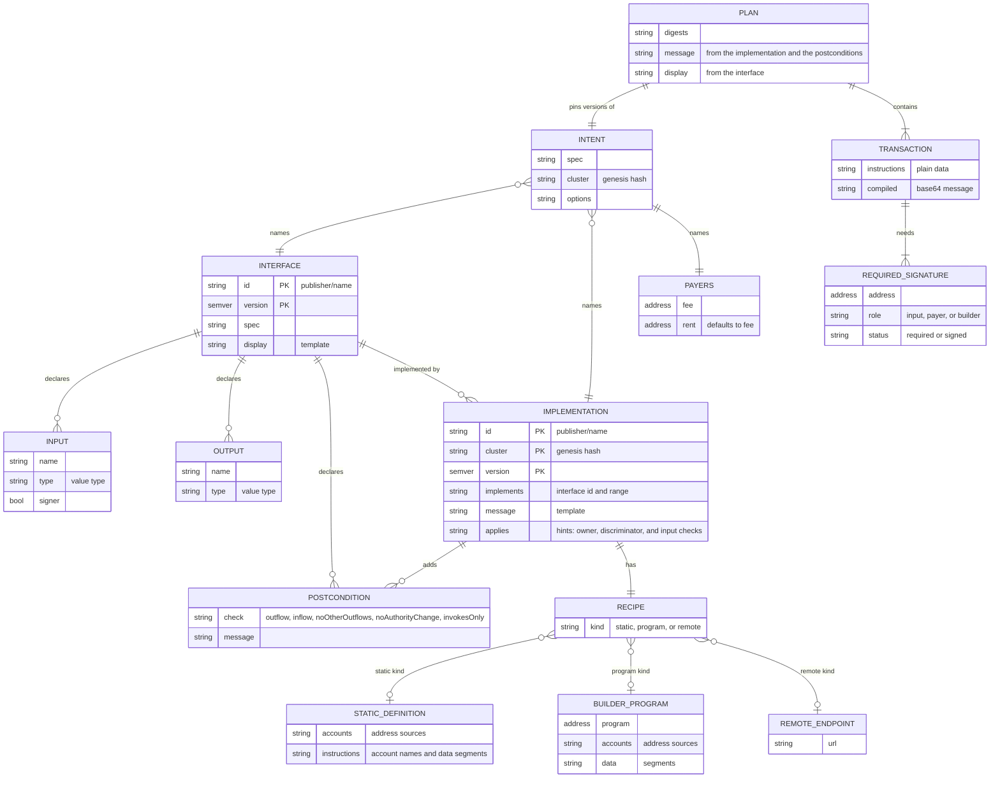
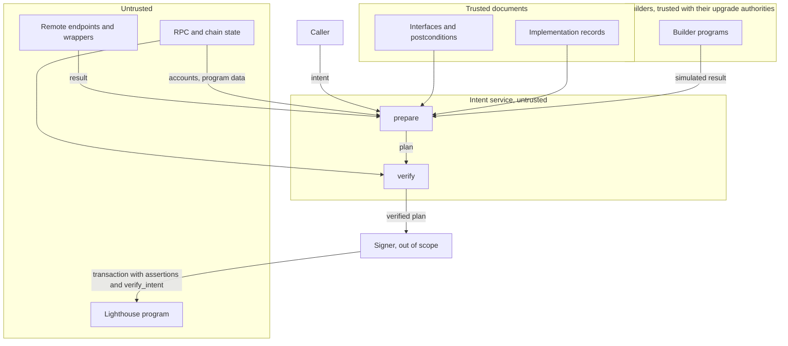

# Intents

Status: draft, prototype. Owner: Noah Prince. Approvers: to be named.

Template: Foundation "Design Document Template", plus SDLC §2, §3.1, §11, §13, and §15. Section 9
lists the gates for production.

## 1. Summary

An interface declares an operation, such as a token transfer. An implementation record says how one
protocol does it. An intent names an interface and its inputs, for example "transfer 100 USDC to
this wallet".

The goal is that every program exposes builders for its own operations. A record has one of three
recipes:

1. Program: a builder instruction that a Rust service simulates. A builder in the target program
   upgrades with that program, so it cannot drift. This is the preferred recipe.
2. Static: the instructions as data, in a language with a fixed set of features. It fills the gap
   until programs ship builders, for operations that are fixed and unlikely to change.
3. Remote: an HTTP endpoint with the same result as a builder, for offchain search such as a swap
   route.

The service adds the postconditions as assertions, verifies the result, and returns a plan: the
transactions, a message for signers, and a display.

Interfaces and implementations live in a registry program. An organization owns each one, and each
interface's approve authority approves the implementations that UIs show.

Question: can SDP build its transactions this way, with the same bytes and safety checks as today,
and keep a path to a wallet program that verifies them onchain?

## 2. Problem

1. Each module builds transactions its own way. Each Earn provider repeats the safety checks
   `assertPlanTargetsCluster`, `sponsoredPrograms`, and `requireAcceptedPlan`.
2. An approver sees bytes or a simulation. No checked statement says what the transaction does.

Context: SDP stores customer custody credentials, and each custody provider takes a different
input. A plan that states the operation and its bounds lets signing move out of SDP later. This
design covers only how transactions are built. Custody and signing are out of scope (section 13).

Users: SDP engineers, protocol teams, and anyone who approves or signs a plan.

Constraints:

1. Token-2022 extensions, reserve walks, and withdrawal legs need real logic. A template language
   that expresses them becomes a programming language. A program already is one. The static
   language therefore has a fixed set of features, and builders do the rest.
2. A static definition can drift from its target program after an upgrade.
3. Swap routes need offchain search.

## 3. Requirements

| ID | Requirement | Section |
| :-- | :-- | :-- |
| R1 | An interface declares inputs, outputs, a display, and postconditions. It names no program or account. | 4.1 |
| R2 | An implementation record has `applies` checks, a message template, added postconditions, a cluster, and one recipe: static, program, or remote. | 4.1, 4.2 |
| R3 | An intent names an interface, an implementation, inputs, payers, and options. A UI selects the implementation with the `applies` hints. `prepare` refuses an unapproved version unless the intent allows it. | 4.2, 4.10 |
| R4 | A static recipe has no conditions or loops. Instruction data is literal bytes and encoded values, with no discriminator rule. | 4.2 |
| R5 | A builder returns instructions and outputs, or a refusal, in a zero-copy layout. Onchain it returns a hash of its instructions, so it writes no account. Its accounts are readonly and include no payer. A library hides both modes from builder authors. | 4.2 |
| R6 | A remote endpoint returns the same result as a builder. | 4.2 |
| R7 | The service verifies every plan against the postconditions and the payer rules, and adds the postconditions as assertions. | 4.5 |
| R8 | A simulation reads every value-bearing account live, with the fewest RPC calls (`AGENTS.md`, "RPC is a budget"). | 4.4 |
| R9 | A wallet program can run static and program recipes onchain and check the postconditions. | 4.7 |
| R10 | Each document has one canonical zero-copy binary form: fixed-size entries in homogeneous tables, within fixed limits. JSON compiles to it, and digests use it. | 4.9 |
| R11 | A spec change leaves published documents and messages valid. Ids are unique across publishers. | 4.8 |
| R12 | Interfaces and implementations live in a registry program: organizations, update authorities, approvals of implementations and versions by the interface's approve authority, with a policy for new versions, an index account that lists the versions of each interface and implementation, and one account for each version. | 4.10 |
| R13 | Each ported flow builds the same bytes as SDP for the same inputs and chain state. | 4.14 |
| R14 | The playground is a registry explorer: browse interfaces and implementations, fill an intent from a typed form, and see the plan. | 4.14 |
| R15 | By default, each transaction proves onchain that its instructions are what the record builds for the intent, so the service is untrusted. An intent can opt out. | 4.6 |
| R16 | Transactions are v1 (SIMD-0385), with the compute budget in the header and no lookup tables. | 4.1 |
| R17 | The definitions live in this repository as JSON. A CLI lints them, plans the registry change, and applies it with a key or as a Squads proposal. | 4.13 |

## 4. Design

### 4.1 Model

The examples are one chain for a transfer of PYUSD, a Token-2022 mint. "…" shortens addresses,
digests, and bytes.

**Intent.**

```json
{
  "spec": "sdp-intents@1.0",
  "kind": "intent",
  "interface": "solana.org/token.transfer@^1",
  "implementation": "solana.org/token-2022-transfer@^1",
  "inputs": {
    "from": "7xKX…",
    "to": "9aBc…",
    "mint": "2b1kV6DkPAnxd5ixfnxCpjxmKwqjjaYmCZfHsFu24GXo",
    "amount": "100000000",
    "memo": null
  },
  "payers": { "fee": "KoRa…", "rent": "KoRa…" },
  "cluster": "5eykt4UsFv8P8NJdTREpY1vzqKqZKvdpKuc147dw2N9d",
  "options": { "priorityFeeLamports": "5000" }
}
```

1. The caller selects the implementation, usually through a UI that reads the `applies` hints
   (4.2).
2. `cluster` is the genesis hash.
3. `options` change execution, not the operation: the total priority fee, `allowUnapproved`
   (4.10), and the onchain checks `assertions` and `verifyIntent` (4.6). `allowUnapproved` defaults
   to false, and both checks default to true.
4. Amounts are base units.

**Interface.**

```json
{
  "spec": "sdp-intents@1.0",
  "kind": "interface",
  "id": "solana.org/token.transfer",
  "version": "1.0.0",
  "inputs": [
    { "name": "from", "type": "address", "signer": true },
    { "name": "to", "type": "address" },
    { "name": "mint", "type": "mint" },
    { "name": "amount", "type": "u64", "display": { "amount": { "mint": "{inputs.mint}" } } },
    { "name": "memo", "type": "string", "optional": true }
  ],
  "outputs": [],
  "display": "Send {inputs.amount} {inputs.mint} to {inputs.to}",
  "postConditions": [
    { "outflow": { "from": "{inputs.from}", "mint": "{inputs.mint}", "max": "{inputs.amount}" },
      "message": "{inputs.from} sends at most {inputs.amount} of {inputs.mint}" },
    { "noOtherOutflows": { "from": "{inputs.from}" },
      "message": "nothing else leaves {inputs.from}" }
  ]
}
```

1. Postconditions are in the interface, so they bound every implementation.
2. Inputs have value types and no encoding (4.8). The record encodes them (4.2).
3. `display` is the same for every implementation. An `amount` display renders the decimal value
   for the named mint.
4. An output is a value that every implementation returns, such as the share mint of a vault
   deposit. A postcondition on an output is only as strong as the recipe (4.3).

**Implementation record, builder.** The `applies` hint marks a record by the program that owns the
mint. This record handles Token-2022 mints:

```json
{
  "spec": "sdp-intents@1.0",
  "kind": "implementation",
  "id": "solana.org/token-2022-transfer",
  "version": "1.0.0",
  "cluster": "5eykt4UsFv8P8NJdTREpY1vzqKqZKvdpKuc147dw2N9d",
  "implements": "solana.org/token.transfer@^1",
  "applies": [
    { "account": "{inputs.mint}", "owner": "TokenzQdBNbLqP5VEhdkAS6EPFLC1PHnBqCXEpPxuEb" }
  ],
  "message": "transfer {inputs.amount} of {inputs.mint} from {inputs.from} to {inputs.to}",
  "recipe": {
    "kind": "program",
    "program": "T22Bld…",
    "accounts": [
      { "name": "mint", "address": "{inputs.mint}" },
      { "name": "from", "address": "{inputs.from}" },
      { "name": "to", "address": "{inputs.to}" },
      { "name": "source", "address": { "ata": { "owner": "{inputs.from}", "mint": "{inputs.mint}", "tokenProgram": "TokenzQdBNbLqP5VEhdkAS6EPFLC1PHnBqCXEpPxuEb" } } },
      { "name": "destination", "address": { "ata": { "owner": "{inputs.to}", "mint": "{inputs.mint}", "tokenProgram": "TokenzQdBNbLqP5VEhdkAS6EPFLC1PHnBqCXEpPxuEb" } } }
    ],
    "data": [
      { "value": "bd1c9adb8ca2623c", "encoding": "hex" },
      { "value": "{inputs.amount}", "encoding": "u64le" },
      { "value": "{inputs.memo}", "encoding": "borsh" }
    ]
  },
  "postConditions": [
    { "invokesOnly": [
        "TokenzQdBNbLqP5VEhdkAS6EPFLC1PHnBqCXEpPxuEb",
        "ATokenGPvbdGVxr1b2hvZbsiqW5xWH25efTNsLJA8knL",
        "MemoSq4gqABAXKb96qnH8TysNcWxMyWCqXgDLGmfcHr"
      ],
      "message": "only Token-2022, ATA, and Memo instructions run" }
  ]
}
```

1. `message` is the template that signers read. The service renders it for every recipe kind
   (4.5). A builder returns no message.
2. `accounts` and `data` are the builder call (4.2). The record derives the ATAs, so the builder
   gets every account in its first round. It asks with `MoreAccounts` only for transfer hook
   accounts. It names the rent payer with a placeholder.
3. `postConditions` add to those of the interface. `invokesOnly` limits the programs that the built
   instructions invoke.
4. Trust in the record includes the builder's upgrade authority (4.3).
5. A devnet record is a separate record with the same id.
6. A record id names the operation, not the recipe, so a record can change its recipe in a major
   version. A builder program can serve several records. The `token-2022-builder` program serves
   `token-2022-transfer`.

**Implementation record, static.** SPL Token mints need no builder:

```json
{
  "spec": "sdp-intents@1.0",
  "kind": "implementation",
  "id": "solana.org/spl-token-transfer",
  "version": "1.0.0",
  "cluster": "5eykt4UsFv8P8NJdTREpY1vzqKqZKvdpKuc147dw2N9d",
  "implements": "solana.org/token.transfer@^1",
  "applies": [
    { "account": "{inputs.mint}", "owner": "TokenkegQfeZyiNwAJbNbGKPFXCWuBvf9Ss623VQ5DA" },
    { "value": "{inputs.memo}", "present": false }
  ],
  "message": "transfer {inputs.amount} of {inputs.mint} from {inputs.from} to {inputs.to}",
  "recipe": {
    "kind": "static",
    "accounts": [
      { "name": "rentPayer", "address": "{payers.rent}", "writable": true, "signer": true },
      { "name": "from", "address": "{inputs.from}", "signer": true },
      { "name": "to", "address": "{inputs.to}" },
      { "name": "mint", "address": "{inputs.mint}" },
      { "name": "systemProgram", "address": "11111111111111111111111111111111" },
      { "name": "tokenProgram", "address": "TokenkegQfeZyiNwAJbNbGKPFXCWuBvf9Ss623VQ5DA" },
      { "name": "source", "writable": true,
        "address": { "ata": { "owner": "{inputs.from}", "mint": "{inputs.mint}", "tokenProgram": "{accounts.tokenProgram}" } } },
      { "name": "destination", "writable": true,
        "address": { "ata": { "owner": "{inputs.to}", "mint": "{inputs.mint}", "tokenProgram": "{accounts.tokenProgram}" } } }
    ],
    "instructions": [
      {
        "program": "ATokenGPvbdGVxr1b2hvZbsiqW5xWH25efTNsLJA8knL",
        "accounts": ["rentPayer", "destination", "to", "mint", "systemProgram", "tokenProgram"],
        "data": [{ "value": "01", "encoding": "hex" }]
      },
      {
        "program": "TokenkegQfeZyiNwAJbNbGKPFXCWuBvf9Ss623VQ5DA",
        "accounts": ["source", "mint", "destination", "from"],
        "data": [
          { "value": "0c", "encoding": "hex" },
          { "value": "{inputs.amount}", "encoding": "u64le" },
          { "read": { "account": "{accounts.mint}", "owner": "TokenkegQfeZyiNwAJbNbGKPFXCWuBvf9Ss623VQ5DA", "offset": "44", "length": "1" } }
        ]
      }
    ]
  }
}
```

1. The first instruction creates the destination ATA if it does not exist. The second is
   `transferChecked` (`0x0c`).
2. The `read` segment copies the decimals from byte 44 of the mint.
3. The record does not use `memo`, so `prepare` refuses an intent with a memo. The hint points a UI
   to `spl-token-transfer-memo` instead (4.11).

**Plan.**

```json
{
  "spec": "sdp-intents@1.0",
  "kind": "plan",
  "intent": {
    "spec": "sdp-intents@1.0",
    "kind": "intent",
    "interface": "solana.org/token.transfer@1.0.0",
    "implementation": "solana.org/token-2022-transfer@1.0.0",
    "inputs": {
      "from": "7xKX…",
      "to": "9aBc…",
      "mint": "2b1kV6DkPAnxd5ixfnxCpjxmKwqjjaYmCZfHsFu24GXo",
      "amount": "100000000",
      "memo": null
    },
    "payers": { "fee": "KoRa…", "rent": "KoRa…" },
    "cluster": "5eykt4UsFv8P8NJdTREpY1vzqKqZKvdpKuc147dw2N9d",
    "options": { "priorityFeeLamports": "5000" }
  },
  "digests": { "interface": "sha256:3f9a…", "implementation": "sha256:c21e…" },
  "builder": { "program": "T22Bld…", "deploySlot": "312004417" },
  "outputs": {},
  "message": "sdp-intents/1: transfer 100 of 2b1kV6DkPAnxd5ixfnxCpjxmKwqjjaYmCZfHsFu24GXo from 7xKX… to 9aBc… | guarantees: 7xKX… sends at most 100 of 2b1kV6DkPAnxd5ixfnxCpjxmKwqjjaYmCZfHsFu24GXo; nothing else leaves 7xKX…; only Token-2022, ATA, and Memo instructions run | interface: solana.org/token.transfer@1.0.0 3f9a… | builder: T22Bld…",
  "display": "Send 100 PYUSD to 9aBc…",
  "transactions": [
    {
      "instructions": [
        {
          "programAddress": "ATokenGPvbdGVxr1b2hvZbsiqW5xWH25efTNsLJA8knL",
          "accounts": [
            { "address": "KoRa…", "role": 3 },
            { "address": "DstA…", "role": 1 },
            { "address": "9aBc…", "role": 0 },
            { "address": "2b1kV6DkPAnxd5ixfnxCpjxmKwqjjaYmCZfHsFu24GXo", "role": 0 },
            { "address": "11111111111111111111111111111111", "role": 0 },
            { "address": "TokenzQdBNbLqP5VEhdkAS6EPFLC1PHnBqCXEpPxuEb", "role": 0 }
          ],
          "data": "AQ=="
        },
        {
          "programAddress": "TokenzQdBNbLqP5VEhdkAS6EPFLC1PHnBqCXEpPxuEb",
          "accounts": [
            { "address": "SrcA…", "role": 1 },
            { "address": "2b1kV6DkPAnxd5ixfnxCpjxmKwqjjaYmCZfHsFu24GXo", "role": 0 },
            { "address": "DstA…", "role": 1 },
            { "address": "7xKX…", "role": 2 }
          ],
          "data": "DADh9QUAAAAABg=="
        }
      ],
      "version": 1,
      "config": { "priorityFeeLamports": "5000", "computeUnitLimit": "61000", "loadedAccountsDataSizeLimit": "131072" },
      "compiled": "gQIA…",
      "signatures": [
        { "address": "KoRa…", "role": "payer:fee", "status": "required" },
        { "address": "7xKX…", "role": "input:from", "status": "required" }
      ]
    }
  ]
}
```

1. `message` is the record's template, then `guarantees` from both sets of postconditions, then
   the ids, digests, and builder. `display` comes from the interface. `deploySlot` is for the audit
   log only.
2. Instructions use the `EarnVaultInstruction` shape: base58 addresses, numeric `AccountRole`
   values, and base64 data.
3. `SrcA…` and `DstA…` are the ATAs of `from` and `to`. `KoRa…` holds both payer roles.
4. Transactions are v1 (SIMD-0385): up to 4,096 bytes and 64 accounts, with the compute budget in
   `config` and no lookup tables. The service sets the compute unit limit and the loaded data size
   from the simulation, because both default to zero.
5. The example leaves out the Lighthouse instructions (4.5), the builder instruction and
   `verify_intent` (4.6), and the permanent delegate warning (4.11).
6. The PYUSD transfer hook names no program, so the transfer has no hook accounts.

**Relations.**



### 4.2 Recipes and the builder ABI

| Kind | Form | Use |
| :-- | :-- | :-- |
| `program` | A builder instruction, simulated | The preferred kind. Anything beyond the static language. |
| `static` | Accounts and instructions, as data | A stopgap for a program with no builder. Only for an operation that the static language covers and that is unlikely to change. |
| `remote` | `{ "kind": "remote", "url": "…" }` | Offchain search, such as a Jupiter route |

Each kind returns outputs and instructions, or a refusal. The service verifies all of them the same
way.

**Selection.** An intent always names its implementation. A UI selects it with `applies`, a list of
at most 4 hints on the record. A record fits an intent when all of its hints hold.

| Hint | Form | Holds when |
| :-- | :-- | :-- |
| Owner | `{ "account": "{inputs.mint}", "owner": "TokenzQdBNbLqP5VEhdkAS6EPFLC1PHnBqCXEpPxuEb" }` | The program that owns the account is `owner` |
| Owner and discriminator | `{ "account": "{inputs.vault}", "owner": "KvauGMspG5k6rtzrqqn7WNn3oZdyKqLKwK2XWQ8FLjd", "discriminator": "<8 bytes>" }` | The owner matches, and the data starts with the discriminator, at most 8 bytes |
| Input present | `{ "value": "{inputs.memo}", "present": false }` | The input is present or absent, as `present` says |
| Input equals | `{ "value": "{inputs.mint}", "equals": "11111111111111111111111111111111" }` | The input equals the literal |

1. Every check is enforced. `prepare` and `verify_intent` refuse an intent that breaks one, so a
   wrong pick fails before the simulation with the index of the check. An owner check needs the
   data of its account, and the engine reads it in the first fetch.
2. `implementationsFor(interface, inputs, cluster)` returns the approved records (4.10) whose hints
   hold. It reads the interface's approved list, then batches the implementation indexes and the
   hint accounts. It ranks them: a builder in the target program (4.3), a static recipe, another
   builder, then a remote endpoint.
3. An input check matters most, because a recipe that does not read an input cannot fail on it.
   For the same reason, `prepare` refuses an optional input that the record does not use. The
   engine finds the inputs that a record reads in its sources, seeds, and segments.
4. Preconditions, such as a balance or a paused mint, stay in builder refusals and in the target
   program.

**Preferred recipe.** The goal is that every program exposes builders. A builder in the target
program ships with the instruction that it builds, so a protocol upgrade cannot leave its records
behind. Static records and SDP builders fill the gap until then. SDP ships them only for programs
without a builder, and deprecates them when one ships. The spec crates make a builder one more
instruction, and `implementationsFor` ranks it first.

**Values.** A string that is exactly one reference names a value: `"{inputs.memo}"`,
`"{outputs.shareMint}"`, `"{payers.rent}"`, or `"{accounts.vault}"`. Any other string is a literal.
`{{` and `}}` are literal braces. A reference inside other text is valid only in a template. The
compiler rejects any other brace.

The encoding parses a literal: decimal digits for an integer, base58 for `address`, `true` or
`false` for `bool`, text for `utf8`, and hex digits for `hex`. A literal cannot use `borsh`,
because a literal has no value type.

**Address sources.**

| Source | Form | Address |
| :-- | :-- | :-- |
| Input or payer | `"{inputs.to}"`, `"{payers.rent}"` | The value |
| Static | `"TokenkegQfeZyiNwAJbNbGKPFXCWuBvf9Ss623VQ5DA"` | The literal |
| PDA | `{ "pda": { "program": "…", "seeds": […] } }` | The PDA. Each seed is a value and an encoding, such as `{ "value": "vault", "encoding": "utf8" }`. |
| ATA | `{ "ata": { "owner": "…", "mint": "…", "tokenProgram": "…" } }` | The associated token account |
| Has one | `{ "hasOne": { "account": "{accounts.vault}", "owner": "KvauGMspG5k6rtzrqqn7WNn3oZdyKqLKwK2XWQ8FLjd", "offset": "8" } }` | The 32 bytes at `offset` in an earlier account. The service refuses when another program owns that account. |

**Data segments.** Instruction data and PDA seeds use the same segments.

| Segment | Form | Bytes |
| :-- | :-- | :-- |
| Literal | `{ "value": "02000000", "encoding": "hex" }` | The literal in the encoding |
| Reference | `{ "value": "{inputs.amount}", "encoding": "u64le" }` | The value in the encoding |
| Account bytes | `{ "read": { "account": "{accounts.mint}", "owner": "…", "offset": "44", "length": "1" } }` | At most 32 bytes at `offset` in an earlier account. The service refuses when another program owns that account. |

| Encoding | Value types | Bytes |
| :-- | :-- | :-- |
| `u8`, `u16le`, `u32le`, `u64le`, `u128le` | Unsigned integers | Little-endian, fixed width |
| `i8`, `i16le`, `i32le`, `i64le`, `i128le` | Signed integers | Little-endian two's complement, fixed width |
| `bool` | `bool` | `0` or `1` |
| `address` | `address`, `mint` | 32 bytes |
| `utf8` | `string` | The UTF-8 bytes, with no length, as the Memo program reads them |
| `borsh` | Every value type | Borsh: a 1-byte tag for an optional value, and a `u32` length for a string, bytes, or an array |
| `hex` | Literals only | The bytes |

1. There is no discriminator rule. A discriminator is a literal: 1 byte for SPL Token, 4 bytes for
   the System program, and 8 bytes for Anchor.
2. The compiler rejects an encoding too small for the type, such as `u32le` for a `u64`.
3. An optional value uses `borsh`.

**Limit of the static language.** The static language has only the sources, segments, and
encodings above, within the limits in 4.9. It has no conditions, loops, lists of variable length,
or extension checks. A record that needs more uses a builder.

**Drift.** Most static drift fails closed: a changed account list or layout fails the simulation.
Silent drift needs a discriminator that the program reuses with a new meaning. The postconditions
bound that case.

**Builder instruction.** The ABI is the `no_std` crate `sdp-intents-spec`, which depends only on
`bytemuck`, so any program can use it. `sdp-intents-builder` writes the results, over pinocchio, so
Anchor v2 and other programs use it.

SDP builders use Anchor v2 (`github.com/otter-sec/anchor`, branch `anchor-next`). Anchor v2 keeps
the 8-byte discriminator and reads arguments as Borsh, so a `borsh` segment is an Anchor v2
argument.

1. Accounts: the record's `accounts`, then the accounts of earlier `MoreAccounts` results. A
   builder knows its round from its account count. A record derives every account that the address
   sources can express, so the service resolves them in batched reads before the first simulation.
   `MoreAccounts` is only for accounts that depend on data the static language cannot read, such as
   a list of variable length or a TLV extension.
2. Account rule: every account is readonly, and no account is a payer. The compiler enforces this.
   The service rejects a `MoreAccounts` result that names a payer.
3. Payers: a built instruction names the rent payer with `PAYER_RENT_PLACEHOLDER`, and the service,
   or `verify_intent`, maps it to the rent payer. No instruction names the fee payer, because the
   runtime charges the fee and the v1 header holds the compute budget.
4. Data: the record's segments. For the PYUSD transfer, the data is 17 bytes:

```
bd1c9adb8ca2623c   discriminator of build_transfer_v1
00e1f50500000000   amount, 100000000, u64le
00                 memo, absent, borsh
```

5. Result: the builder returns it in one of two modes. The library picks the mode from the stack
   height, so a builder author writes the same code for both.

| Mode | When | Result |
| :-- | :-- | :-- |
| Staged | Stack height 1: a top-level instruction, which only a simulation sends | The full result in scratch, and a `ResultPointerV1` in return data. `MoreAccounts` is valid. |
| Hashed | Stack height above 1: a CPI from `verify_intent` (4.6) or a wallet (4.7) | A `HashedReadyV1` in return data: the SHA-256 of the instruction section, the signers, and the outputs |

In staged mode the simulation appends the scratch account as the last account, writable. The record
never names it. The simulated transaction creates scratch first: a `createAccount` of 10,240 bytes,
owned by the builder, funded by any account that holds the rent. A simulation does not verify
signatures, so scratch needs no keypair. Nothing lands, so no one pays the rent.

**Builder library.** A builder author writes one handler against `sdp-intents-builder`:

```rust
pub fn build_transfer_v1(ctx: &mut Context<BuildTransferV1>, amount: u64, memo: Option<String>) -> Result<()> {
    let remaining = ctx.remaining_accounts();
    let mut build = Build::new(ctx.program_id, <BuildTransferV1 as TryAccounts>::HEADER_SIZE, &remaining)?;

    let Some(hook_accounts) = build.require_accounts(&hook_addresses(&ctx.accounts.mint)?)? else {
        return Ok(build.finish()?);
    };

    let destination = build.create_associated_token_account_idempotent(to, mint, &TOKEN_2022)?;
    build.transfer_checked(&TransferChecked { destination: &destination, extra_accounts: &hook_metas, /* … */ })?;
    Ok(build.finish()?)
}
```

1. `Build::new` reads the stack height, and in staged mode takes the last account as scratch. The
   accounts struct holds only the accounts that the record names. The extra accounts of earlier
   rounds and scratch are the remaining accounts.
2. `require_accounts` returns the accounts when the caller passed them. Otherwise it returns `None`,
   and the handler returns `finish()`, which writes `MoreAccounts`. In hashed mode a missing account
   is an error.
3. `Meta::rent_payer()` writes the placeholder. `build.refuse(code, message)` writes `Refused` in
   staged mode and fails in hashed mode.
4. `finish` writes the staged result and the pointer, or hashes the instruction section and writes
   `HashedReadyV1`.
5. The `token` helpers derive associated token accounts and add `createIdempotent`,
   `transferChecked`, and memos.

**Result layout.** Every type is alignment-1 pod, so a reader casts it in place. `PodU16`, `PodU32`,
`PodU64`, and `PodBool` are little-endian byte arrays with alignment 1, in the layout of the Anchor
v2 pod types. `sdp-intents-spec` defines its own, so it needs no Anchor dependency.

```rust
pub const RESULT_READY: u8 = 1;
pub const RESULT_MORE_ACCOUNTS: u8 = 2;
pub const RESULT_REFUSED: u8 = 3;
pub const RESULT_HASHED_READY: u8 = 4;
pub const RESULT_POINTER_LEN: usize = 10;
pub const PAYER_RENT_PLACEHOLDER: [u8; 32] = *b"sdp-intents/payer/rent\0\0\0\0\0\0\0\0\0\0";

#[repr(C)]
pub struct ResultPointerV1 {
    pub kind: u8,
    pub account_index: u8,
    pub offset: PodU32,
    pub len: PodU32,
}

#[repr(C)]
pub struct ReadyHeaderV1 {
    pub num_instructions: u8,
    pub num_signers: u8,
    pub outputs_len: PodU16,
}

#[repr(C)]
pub struct InstructionHeaderV1 {
    pub program: [u8; 32],
    pub num_accounts: u8,
    pub data_len: PodU16,
}

#[repr(C)]
pub struct AccountMetaV1 {
    pub address: [u8; 32],
    pub role: u8,
}

#[repr(C)]
pub struct HashedReadyV1 {
    pub kind: u8,
    pub instructions_hash: [u8; 32],
    pub num_signers: u8,
    pub outputs_len: PodU16,
}
```

| Result | Bytes at the pointer | The service then |
| :-- | :-- | :-- |
| `Ready` | `ReadyHeaderV1`, the outputs, and 32 bytes for each signer. Then, for each instruction, an `InstructionHeaderV1`, an `AccountMetaV1` for each account, and the data. | Verifies |
| `MoreAccounts` | `num_accounts: u8`, then 32 bytes for each address | Simulates again with the accounts appended, for at most 4 rounds and 64 accounts. Each round can depend on the round before. |
| `Refused` | `code_len: u8`, `message_len: PodU16`, the code, and the message | Returns the refusal |

1. The outputs are the interface's outputs, in order, in `borsh`.
2. `role` is the `AccountRole` value: `0` readonly, `1` writable, `2` readonly signer, and `3`
   writable signer.
3. A signer is a new account that the service signs for, such as a fresh keypair.
4. The instruction section is the part of `Ready` after the signers: each `InstructionHeaderV1`,
   its `AccountMetaV1` entries, and its data, with the rent placeholder in place. `HashedReadyV1`
   is followed by 32 bytes for each signer and by the outputs. Return data holds at most 1,024
   bytes, so the signers and the outputs fit in 988 bytes.

**Remote endpoint.** The same ABI in JSON over HTTP. The request is
`{ spec, kind, cluster, inputs, payers }`. The response is `Ready` or `Refused`, with
instructions in the shape of the plan. An endpoint reads chain state itself, so it never returns
`MoreAccounts`. A wrapper adapts other APIs. The playground wraps the Jupiter swap API. An
endpoint never receives a credential.

**Builder rules.**

1. A builder runs in simulation during `prepare`, and again by CPI from `verify_intent` (4.6). It
   runs nowhere else.
2. A builder can change only accounts that it owns, and use only the signatures that its caller
   passes. `verify_intent` passes every account readonly and unsigned. In simulation, no input or
   payer signs. So a builder can invoke any program and still change nothing.
3. A refusal is a precondition with a code, such as `nonTransferable` or `vaultPaused`.
4. A builder can use the target program's crates, such as `spl-token-2022`,
   `spl-tlv-account-resolution`, and Codama clients.
5. The call is a stable ABI. A builder asks for new accounts with `MoreAccounts`. A changed call is
   a new instruction, such as `build_deposit_v2`. The old instruction stays until records move.

### 4.3 Trust

A static recipe is trusted data in the registry. A builder is trusted code with an upgrade
authority. A remote endpoint is a trusted operator.

| Claim | Source | Bound |
| :-- | :-- | :-- |
| Instructions | The recipe | Postconditions and payer rules (4.5) |
| Outputs | The recipe | None. A postcondition on an output trusts the recipe. |
| Message | The record's template, rendered by the service | Registry review. An output in the template trusts the recipe. |
| Display | The interface, rendered by the service | Token symbols come from token metadata. Nothing signs the display. |
| Refusals | Builder or remote endpoint | The target program checks its own rules at landing. |

**No pins.** Trust in a record includes the builder's upgrade authority, so a pin adds no
protection. A pin would also stop `prepare` after each upgrade until a new record exists.

1. An upgrade changes what every record that names the builder builds. Postconditions and payer
   rules bound it, and monitoring alerts on it (section 7).
2. A builder is in the target program when it has the same upgrade authority as each target program,
   and there is at least one. The target programs are the owners in the `applies` hints, except the
   System, token, ATA, and Memo programs. Such a builder adds no trust.
3. An SDP builder for another protocol adds SDP's upgrade authority, a multisig (section 9).
4. A builder with no upgrade authority cannot change. A customer that requires fixed code accepts
   only such builders.
5. The registry records each builder's verified build hash (`solana-verify get-program-hash`) for
   review. The plan records its deploy slot for audit. Nothing checks either value.

### 4.4 Simulation and RPC

The planner (4.14) runs `prepare` with no IO. It asks for accounts to fetch and for transactions to
simulate, and its caller answers. The client answers with RPC: `getMultipleAccounts`, and
`simulateTransaction` with `sigVerify` off, `replaceRecentBlockhash` on, and scratch in `accounts`.
The service answers from an account cache, and simulates in LiteSVM over it. The `intents/chain`
crate holds both, and starts as a copy of relay's `chain-source` (4.14).

1. Reads use `processed`. The blockhash uses `confirmed`.
2. A cached account is served only while a live subscription covers it. Other accounts are fetched
   again after about one slot.
3. A static recipe needs one batch of reads for each `hasOne` level, at most 4, then one
   simulation.
4. A builder needs one simulation for each round. A Token-2022 transfer takes one, or two when the
   mint has a transfer hook. A Kamino deposit takes two: the vault, then its reserves and markets.
5. A builder that runs out of compute or rounds fails `prepare`, with no retry.

**Engine.** The engine never fetches. Each resolve returns the accounts whose data it needs next,
which is one `hasOne` level, with every `read` account that is resolved. The service fetches them in
one call with every resolved account that the cache does not hold, so the last fetch also loads the
simulation. `verify_intent` answers from the accounts of its instruction, so one resolve completes
or fails.

**RPC.** Every read goes through the cache. Each step collects its cache misses and fetches them
with one `getMultipleAccounts` call, split at 100 accounts. Concurrent requests for the same
account share one fetch, and the cache never stores a failure (`AGENTS.md`, "RPC is a budget").

| Step | Accounts | Calls on a miss |
| :-- | :-- | :-- |
| Registry | Two `VersionIndexV1` accounts, under a subscription, and two version accounts, which never change | One `getMultipleAccounts` |
| `implementationsFor` | The interface index, then the listed implementation indexes and their `applies` accounts | Two `getMultipleAccounts`. The interface index is usually cached. |
| Account resolution | The accounts of one `hasOne` or `read` level, and the mints that rendering needs | One `getMultipleAccounts` for each level |
| Simulation round | The accounts that the transaction or the builder names and the cache does not hold | One `getMultipleAccounts` |
| `verify` | The accounts of the final simulation, already loaded | None |

With a warm cache, an SPL Token or Token-2022 transfer takes one `getMultipleAccounts` call, and a
Kamino deposit takes two. The report counts the calls for each flow (section 10).

### 4.5 Signers, payers, and verification

| Kind | Declared in | Checked by |
| :-- | :-- | :-- |
| Signer input, `input:<name>` | Interface input with `"signer": true` | Postconditions |
| Payer, `payer:fee` or `payer:rent` | Intent `payers`. `rent` defaults to `fee`. | Rules 4 and 5 |
| Builder signer, `builder` | The `Ready` result. A fresh keypair that the service signs for. | The account must not exist before the transaction. |

`verify` simulates the final transaction with account snapshots and checks:

1. Each postcondition of the interface and the implementation.
2. `noOtherOutflows`: no balance of a signer input goes down, except as a postcondition or the
   input's payer role allows.
3. No delegate, close authority, or owner of a signer input's accounts changes.
4. The fee payer loses at most the fee plus capped rent.
5. No instruction names a payer or a signer input, except as the fee payer, as the funder of a new
   account, or where the interface requires that signer.

Rule 5 runs on the final instruction list, after placeholder replacement.
Signer status belongs to the whole transaction, so any instruction that names the fee payer can
drain it.

Rules 4 and 5 and `invokesOnly` replace Kora's sponsorship checks and `sponsoredPrograms`. The
cluster lock on each record replaces `assertPlanTargetsCluster`.

**Implementation postconditions.** A record can add checks to those of its interface, and cannot
remove one. Only a record can state `invokesOnly`, because an interface names no programs. It holds
when every top-level instruction invokes a listed program, Lighthouse, or the registry's
`verify_intent`. Lighthouse
cannot assert it, so `verify` and the onchain wallet check it. A sponsor can add its own program
policy.

**Assertions.** Lighthouse (`github.com/Jac0xb/lighthouse`):

1. First, `MemoryWrite` copies the mint, owner, and amount of each token account of a signer input.
2. Last, `AssertAccountDelta` checks outflows and inflows against the copy, and
   `AssertTokenAccount` checks delegate, close authority, and owner.
3. The final instruction closes the memory account.

**Rendering.** `message` uses the `message` column. `display` uses the `display` column.

| Value type | In `message` | In `display` |
| :-- | :-- | :-- |
| Integer with an `amount` display | The value divided by 10 to the power of the mint's decimals, with trailing zeros and a trailing point removed. No thousands separator. | The same |
| `mint` | Base58 | `SOL` for the System program, else the symbol from token metadata, else base58 |
| Other integer | Decimal digits, with `-` for a negative value | The same |
| Boolean | `true` or `false` | The same |
| Address | Base58 | Base58, shortened to the first and last 4 characters |
| Bytes | Lowercase hex | The same |
| String | Restricted ASCII only | UTF-8 |
| Absent option | `none` | Empty |

`message` names tokens by mint address, because anyone can name a token "USDC".

### 4.6 Verification in the transaction

The service is untrusted. By default, each transaction proves onchain that its instructions are
what the record builds for the intent, so a signer needs only the transaction bytes.

```
[Lighthouse snapshot] [built instructions] [Lighthouse assertions] [verify_intent]
```

`verify_intent` is an instruction of the registry program. Its data is the intent in binary form.
Its accounts are the interface and implementation version accounts, the builder program, and the
accounts that the recipe names, including those of the last `MoreAccounts` round. The recipe logic
and the registry change together, so one program holds both.

1. It checks that the registry owns both version accounts, that they match the intent, that the
   version is approved unless the intent sets `allowUnapproved`, and the checks of `applies`.
2. Static recipe: it checks each account against its source, reads the `hasOne` and `read` bytes,
   and builds the instructions.
3. Program recipe: it calls the builder by CPI with the record's data, and every account readonly
   and unsigned. The builder returns `HashedReadyV1` (4.2).
4. It serializes the built instructions from the instructions sysvar into the instruction section,
   with the rent payer's address mapped back to the placeholder. For a static recipe it compares the
   bytes. For a program recipe it compares their SHA-256 with `instructions_hash`, and checks the
   signers. It also compares the Lighthouse instructions with the ones that the postconditions give.
5. Any difference fails the transaction.

A signer decodes the intent from `verify_intent`, renders the message from the intent and the
record, and checks the fee payer and its own signature. It needs no simulation and no trust in the
service.

1. The intent options `assertions` and `verifyIntent` default to true. An intent can set either to
   false to save space and compute units. Without `verifyIntent`, a signer trusts the service for
   the instructions. Without `assertions`, the postconditions hold only in the simulation.
2. The builder runs again at execution, on the state of that slot. If the state changed since
   `prepare`, the instructions differ and the transaction fails.
3. The builder never sees a payer, so the rent payer can reach a built instruction only as the
   placeholder. One placeholder maps to one address, so the reverse mapping is exact, also when one
   address pays both the fee and the rent.
4. A remote recipe cannot run onchain. `verify_intent` checks the registry part and the assertions
   only, so the instructions trust the endpoint, within the postconditions.
5. Outputs still trust the builder, at execution.
6. The builder runs at CPI depth 2, with no writes. Its limits are its heap, up to 256 KB through
   the v1 heap config, and the 988 bytes for signers and outputs.
7. The wallet in 4.7 uses the same logic inside `execute`.

### 4.7 Onchain execution

A multisig wallet with a PDA vault can run static and program recipes. A proposer submits an
intent, the signers approve its message, and `execute` builds and invokes the instructions. The
wallet stores the version account of each document that it accepts (4.10), and reads the document in
place.

Prior art: clear-msig (`github.com/ChewingGlass/clear-msig`) is such a wallet. It is a reference
for the static recipe and the binary layout. This design does not depend on it.

1. The wallet renders the whole message from the record and the postconditions. No part comes from
   a builder.
2. `execute` records the state of each wallet token account.
3. Static: `execute` checks each account that the proposer passes against its source, reads the
   `hasOne` and `read` bytes, and builds the instructions.
4. Program: the proposer passes the built instructions in the proposal. `execute` calls the
   builder by CPI in hashed mode, as `verify_intent` does, and compares the hash with the
   proposed instructions. `execute` replaces the rent placeholder. The builder never gets the
   vault's signature.
5. `execute` signs and invokes the instructions, then checks the postconditions.

A builder result is about 140 bytes for an SPL transfer and 550 bytes for a Kamino deposit. The
limits that matter are the v1 limits of 4,096 bytes, 64 accounts, and 64 instructions, and compute
units.

1. The message can use only inputs, and outputs that stay the same between approval and execution,
   such as a share mint. Otherwise an approved proposal fails later.
2. A builder upgrade between approval and execution changes what runs. The postconditions still
   hold. A wallet that requires fixed code accepts only builders with no upgrade authority.
3. A remote recipe has no onchain form. A wallet can still execute a remote result that a proposer
   supplies, with the postconditions checked onchain.
4. The wallet must not enable CPI Guard on its token accounts. CPI Guard blocks owner transfers by
   CPI, and a PDA signs only by CPI.

**Compromised proposer.** With such a wallet, a compromised SDP API can propose. It cannot change
what a signature means, or move more than the postconditions allow.

### 4.8 Versions and compatibility

**Content versions.** Interfaces and records use semver. An intent can name a range, which resolves
against the head (4.10). `prepare` pins the exact version and records the SHA-256 of each document's
binary form. A version is published once. A record's key is its id, its cluster, and its version. A
wallet never resolves a range. It checks that the record's interface has the same major version and
at least its minor version.

| Change | Interface | Implementation record |
| :-- | :-- | :-- |
| Major | Input or output removed or retyped, or postcondition loosened | A new builder program, builder call, or endpoint, a changed static instruction, or a loosened postcondition |
| Minor | Optional input added, or postcondition tightened | A tightened postcondition, or a newly handled optional input |
| Patch | Postcondition message wording | Message wording |

Golden fixtures enforce the implementation column. Each holds inputs, a chain snapshot, and the
expected instructions.

**Ids.** An id is `{organization}/{name}`, such as `solana.org/token.transfer`. The organization
name seeds its registry account, so the name is unique (4.10).

**Naming.** JSON keys and check names are camelCase, such as `postConditions` and
`noOtherOutflows`. Rust and binary names are snake_case.

**Spec version.** Each document states `"spec": "sdp-intents@major.minor"` and its `kind`. The
version covers every format in this document.

1. A minor version only adds. A new meaning gets a new name.
2. A major version can change meanings, including any rendering.
3. A reader supports every published major version. It refuses a newer minor version than it
   knows.
4. The message prefix, such as `sdp-intents/1:`, carries the major version.
5. A reader rejects an unknown JSON key or binary code, except the JSON keys `name` and
   `annotations`. An ignored check is a loosened check.
6. A minor version adds binary fields in the extension area. A newer reader reads an empty area as
   the defaults.

**Value types.** `"u8"` to `"u128"`, `"i8"` to `"i128"`, `"bool"`, `"address"`, `"mint"`,
`"string"`, `"bytes"`, and `{ "array": type }` of any of those. An optional input states
`"optional": true`. Version 1 has no struct or enum types. An operation that needs one uses
parallel arrays, or a minor version adds the type. In JSON, an integer is a string, an address is
base58, bytes are base64, and an absent value is `null`. A new encoding is a minor version.

**Compatibility corpus.** `fixtures/corpus/` holds binary documents, builder results, and messages
for every spec version, and never loses an item. CI checks that each item still parses, renders,
and hashes the same.

### 4.9 Binary form and limits

The binary form is canonical. JSON is the authoring form, and `sdp-intents-compiler` compiles each
to the other. Digests, the registry, and onchain wallets use only the binary form.

**Layout.** Each document is alignment-1 pod, as the builder result is. The rules:

1. Every table is a homogeneous array of one fixed-size entry type. A reader casts it to `&[T]` in
   place.
2. A variant is a tag and a fixed payload, sized to the largest variant. A payload holds indexes,
   never inline data.
3. A list is a `RangeV1` into another table, such as the seeds of a PDA or the accounts of an
   instruction.
4. Addresses are in one table of 32-byte entries. Other entries refer to an address by its 1-byte
   index.
5. Only names, templates, and literal bytes are in the byte pool.
6. The binary form has no optional fields. A JSON default is a fixed value: `false` flags, a
   discriminator length of 0, an empty `PoolRefV1`, or a `ValueRefV1` with source `0`.
7. The fixed part holds a `TableRefV1` for every table, so any entry is one offset computation
   away.

```rust
pub const MAGIC: [u8; 4] = *b"SDPI";
pub const KIND_INTERFACE: u8 = 1;
pub const KIND_IMPLEMENTATION: u8 = 2;
pub const KIND_INTENT: u8 = 3;

#[repr(C)]
pub struct DocumentHeaderV1 {
    pub magic: [u8; 4],
    pub spec_major: u8,
    pub spec_minor: u8,
    pub kind: u8,
    pub body_len: PodU16,
    pub extension_len: PodU16,
}

#[repr(C)]
pub struct DocumentIdV1 {
    pub publisher: [u8; 32],
    pub name_hash: [u8; 32],
    pub major: PodU16,
    pub minor: PodU16,
    pub patch: PodU16,
}

#[repr(C)]
pub struct PoolRefV1 { pub offset: PodU16, pub len: PodU16 }

#[repr(C)]
pub struct TableRefV1 { pub offset: PodU16, pub count: u8 }

#[repr(C)]
pub struct RangeV1 { pub first: u8, pub count: u8 }

#[repr(C)]
pub struct ValueRefV1 { pub source: u8, pub index: u8 }

#[repr(C)]
pub struct ImplementationDocV1 {
    pub header: DocumentHeaderV1,
    pub id: DocumentIdV1,
    pub implements: DocumentIdV1,
    pub recipe_kind: u8,
    pub name: PoolRefV1,
    pub message: PoolRefV1,
    pub url: PoolRefV1,
    pub applies: TableRefV1,
    pub post_conditions: TableRefV1,
    pub addresses: TableRefV1,
    pub accounts: TableRefV1,
    pub seeds: TableRefV1,
    pub instructions: TableRefV1,
    pub instruction_accounts: TableRefV1,
    pub segments: TableRefV1,
    pub output_bindings: TableRefV1,
    pub literals: TableRefV1,
    pub pool: PoolRefV1,
}

#[repr(C)]
pub struct AppliesV1 {
    pub kind: u8,
    pub value: ValueRefV1,
    pub owner: u8,
    pub discriminator_len: u8,
    pub discriminator: [u8; 8],
}

#[repr(C)]
pub struct PostConditionV1 {
    pub check: u8,
    pub args: [ValueRefV1; 3],
    pub programs: RangeV1,
    pub message: PoolRefV1,
}

#[repr(C)]
pub struct AccountV1 {
    pub name: PoolRefV1,
    pub flags: u8,
    pub source: u8,
    pub payload: [u8; 6],
}

#[repr(C)]
pub struct SegmentV1 {
    pub source: u8,
    pub encoding: u8,
    pub payload: [u8; 6],
}

#[repr(C)]
pub struct InstructionV1 {
    pub program: u8,
    pub accounts: RangeV1,
    pub segments: RangeV1,
}

#[repr(C)]
pub struct OutputBindingV1 { pub output: u8, pub account: u8 }

#[repr(C)]
pub struct LiteralV1 { pub value_type: u8, pub bytes: PoolRefV1 }
```

An interface and an intent use the same parts:

| Document | Fixed part |
| :-- | :-- |
| `InterfaceDocV1` | Header, id, name, display, and a `TableRefV1` for inputs (`InputV1`: name, value type, flags, amount mint `ValueRefV1`), outputs (`OutputV1`: name, value type), post conditions, addresses, and literals |
| `IntentDocV1` | Header, interface id, implementation id, fee payer, rent payer, priority fee, flags (`allowUnapproved`, `noAssertions`, `noVerifyIntent`), and a `TableRefV1` of one `PoolRefV1` for each input, in interface order. Each input is in `borsh`. The ids hold exact versions, which `prepare` pins. `cluster` is not stored, because a registry is on one cluster. |

| Payload | Source | Payload |
| :-- | :-- | :-- |
| Account | `1` input or payer | `ValueRefV1` |
| Account | `2` static | Address index |
| Account | `3` PDA | Program `ValueRefV1`, then seeds as a `RangeV1` |
| Account | `4` ATA | Owner, mint, and token program, each a `ValueRefV1` |
| Account | `5` has one | Account index, owner address index, and a `PodU16` offset |
| Segment or seed | `1` literal | `PoolRefV1` of the encoded bytes |
| Segment or seed | `2` reference | `ValueRefV1` |
| Segment | `3` account bytes | Account index, owner address index, a `PodU16` offset, and length |

1. A `ValueRefV1` source is `0` none, `1` input, `2` output, `3` payer (`0` fee, `1` rent), `4`
   account, `5` address, or `6` literal.
2. An `AppliesV1` kind is `1` owner, `2` input present, `3` input absent, or `4` input equals.
   `owner` is an address index: the owner for kind `1`, and the expected value for kind `4`.
3. `invokesOnly` uses `programs`, a range of addresses. Other checks use `args`.
4. An instruction's `program` is an account index. Its `accounts` is a range of the
   `instruction_accounts` table, which holds one account index per entry. A program recipe has one
   instruction, the builder call.
5. `name_hash` is the SHA-256 of the name. `publisher` is the organization address, which the
   compiler derives from the organization name (4.10).

**Views.** A view reads a document in place. It never allocates, and it never copies an entry out
of the bytes:

```rust
pub struct Implementation<'a> {
    body: &'a [u8],
    fixed: &'a ImplementationDocV1,
}

impl<'a> Implementation<'a> {
    pub fn parse(bytes: &'a [u8]) -> Result<Self, SpecError>;
    pub fn text(&self, range: PoolRefV1) -> Result<&'a [u8], SpecError>;
    pub fn accounts(&self) -> Result<&'a [AccountV1], SpecError>;
    pub fn instructions(&self) -> Result<&'a [InstructionV1], SpecError>;
    pub fn instruction_accounts(&self, instruction: &InstructionV1) -> Result<&'a [u8], SpecError>;
    pub fn instruction_segments(&self, instruction: &InstructionV1) -> Result<&'a [SegmentV1], SpecError>;
    pub fn seeds(&self, seeds: RangeV1) -> Result<&'a [SegmentV1], SpecError>;
}

impl AccountV1 {
    pub fn address(&self) -> Result<AddressSource, SpecError>;
}

pub enum AddressSource {
    Value(ValueRef),
    Static { address: u8 },
    Pda { program: ValueRef, seeds: RangeV1 },
    Ata { owner: ValueRef, mint: ValueRef, token_program: ValueRef },
    HasOne { account: u8, owner: u8, offset: u16 },
}
```

1. The view holds two references, 24 bytes. Each accessor finds its table from the fixed part
   with one bounds check and a cast.
2. A wire struct decodes its own variant on demand, such as `AccountV1::address` and
   `SegmentV1::decode`. The decoded value is a `Copy` enum of at most 8 bytes. Tests pin these
   sizes.
3. `parse` validates every table, code, index, and range once. After it, every accessor returns
   `Ok`. The accessors return `Result` so that no path can panic.
4. `from_registry` checks that the registry program owns the version account and skips the full
   validation, because the registry validated the document at publish (4.10). An onchain wallet
   uses this form.
5. Nothing recurses, and no frame holds more than a few decoded values, so a reader fits the SBF
   stack frame of 4 KB.
6. The compiler uses owned serde types for JSON, in the `sdp-intents-compiler` crate. The spec
   crate stays `no_std` and depends only on `bytemuck`.

| Code | Value type | Code | Encoding |
| :-- | :-- | :-- | :-- |
| `1` to `5` | `u8` to `u128` | `1` to `5` | `u8` to `u128le` |
| `6` to `10` | `i8` to `i128` | `6` to `10` | `i8` to `i128le` |
| `11` | `bool` | `11` | `bool` |
| `12` | `address` | `12` | `address` |
| `13` | `mint` | `13` | `utf8` |
| `14` | `string` | `14` | `borsh` |
| `15` | `bytes` | | |
| `0x80` plus a code | Array of that type | | |

The compiler encodes literals, so the binary form has no `hex` code. Check codes are `1` outflow,
`2` inflow, `3` `noOtherOutflows`, `4` `noAuthorityChange`, and `5` `invokesOnly`. Recipe kinds are
`1` static, `2` program, and `3` remote.

**Templates.** Placeholders compile to positions: `{i3}` is input 3, `{o0}` is output 0, `{p0}` is
the fee payer, and `{a2}` is account 2.

**Determinism.** The compiler writes entries in JSON order and pool data in entry order, with no
shared data and with unused fields at zero. A decompile and compile gives the same bytes. CI checks
this for every definition and corpus item.

**Limits.** A document that needs more uses a builder.

| Item | Limit |
| :-- | :-- |
| Document | 10,000 bytes, so a version account fits the 10,240-byte CPI allocation (4.10) |
| Byte pool | 4,096 bytes |
| Template | 256 bytes |
| Inputs, outputs, postconditions, literals | 16, 8, 8, 16. A record adds at most 8 postconditions. |
| Applies checks | 4 |
| Programs, accounts, seeds, instructions, segments | 16, 32, 32, 12, 48 |
| `hasOne` depth | 4 levels |
| Builder rounds | 4 simulations, and 64 accounts in total |
| Builder result | 10,240 bytes in staged mode. In hashed mode, 988 bytes for signers and outputs. |
| Builder heap | 32 KB, or up to 256 KB through the v1 heap config |

### 4.10 Registry

The registry is an Anchor v2 program with zero-copy accounts. The prototype runs it on local
surfpool, and the service reads every interface and implementation from it.

An organization owns interfaces and implementations. Anyone can create an organization, and anyone
can propose an implementation of any interface. Each interface has an approve authority, which
approves the implementations that UIs show.

Each interface and each implementation has one `VersionIndexV1` and one account for each version.
The index lists the versions that exist, so one read shows what is available. Every account type
carries its version in its name.

| Account | Seeds | Contents |
| :-- | :-- | :-- |
| `OrganizationV1` | `"org"`, SHA-256 of the name | Authority and name |
| `VersionIndexV1` | `"index"`, kind, organization, name hash | Authorities, head, and the list of versions |
| `InterfaceV1` | `"interface"`, organization, name hash, major, minor, patch | Version, publish slot, and an `InterfaceDocV1` |
| `ImplementationV1` | `"implementation"`, organization, name hash, major, minor, patch | Version, publish slot, and an `ImplementationDocV1` |

```rust
#[repr(C)]
pub struct SemverV1 {
    pub major: PodU16,
    pub minor: PodU16,
    pub patch: PodU16,
}

#[repr(C)]
pub struct VersionEntryV1 {
    pub version: SemverV1,
    pub publish_slot: PodU64,
    pub approved: PodBool,
}

#[repr(C)]
pub struct VersionIndexV1 {
    pub kind: u8,
    pub organization: Address,
    pub name_hash: [u8; 32],
    pub update_authority: Address,
    pub approve_authority: Address,
    pub interface: Address,
    pub approve_new_versions: PodBool,
    pub has_head: PodBool,
    pub head: SemverV1,
    pub version_count: PodU32,
    pub approved_count: PodU32,
}
```

1. The update authority of an index publishes its new versions, moves its head, and removes its
   versions. An update authority or an approve authority of `Address::default()` means the
   organization authority, so that the index follows a change of the organization authority.
2. `kind` is `KIND_INTERFACE` or `KIND_IMPLEMENTATION` (4.9), and is a seed, so one account type
   serves both.
3. Two lists follow the fixed part, and neither has a limit: `version_count` entries of
   `VersionEntryV1`, sorted so that the last entry is the newest, then `approved_count` addresses.
   A reader casts each list to a slice in place. A version account address follows from the seeds,
   so the versions list stores no addresses.
4. `head` is the released version, when `has_head` is set. It is a version and not a position,
   because an insert moves positions. Only `set_head` changes it.
5. The approved list holds the index addresses of an interface's approved implementations. An
   implementation index has none, leaves `approve_authority` and `approve_new_versions` at zero,
   and sets `interface` to the interface's index address, which never changes.
6. `publish` grows the account by 15 bytes and inserts the entry in order. `remove` takes the entry
   out and shrinks the account. `approve` grows the account by 32 bytes and appends an address, and
   `unapprove` moves the last address into the gap and shrinks the account. Each shrink returns the
   rent. Growing the versions list moves the approved list, which costs one memory move.
7. A version of an implementation is approved when the interface's list holds the implementation
   and the version entry's `approved` is set. Only the interface's approve authority changes
   either one. The list makes approved implementations discoverable with no `getProgramAccounts`.
8. `approve_new_versions` is the interface's policy, and defaults to false. When it is true,
   `publish` marks a new version of an approved implementation as approved. When it is false, each
   version needs its own approval.

| Instruction | Signer | Effect |
| :-- | :-- | :-- |
| `create_organization` | Any payer | Creates the organization with an authority. The name is first come. |
| `set_organization_authority` | Organization authority | Changes the authority |
| `create_interface` | Organization authority | Creates the index, with an update authority and an approve authority |
| `create_implementation` | Organization authority of the proposer | Creates the index for one interface, with an update authority |
| `set_update_authority` | Update authority | Changes the update authority of an index |
| `set_approve_authority` | Approve authority | Changes the approve authority of an interface |
| `write_buffer` | Any key | Writes a document into a buffer account, in parts. The buffer records the key that wrote it. |
| `publish` | Update authority | Checks that the buffer's SHA-256 equals the hash in the instruction, runs `parse` and the limits on the buffer, creates the version account, copies the document, adds the entry to the index, and closes the buffer. The head does not move. |
| `set_head` | Update authority | Points the head at a published version |
| `remove` | Update authority | Closes a version account, removes its entry, and returns the rent |
| `approve`, `unapprove` | Approve authority of the interface | Adds an implementation to the interface's list or removes it, or sets or clears `approved` on one of its versions |
| `set_approval_policy` | Approve authority | Sets `approve_new_versions` on an interface index |

`publish` checks that the document's `DocumentIdV1` matches the index and the seeds. For an
implementation, it also checks that `implements` names the index's interface, and that the
interface index lists the lowest version in that range.

1. A published version never changes. It stays until its update authority removes it.
2. A range in an intent resolves to the highest matching version that is not above the head. A
   version above the head is published but not released. An intent reaches it only by its exact
   version, which lets a publisher test a release before `set_head`.
3. Removing a version is how a publisher revokes it. `prepare` refuses an intent that names a
   removed version, and a wallet that stored it can no longer execute it. `remove` refuses the
   head version, so the update authority moves the head first.
4. The interface's approve authority can unapprove an implementation or a version at any time. A
   change of policy does not change versions that are already published.
5. `prepare` refuses an unapproved version with `notApproved`, unless the intent sets
   `options.allowUnapproved`. `implementationsFor` returns only approved versions unless the caller
   asks for all, and a UI shows only approved ones.
6. The organization name is unique, because it seeds the organization address. In
   `solana.org/token.transfer`, `solana.org` is the organization name, and the compiler derives the
   publisher address from it.
7. A stolen update authority key can publish versions, move the head, and remove versions. A new
   version is approved only when the interface approves new versions automatically. The key cannot
   change a published version, and the approve authority can unapprove at any time.
8. `prepare` resolves the range from the two indexes, then reads both version accounts in one
   batched call. The service keeps the indexes cached under a subscription, as in 4.4, so a
   `prepare` usually makes one call. `implementationsFor` reads the interface index, then the
   listed implementation indexes in one `getMultipleAccounts` call. The registry needs no
   `getProgramAccounts`.
9. An unapproved implementation is not in any list. An intent that uses one names it, and sets
   `allowUnapproved`.
10. `cluster` is implied. The JSON form keeps it for copies outside the chain.
11. A version account has a header of less than 240 bytes, so the document limit of 10,000 bytes
    keeps it inside the 10,240-byte CPI allocation. A full version account needs about 0.071 SOL of
    rent, which `remove` returns.

### 4.11 Token transfers

| Record | Recipe | Fits |
| :-- | :-- | :-- |
| `spl-token-transfer` | Static: create the destination ATA if it does not exist, then `transferChecked` | An SPL Token mint, with no memo |
| `spl-token-transfer-memo` | Static: the same, with a Memo instruction | An SPL Token mint, with a memo |
| `token-2022-transfer` | Builder | A Token-2022 mint |
| `system-transfer` | Static: a System program transfer | The System program as the mint, with no memo |

The System program address as the mint means native SOL: lamports, with 9 decimals. Postconditions
measure lamports, and `display` shows SOL. Wrapped SOL is an ordinary SPL Token mint. SDP names
native SOL with the wrapped SOL mint (`SOL_MINT` in `packages/sdp-types/src/well-known-tokens.ts`),
so the parity test maps `SOL_MINT` to the System program.

The memo needs a second static record because the static language has no conditions. The `present`
hint lets a UI pick between the two.

The `token-2022-builder` program handles each extension with the `spl-token-2022` crate. No
interface or record mentions an extension.

| Effect | Extensions | Builder behavior |
| :-- | :-- | :-- |
| Adds accounts | `TransferHook` | Resolves the `ExtraAccountMetaList` with `spl-tlv-account-resolution` |
| Adds an instruction | `MemoTransfer` on the destination account | Adds the memo before the transfer, or refuses with `memoRequired` |
| Changes the amount received | `TransferFeeConfig` | Uses `transferChecked`. The display shows the amount after the fee. |
| Stops the transfer | `NonTransferable`, paused `Pausable`, confidential-only, `InterestBearingConfig`, `ScaledUiAmountConfig` | Refuses. SDP refuses the last two today (`services/payments/token-amount.ts`). |
| None | `PermanentDelegate` | The display warns that the delegate can move the tokens. |

A program that moves a hooked mint by CPI needs the hook accounts too. A Kamino deposit of PYUSD or
USDG is an example. `kamino-builder` uses the same resolution.

SDP sends from the owner's largest token account (`findSourceTokenAccount`). The records use the
owner's ATA, because a recipe cannot search accounts by owner. The parity test records the
difference.

### 4.12 Earn precedent

`EarnVaultTransactionPlan` (`packages/sdp-earn/src/types.ts`) already splits building from signing.

| Earn plan | This design |
| :-- | :-- |
| `EarnVaultInstruction` | Same shape |
| `assetIdentity`, compared with the catalogue | The input `asset` and the output `shareMint`, checked by postconditions |
| `accepted` amounts | Not needed. Amounts are base units. |
| `providerTransaction`, signed by the provider | Builder signers with status `signed` |
| `rentPayer` | `payers.rent` |
| `sponsoredPrograms(cluster)` | `invokesOnly` |
| Capabilities by method presence | Separate interfaces, such as `vault.deposit` and `vault.withdraw` |
| An SDK per provider | A builder per provider, or a builder in the provider's program |

ADR 0002, "money out beats money off", becomes a registry rule: no `vault.deposit` record without a
`vault.withdraw` record for the same vaults. An onchain registry can require the link. Review checks
that the vaults match.

### 4.13 Definitions and CLI

The definitions live in this repository as JSON. The `sdp-intents` CLI lints them, compares them
with the registry, and applies the difference. The repository is the source of truth, and the
registry follows it.

```
intents/definitions/
  solana.org/
    organization.json          authority
    interfaces/
      token.transfer/
        index.json             update authority, approve authority, head, approveNewVersions,
                               and approvals
        1.0.0.json
    implementations/
      token-2022-transfer/
        index.json             interface, update authority, and head
        1.0.0.json
```

An `index.json` states what the registry index must hold. The approvals of an interface are a map
from implementation id to the approved versions:

```json
{
  "updateAuthority": "SqdsVlt…",
  "approveAuthority": "SqdsVlt…",
  "head": "1.0.0",
  "approveNewVersions": false,
  "approvals": {
    "solana.org/token-2022-transfer": ["1.0.0"],
    "solana.org/spl-token-transfer": ["1.0.0"]
  }
}
```

| Command | Effect |
| :-- | :-- |
| `sdp-intents lint [paths]` | Checks every definition, and exits with an error on a finding. `--format github` writes GitHub annotations. |
| `sdp-intents prepare <intent> --rpc <url>` | Plans the intent over RPC and prints the plan. Until the registry exists, it reads the documents from the definitions, and refuses an intent that keeps `assertions` or `verifyIntent`, because neither program exists yet. |
| `sdp-intents plan --cluster <url>` | Reads the registry and prints the instructions that make it match the definitions |
| `sdp-intents apply --cluster <url> --keypair <path>` | Sends the plan, signed by the key |
| `sdp-intents apply --cluster <url> --squads <multisig>` | Proposes the plan to a Squads v4 multisig instead of sending it |

`lint` checks:

1. The schema: ids, versions, camelCase keys, and unknown keys (4.8).
2. The compile: the binary form, the limits, and the round trip (4.9).
3. References: every reference in a template, segment, seed, or postcondition names a real input,
   output, payer, or account.
4. Encodings: each encoding holds its type, and each optional input is used or has a `present`
   check.
5. `implements` names an interface version in the definitions or the registry.
6. Versions: a published version's bytes never change. A change from the previous version bumps
   the part of the version that 4.8 requires.
7. Approvals and heads name versions that exist.

`plan` and `apply` cover every registry instruction: organizations, indexes, authorities,
`write_buffer`, `publish`, `set_head`, `remove`, approvals, and the approval policy. `plan` never
removes a version on its own. A removal needs `--remove`.

**Multisig.** Any authority can be a Squads vault. With `--squads`, `apply` uploads each document
with `write_buffer` from the proposer's key. It then wraps the other instructions, in order, in
Squads vault transactions and proposals. The members approve in Squads. `publish` carries the
SHA-256 of the document, so the members approve the exact bytes, and the upload needs no vote.

**GitHub.** Later, a workflow runs `lint` and `plan` on each pull request, and posts the plan as a
comment. On merge to `main`, it runs `apply --squads`, so the registry changes only through a
multisig vote on a reviewed plan. The prototype runs the same commands from the `justfile` against
local surfpool, with a Squads v4 program cloned from a mainnet fork.

### 4.14 Prototype

**Layout.** Two Cargo workspaces in `intents/`. `intents/programs/` has its own `Cargo.lock`, so the
Anchor v2 dependencies never unify with those of the service.

```
intents/
  Cargo.toml
  rust-toolchain.toml
  justfile
  spec/                 sdp-intents-spec: binary documents, views, limits, and the zero-copy
                        builder ABI and result layout. no_std, bytemuck only.
  compiler/             sdp-intents-compiler: JSON to binary and back, and the lint checks
  engine/               sdp-intents-engine: binds an intent to its records, resolves accounts, and
                        builds instructions. no_std, no heap. The planner and verify_intent use it.
  planner/              sdp-intents-planner: prepare with no IO. Asks for fetches and simulations,
                        runs the builder rounds, and returns the plan.
  client/               sdp-intents-client: the planner over RPC. No service, cache, or LiteSVM.
  programs/             Anchor v2 workspace: Cargo.toml, Cargo.lock
    builder/            sdp-intents-builder: the builder library, over pinocchio, for Anchor v2
                        and other programs. Staged and hashed modes, require_accounts, the rent
                        payer, and token helpers.
    testing/            the planner against LiteSVM, for the programs' tests
    test-builder/       a builder with one MoreAccounts round, for the library's tests
    registry/           organizations, interfaces, implementations, approvals, versions, and
                        verify_intent
    token-2022-builder/ token.transfer for Token-2022 mints
    jupiter-lend-builder/
    kamino-builder/     vault.deposit and vault.withdraw
  chain/                account cache, subscriptions, and LiteSVM simulation, copied from relay
  service/              the planner over chain/, the HTTP API, verify, the remote client, and
                        monitoring
  cli/                  sdp-intents: lint, plan, and apply, with Squads support (4.13)
  definitions/          organizations, interfaces, and implementations in JSON (4.13)
  fixtures/
    golden/
    corpus/
apps/intents-playground/
  Vite and React. Calls the service. A local server hosts the Jupiter swap wrapper.
packages/sdp-intents/
  DESIGN.md
```

**Flows.**

| Interface | Implementation | Recipe | Shows |
| :-- | :-- | :-- | :-- |
| `token.transfer` | `system-transfer` | static | Native SOL, selected by an `equals` check |
| `token.transfer` | `spl-token-transfer`, `spl-token-transfer-memo` | static | SPL Token. Parity with `buildSplTransferInstructions`. |
| `token.transfer` | `token-2022-transfer` | program | Token-2022 with all extensions. Parity with `buildSplTransferInstructions`. |
| `vault.deposit`, `vault.withdraw` | `jupiter-lend-deposit`, `jupiter-lend-withdraw` | program | An SDK flow as a builder |
| `vault.deposit`, `vault.withdraw` | `kamino-deposit`, `kamino-withdraw` | program | Reserve walks and withdrawal legs from live liquidity, with rounds |
| `swap` | `jupiter-swap` | remote | Offchain search |

**The `vault.deposit` interface.**

```json
{
  "spec": "sdp-intents@1.0",
  "kind": "interface",
  "id": "solana.org/vault.deposit",
  "version": "1.0.0",
  "inputs": [
    { "name": "owner", "type": "address", "signer": true },
    { "name": "vault", "type": "address" },
    { "name": "asset", "type": "mint" },
    { "name": "amount", "type": "u64", "display": { "amount": { "mint": "{inputs.asset}" } } },
    { "name": "minShares", "type": "u64", "display": { "amount": { "mint": "{outputs.shareMint}" } } }
  ],
  "outputs": [
    { "name": "shareMint", "type": "mint" }
  ],
  "display": "Deposit {inputs.amount} {inputs.asset} into vault {inputs.vault}",
  "postConditions": [
    { "outflow": { "from": "{inputs.owner}", "mint": "{inputs.asset}", "max": "{inputs.amount}" },
      "message": "{inputs.owner} sends at most {inputs.amount} of {inputs.asset}" },
    { "inflow": { "to": "{inputs.owner}", "mint": "{outputs.shareMint}", "min": "{inputs.minShares}" },
      "message": "{inputs.owner} receives at least {inputs.minShares} of {outputs.shareMint}" },
    { "noOtherOutflows": { "from": "{inputs.owner}" },
      "message": "nothing else leaves {inputs.owner}" }
  ]
}
```

The `inflow` postcondition depends on the builder's `shareMint`. The `outflow` postcondition
depends only on inputs.

**Anchor v2 builders.** Each builder pins Anchor v2 to one git revision and builds with platform
tools v1.54, because v1.52 miscompiles Anchor v2 programs. Tests load the programs in LiteSVM.

**Code from relay.** Relay (`github.com/velocity-exchange/relay`) is not maintained, so the
prototype copies what it needs and owns the copies. `spec/` starts from `relay-spec`, and `chain/`
from `chain-source`: the account cache, the subscriptions, and in-process LiteSVM simulation. Relay
is Apache-2.0. Each copied file keeps its notice, and `intents/NOTICE` names the source.

`kamino-builder` uses `kvault-interface` 0.1.0 and `klend-interface` 0.6.0. `kvault-interface`
declares Apache-2.0. `klend-interface` is BUSL-1.1, whose Additional Use Grant allows use in
unmodified form as a dependency, so the builder depends on it and copies none of its layouts. Both
have no Anchor dependency, and hold Kamino's instruction builders, state types, and PDAs. They use `solana-pubkey` 2 and
`solana-instruction` 2. Anchor v2 uses `solana-address` 2.6 and `solana-instruction` 3, so the
builder converts through 32-byte arrays. M1 checks that each crate builds for SBF beside Anchor v2.
If one does not, the builder copies the layouts that it reads. v1 has no lookup tables, so a Kamino
deposit must fit 64 accounts with the onchain checks. M3 measures it.

**Parity tests.** A script in `apps/sdp-api` writes fixtures from `buildSplTransferInstructions`,
`@sdp/kamino`, and `@sdp/jupiter-lend` on a surfpool mainnet fork. Service tests compare against
them. No production file changes.

**Playground.** `apps/intents-playground` is an explorer for the registry, in the style of an API
explorer: an interface is an endpoint, an implementation is a provider behind it, and an intent is
the request. It reads the local registry on surfpool and is never deployed.

```
┌ Registry ─────────────┬ token.transfer 1.0.0 ───────────────────┬ Intent ───────────────────┐
│ solana.org            │ Send {amount} {mint} to {to}             │ {                         │
│  ▾ token.transfer     │                                          │   "interface": "…@^1",    │
│     system-transfer   │ from    [ Treasury        ▾ ]  signer    │   "implementation": "…",  │
│     spl-token-transfer│ to      [ Alice           ▾ ]            │   "inputs": { … }         │
│   ✓ token-2022-transfer│ mint    [ PYUSD          ▾ ]            │ }                         │
│  ▸ vault.deposit      │ amount  [ 100.00          ]  PYUSD       │ [ Copy ] [ curl ] [ Rust ]│
│  ▸ vault.withdraw     │ memo    [                 ]  optional    │                           │
│  ▸ swap               │                                          │ [ Prepare ]               │
│ kamino.finance        │ Guarantees                               ├ Plan ─────────────────────┤
│  ▸ kamino-deposit     │ ✓ Treasury sends at most 100 PYUSD       │ message · instructions ·  │
│ jup.ag                │ ✓ nothing else leaves Treasury           │ rounds · verify · [ Send ]│
│  ▸ jupiter-lend-…     │ Implementations                          │                           │
│                       │ ✓ token-2022-transfer   builder  fits    │                           │
│                       │   spl-token-transfer    static   mint is │                           │
│                       │                                 Token-2022│                          │
│                       │   system-transfer       static   mint is │                           │
│                       │                                 not SOL  │                           │
└───────────────────────┴──────────────────────────────────────────┴───────────────────────────┘
```

1. Left: organizations, their interfaces, and the implementations of each, with version, recipe
   kind, and approval. A switch shows unapproved implementations.
2. Center: the interface page. The display template is the title. The inputs are a typed form: an
   address picker with local wallets, a mint picker by symbol, and an amount in decimal units. The
   postconditions read as guarantees. Each implementation shows whether its `applies` hints hold,
   and why not. A change to the mint moves the selection live, between `system-transfer`,
   `spl-token-transfer`, and `token-2022-transfer`.
3. Right: three tabs, and the explorer opens on Intent. Intent shows the intent JSON, which updates
   as the form changes, with `curl`, Rust, and TypeScript snippets for `prepare`. Plan shows the
   message, display, decoded instructions, simulation rounds, and the `verify` and `verify_intent`
   results, with `curl`, Rust, and TypeScript snippets that sign and send the transaction. Record
   shows the selected implementation. `Send` lands the transaction on surfpool.
4. A click on an implementation opens its record: the JSON, the binary form as annotated hex, and
   the recipe. A static recipe shows its instructions. A builder shows its call.
5. Two switches show the checks: one makes the swap wrapper add a transfer to an attacker, and
   `verify` fails on rule 2. The other makes the service tamper with a plan, and `verify_intent`
   fails the transaction.

Programs run only on local surfpool. Local keypairs sign. No provider credential is used.

## 5. Security

_SDLC §2 · §3.1 · §11_

**Tier: Low**, while all of these hold:

1. No production file in `apps/sdp-api` or `apps/sdp-web` uses the service or its crates.
2. The service and the playground have no deployment configuration.
3. The registry, the builders, and any wallet program run only on local surfpool.
4. No mainnet key or provider credential is loaded.

Otherwise the tier is **Critical**, because builders are onchain programs that decide fund
movements. Section 9 lists the gates.

**Touches.** Public addresses, public chain state, and playground inputs. In production: customer
addresses, amounts, and counterparties.

**Trust boundaries.**



| Boundary | Crossing | Authentication |
| :-- | :-- | :-- |
| Caller to service | Intent | None in the prototype. Production: SDP API auth and `requireAction`. |
| Registry to service | Interfaces, records, and approvals | The registry program checks authorities. The service checks exact versions and digests. |
| Builder to service | Simulated result | None. `verify` checks the instructions. |
| Remote endpoint to service | Result over HTTP | None. `verify` checks the instructions. |
| RPC to service | Accounts and program data | None. See dependencies. |
| Service to signer | Plan | None needed. `verify_intent` and the assertions check the transaction onchain (4.6). |

**Dependencies.**

| Dependency | Fails | Lies or goes stale | Disappears |
| :-- | :-- | :-- | :-- |
| Registry program | `prepare` errors. | A bug in `verify_intent` can pass a transaction that the record does not build, within the assertions. A false approval makes UIs show a bad implementation, within the postconditions. A published version cannot change. | No new plans. |
| Builder program | `prepare` errors or refuses. | Any instructions within the postconditions, and a false output. The message and the assertions still hold. | That implementation is unavailable. |
| Builder upgrade | Not applicable. | Every record that names the builder follows the new code, within the postconditions and payer rules. Monitoring alerts. | Not applicable. |
| Target program upgrade, static recipe | Not applicable. | A changed account list or layout fails the simulation. A reused discriminator passes, within the postconditions. | That implementation is unavailable. |
| Remote endpoint | `prepare` errors. | The same as a builder. | That implementation is unavailable. |
| RPC reads | `prepare` errors. | A false account builds a wrong transaction. `verify` catches outflows, not a wrong destination that the inputs name. | No builds. |
| RPC simulation | `verify` fails closed. | A false simulation can only build a transaction that fails onchain, unless the intent opts out of the onchain checks. | Nothing is signed. |
| Intent service | No plans. | A false plan fails `verify_intent` or the assertions. | No plans. |
| Jupiter API | Swap errors. | A bad route fails postconditions. A bad price above the minimum passes. | No swaps. |
| Lighthouse | The transaction fails. Nothing moves. | A bug can pass a bad transaction. An upgrade can change an assertion. | Assertions fail. Only `verify` applies. |
| surfpool, local | Local tests fail. | Not applicable. | Not applicable. |

**Worst case.** Prototype: a wrong transaction on a local fork. Production: a wrong builder emits
the worst transaction that the postconditions allow. A compromised service can only stop plans,
unless an intent opts out of the onchain checks. A malicious interface with loose
postconditions is worse, because nothing bounds it. The interface registry and the builder upgrade
authorities are the main assets.

**STRIDE.**

| Threat | Where | Control |
| :-- | :-- | :-- |
| Spoofing | False builder, version, or name | Organization accounts, approvals, exact versions, and digests |
| Tampering | Builder output, remote output, RPC data | Postconditions, assertions, and an independent RPC in production |
| Repudiation | Which code built a transaction | Digests and the builder's deploy slot in the plan and audit log |
| Information disclosure | Inputs to a remote endpoint | Only inputs and payers go out. No credentials. |
| Denial of service | Slow simulation, RPC, or remote | Round and compute limits, and timeouts. Fail closed. |
| Elevation of privilege | Fee payer among a builder's accounts, or a payer or signer input in a built instruction | The builder account rule at compile time (4.2), and rule 5 at signing time |

**Open findings.** None filed. Known limits: outputs trust the recipe, a remote recipe's
instructions trust the endpoint, and an intent that opts out of the onchain checks trusts the
service.

## 6. Data classification

_SDLC §13 · §15_

| Data | Class | Why | Where | Access | Retention |
| :-- | :-- | :-- | :-- | :-- | :-- |
| Interfaces and implementation records | Public | Open source | Repository | Everyone | Git history |
| Builder program source | Public | Open source | Repository | Everyone | Git history |
| Golden fixtures and corpus | Public | Public chain state and test inputs | Repository | Everyone | Git history |
| Playground inputs | Internal | Test data on a local fork | Browser and local service | Developer | Process |
| Local test keypairs | Internal | No value on any cluster | Test process memory | Developer | Process |

| Requirement | SDLC | Today | Gap |
| :-- | :-- | :-- | :-- |
| Encryption at rest | §13 | Not applicable. No Restricted data. | None |
| Hardware-backed access | §13 | Not applicable. No Restricted data. | None |
| Rotation | §6.4 | Not applicable. No credentials. | None |
| Inventory with owner and last rotation | §6.5 | Not applicable. Local program keypairs only. | None |
| Named human owner | §4 | Noah Prince | None |
| No credentials shared across environments | §12 | No credentials | None. The Jupiter endpoint needs no key. |

The prototype is not a production system, so it is not in the systems inventory (§15).

## 7. Monitoring

_SDLC §8.1_

Not applicable to the prototype. Production alerts on `verify` failures, payer rule failures,
builder upgrades, refusal rates, simulation rounds, and simulation latency.

## 8. Platform controls

| Area | Deviation |
| :-- | :-- |
| Toolchain (§3.2.3, §3.2.4) | `intents/` adds `rust-toolchain.toml`, a `justfile` with the standard recipes, and a committed `Cargo.lock`. |
| Rust (§3.2.8) | `rustfmt.toml`, Clippy with `-D warnings`, workspace lints. No `unwrap`, `expect`, or `panic!` in the service or builders. |
| Programs (§3.2.1) | Builders use Anchor v2 and checked arithmetic, and validate owner, PDA, and discriminator for every account that they read. |
| New dependencies (§3.2.2) | Rust: the Squads v4 client, Anchor v2 (`anchor-lang` from `otter-sec/anchor`, pinned by git revision), `wincode`, `bytemuck`, `spl-token-2022`, `spl-tlv-account-resolution`, `spl-associated-token-account`, `kvault-interface`, `klend-interface`, `litesvm`, the Lighthouse Rust client, and an HTTP server crate. TypeScript: `vite`, `@vitejs/plugin-react`, and `react-dom`. All pinned exactly, with a reason in the PR. |
| Review (§3.4) | Low tier, one reviewer. |
| Deployment (§3.5) | None. The registry and the builders deploy to local surfpool only. |

## 9. Gates before production

Production is a separate project with its own design document. Minimum gates:

1. Critical tier (§2), internal security review, and external audit (§3.4.3) for the service, the
   registry program with `verify_intent`, and every builder.
2. Builder deployment per §3.5.1: verified builds, an IDL, and a multisig upgrade authority. With no
   pins, the multisig is the control on builder code.
3. The registry program deployed per §3.5.1, with a multisig upgrade authority. Each organization
   reviews the implementations that it approves.
4. A threat model for the service and the registry (§3.1).
5. Monitoring as in section 7 (§8.1).
6. A review of Lighthouse (§11): its audit, its upgrade authority, and how SDP handles its
   upgrades.
7. An audited Anchor v2 release, or a builder audit that covers the framework. Anchor v2 is an
   alpha, not audited and not on crates.io.

## 10. Milestones

| Milestone | Content | Days |
| :-- | :-- | :-- |
| M0 | This document, reviewed | 1 |
| M1 | Workspaces and toolchains. The copies from relay. `sdp-intents-spec` and `sdp-intents-builder`. The binary form, the views, the JSON compiler, the limits, and the round-trip check. SBF build check of each client crate. | 4 |
| M2 | The registry program on surfpool. The CLI: `lint`, `plan`, `apply`, and `--squads`. Service `prepare` that reads the registry, with LiteSVM and rounds. Static recipes for SOL and SPL Token transfers. `implementationsFor` with approvals. `token-2022-builder` without extensions. Rendering. Transfer parity. First corpus items. | 8 |
| M3 | All extensions in `token-2022-builder`. `jupiter-lend-builder`. `kamino-builder` deposit. Surfpool parity. | 6 |
| M4 | `verify`, Lighthouse assertions, `verify_intent`, the remote recipe, the Jupiter swap wrapper, and the `kamino-builder` withdrawal. Property and mutation tests. | 8 |
| M5 | Playground: the registry explorer, the intent form, and the plan view | 4 |
| M6 | A minimal Anchor v2 wallet program on surfpool: static recipes, builder CPI in hashed mode, `execute`, and postcondition checks. Compute units and transaction size. | 5 |
| M7 | Findings report in `intents/README.md` | 1 |

Each milestone ends with a local commit. Nothing is pushed before M0 is approved.

**Report criteria.**

1. Parity: flows with identical bytes.
2. Builder cost: compute units per flow, in simulation and in a wallet `execute`.
3. Rounds: simulations per flow, and for each `MoreAccounts` round, why the record could not derive
   the accounts.
4. Latency and RPC calls per flow, by method, against provider simulation and against SDP today.
   Every account read is a cache hit or part of a `getMultipleAccounts` call.
5. Size: bytes and accounts per flow against the v1 limits, with and without the onchain checks.
6. Safety: the malicious remote fails, and each `verify` rule has a test that fails without it.
7. Code: lines of builder code against the SDP code that it replaces.
8. Static or builder: which flows a static recipe covers, and which drift fails closed.
9. Hints: `implementationsFor` returns exactly one record for each flow.
10. Compatibility: the corpus passes after each milestone.
11. Limits: the binary size of each document.
12. Registry: compute units of `publish` for the largest document, and RPC calls for
    `implementationsFor`.
13. Onchain checks: compute units and bytes of `verify_intent`, the builder CPI with its hashing,
    and the assertions per flow, and how often state changes between `prepare` and landing make a
    transaction fail.

## 11. Cost

| Driver | Estimate |
| :-- | :-- |
| Engineering | About 37 days, one engineer |
| Infrastructure | None. Everything runs locally. |
| Vendors | None |

## 12. Open questions

1. Organization names are first come. Does SDP reserve names, or let a UI show only verified
   organizations?
2. Who holds the registry program's upgrade authority in production?
3. Are the incentives in 4.2 enough to make protocols ship builders in their own programs?
4. Which multisig holds the `solana.org` authorities, and who are its members?

## 13. Out of scope

1. Changes to SDP routes or production code.
2. Signing `message`. The format keeps it possible (4.7).
3. Custody and signing: adapters, routing, and provider calls. The registry and the service never
   know which custodian holds a key.
4. Deploying builders or a wallet program beyond local surfpool.
5. A definition marketplace.
