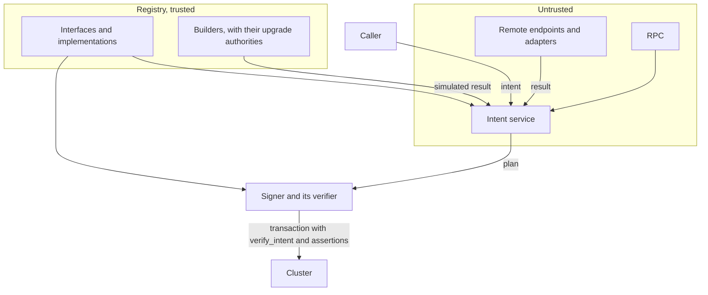

# Intents

Status: draft, working prototype. Owner: Noah Prince. Approvers: to be named.

Template: Foundation "Design Document Template", with SDLC §2, §3.1, §11, §13, and §15. Section 9
lists the gates for production.

## 1. Summary

Intents fix a set of security and convenience problems, in SDP and across Solana.

1. **A transaction is readable, and the transaction proves what it says.** A signer reads one
   message, such as `transfer 100 of <mint> from A to B`. `verify_intent` and Lighthouse
   assertions in the same transaction prove that message (4.6).
2. **A protocol ABI change does not break SDP.** The instruction logic lives onchain, in a builder.
   The goal is a builder in each target program, which upgrades with the program (4.2).
3. **Interfaces cover many protocols.** An interface such as `vault.deposit` names inputs, outputs,
   and postconditions, as an Ethereum interface does. Each protocol implements it (4.1).
4. **SDP is not a kingmaker.** Anyone can publish an implementation. Each interface's approve
   authority keeps the vetted list that UIs show (4.10).
5. **No SDK for each protocol.** One planner builds every implementation from registry data (4.4).
6. **AI agents can discover operations.** The registry lists every interface and its approved
   implementations, with typed inputs, and needs no `getProgramAccounts` (4.10).
7. **Protocols fit the interfaces.** A protocol ships its implementation, so SDP maintains no code
   for each protocol (4.2).
8. **A compromised SDP cannot return a malicious transaction.** By default, `verify_intent`
   rebuilds the instructions onchain from the registry, and Lighthouse asserts each postcondition.
   A transaction that the implementation does not build, or that breaks a bound, fails (4.3, 4.6).

**How it works.** An interface declares an operation. An implementation says how one
protocol does it, with one recipe: a builder program, static instructions as data, or an HTTP
endpoint. An intent names an interface, an implementation, and inputs. `prepare` plans one or more intents
into one transaction with one message. The signer verifies the message from the transaction and
the registry, and never trusts the service.

## 2. Problem

1. Each SDP module builds transactions its own way. Each Earn provider repeats the checks
   `assertPlanTargetsCluster`, `sponsoredPrograms`, and `requireAcceptedPlan`.
2. An approver sees bytes or a simulation. No checked statement says what the transaction does.
3. Real operations need logic: Token-2022 extensions, reserve walks, and withdrawal legs. A
   template language that expresses them becomes a programming language, and a program already is
   one. So the static language stays small, and builders do the rest.

Custody and signing are out of scope (section 12). A plan that states the operation and its bounds
lets signing move out of SDP later.

## 3. Requirements

| ID | Requirement | Section |
| :-- | :-- | :-- |
| R1 | An interface declares inputs, outputs, a display, and postconditions. It names no program or account. | 4.1 |
| R2 | An implementation has `applies` checks, a message template, added postconditions, a cluster, and one recipe. | 4.1, 4.2 |
| R3 | An intent names an interface, an implementation, inputs, and options. A plan request names the payers, the priority fee, and the cluster. `prepare` refuses an unapproved version unless the intent allows it. | 4.1, 4.10 |
| R4 | A static recipe has no conditions or loops. | 4.2 |
| R5 | A builder returns instructions and outputs, or a refusal, in a zero-copy layout. Onchain it returns a hash. Its accounts are readonly and include no payer. | 4.2 |
| R6 | A remote endpoint returns instructions, or a whole transaction that the provider signed. | 4.16 |
| R7 | The service checks every plan against the postconditions and the payer rules, and adds them as assertions. | 4.5 |
| R8 | A plan reads every value-bearing account live, with the fewest RPC calls (`AGENTS.md`, "RPC is a budget"). | 4.4 |
| R9 | A wallet program can run static and program recipes onchain. | 4.7 |
| R10 | Each document has one canonical zero-copy binary form, within fixed limits. | 4.9 |
| R11 | A spec change leaves published documents and messages valid. | 4.8 |
| R12 | A registry program holds organizations, interfaces, implementations, versions, and approvals. | 4.10 |
| R13 | By default, each transaction proves onchain that its instructions are what the implementation builds. An intent can opt out. | 4.6 |
| R14 | `prepare` returns a v1 transaction, or the instructions alone for a caller that compiles legacy, v0, or v1. | 4.1 |
| R15 | The definitions live in this repository as JSON. A CLI lints them and applies them with a key or a Squads proposal. | 4.13 |
| R16 | A playground explores the registry and plans intents from a typed form. | 4.14 |

## 4. Design

### 4.1 Model

The examples are one chain for a PYUSD transfer. "…" shortens addresses and bytes.

**Intent.**

```json
{
  "spec": "sdp-intents@1.0",
  "kind": "intent",
  "interface": "solana.org/token.transfer@^1",
  "implementation": "solana.org/token-2022-transfer@^1",
  "inputs": { "from": "7xKX…", "to": "9aBc…", "mint": "2b1kV6…", "amount": "100000000", "memo": null }
}
```

An intent is the operation only, in base units. `options` can turn off an onchain check
(`assertions`, `verifyIntent`) or set `allowUnapproved` (4.10). Both checks are on by default.

**Plan request.**

```json
{
  "spec": "sdp-intents@1.0",
  "kind": "plan",
  "payers": { "fee": "KoRa…" },
  "cluster": "mainnet",
  "options": { "priorityFeeLamports": "5000", "output": "transaction" },
  "intents": [{ "interface": "…", "implementation": "…", "inputs": { … } }]
}
```

1. `payers.rent` defaults to `fee`.
2. `cluster` is `mainnet`, `devnet`, `testnet`, or a genesis hash. Each implementation must be for it.
3. `output` is `transaction`, the default, or `instructions`. With `instructions`, the plan holds no
   transaction, and `prepare` reads no blockhash. The caller compiles a legacy, v0, or v1
   transaction. It must keep each segment whole and in order, keep the payers, and set the compute
   budget. `verify_intent` finds its segment after itself in the instructions sysvar, so the
   version does not matter. A provider's signed transaction (4.16) has no instructions, so
   `prepare` refuses `instructions` for it.

**Interface.**

```json
{
  "spec": "sdp-intents@1.0",
  "kind": "interface",
  "id": "solana.org/token.transfer",
  "version": "1.0.0",
  "inputs": [
    { "name": "from", "type": "address", "signer": true },
    { "name": "to", "type": "address" },
    { "name": "mint", "type": "mint" },
    { "name": "amount", "type": "u64", "display": { "amount": { "mint": "{inputs.mint}" } } },
    { "name": "memo", "type": "string", "optional": true }
  ],
  "outputs": [],
  "display": "Send {inputs.amount} {inputs.mint} to {inputs.to}",
  "postConditions": [
    { "outflow": { "from": "{inputs.from}", "mint": "{inputs.mint}", "max": "{inputs.amount}" },
      "message": "{inputs.from} sends at most {inputs.amount} of {inputs.mint}" },
    { "noOtherOutflows": { "from": "{inputs.from}" }, "message": "nothing else leaves {inputs.from}" }
  ]
}
```

Postconditions in the interface bound every implementation. Inputs have value types and no
encoding. An output, such as a vault's share mint, comes from the recipe, so a postcondition on an
output trusts the recipe (4.3).

**Implementation, builder.**

```json
{
  "spec": "sdp-intents@1.0",
  "kind": "implementation",
  "id": "solana.org/token-2022-transfer",
  "version": "1.0.0",
  "cluster": "mainnet",
  "implements": "solana.org/token.transfer@^1",
  "applies": [{ "account": "{inputs.mint}", "owner": "TokenzQdBNbLqP5VEhdkAS6EPFLC1PHnBqCXEpPxuEb" }],
  "message": "transfer {inputs.amount} of {inputs.mint} from {inputs.from} to {inputs.to}",
  "recipe": {
    "kind": "program",
    "program": "2gMFoKF3p5eB2m72ccjncZH8e5agVYbHBH8A29zDMdBm",
    "accounts": [
      { "name": "mint", "address": "{inputs.mint}" },
      { "name": "from", "address": "{inputs.from}" },
      { "name": "to", "address": "{inputs.to}" },
      { "name": "source", "address": { "ata": { "owner": "{inputs.from}", "mint": "{inputs.mint}", "tokenProgram": "TokenzQd…" } } },
      { "name": "destination", "address": { "ata": { "owner": "{inputs.to}", "mint": "{inputs.mint}", "tokenProgram": "TokenzQd…" } } }
    ],
    "data": [
      { "value": "bd1c9adb8ca2623c", "encoding": "hex" },
      { "value": "{inputs.amount}", "encoding": "u64le" },
      { "value": "{inputs.memo}", "encoding": "borsh" },
      { "value": "{builder.bumps}", "encoding": "borsh" }
    ]
  },
  "postConditions": [
    { "invokesOnly": ["TokenzQd…", "ATokenGP…", "MemoSq4g…"], "message": "only Token-2022, ATA, and Memo instructions run" }
  ]
}
```

1. `message` is the template that the signer reads. A builder returns no message.
2. The implementation derives the ATAs, so the builder gets every account in its first round.
3. An implementation adds postconditions to the interface's, and cannot remove one.
4. An implementation id names the operation, not the recipe. One builder program can serve several implementations.

**Implementation, static.** An SPL Token transfer needs no builder:

```json
"recipe": {
  "kind": "static",
  "accounts": [
    { "name": "rentPayer", "address": "{payers.rent}", "writable": true, "signer": true },
    { "name": "from", "address": "{inputs.from}", "signer": true },
    { "name": "to", "address": "{inputs.to}" },
    { "name": "mint", "address": "{inputs.mint}" },
    { "name": "systemProgram", "address": "11111111111111111111111111111111" },
    { "name": "tokenProgram", "address": "TokenkegQfeZyiNwAJbNbGKPFXCWuBvf9Ss623VQ5DA" },
    { "name": "source", "writable": true, "address": { "ata": { "owner": "{inputs.from}", "mint": "{inputs.mint}", "tokenProgram": "{accounts.tokenProgram}" } } },
    { "name": "destination", "writable": true, "address": { "ata": { "owner": "{inputs.to}", "mint": "{inputs.mint}", "tokenProgram": "{accounts.tokenProgram}" } } }
  ],
  "instructions": [
    { "program": "ATokenGPvbdGVxr1b2hvZbsiqW5xWH25efTNsLJA8knL",
      "accounts": ["rentPayer", "destination", "to", "mint", "systemProgram", "tokenProgram"],
      "data": [{ "value": "01", "encoding": "hex" }] },
    { "program": "TokenkegQfeZyiNwAJbNbGKPFXCWuBvf9Ss623VQ5DA",
      "accounts": ["source", "mint", "destination", "from"],
      "data": [
        { "value": "0c", "encoding": "hex" },
        { "value": "{inputs.amount}", "encoding": "u64le" },
        { "read": { "account": "{accounts.mint}", "owner": "Tokenkeg…", "offset": "44", "length": "1" } }
      ] }
  ]
}
```

The first instruction creates the destination ATA when it does not exist. The second is
`transferChecked`, with the decimals read from byte 44 of the mint.

**Plan.**

```json
{
  "spec": "sdp-intents@1.0",
  "kind": "plan",
  "request": { "…": "…" },
  "message": "sdp-intents/1 on mainnet || 1: transfer 100 of 2b1kV6… from 7xKX… to 9aBc… | interface: solana.org/token.transfer@1.0.0 | implementation: solana.org/token-2022-transfer@1.0.0 | tier 1 | onchain checks: verify_intent, assertions | rent cap 2039280 lamports || fee and rent payer KoRa… | priority fee 5000 lamports",
  "intents": [{ "display": "Send 100 PYUSD to 9aBc…", "digests": { "…": "…" }, "builder": { "program": "2gMF…" }, "verify": 0, "span": { "start": 2, "end": 4 } }],
  "signers": [{ "address": "KoRa…", "role": "payer:fee" }, { "address": "7xKX…", "role": "input:from" }],
  "priorityFeeLamports": "5000",
  "instructions": [{ "programAddress": "…", "accounts": [{ "address": "…", "role": 1 }], "data": "…" }],
  "computeBudget": { "unitLimit": "61000", "loadedAccountsDataSizeLimit": "131072", "heapSize": "32768" },
  "transaction": { "version": 1, "messageBytes": "gQIA…", "lastValidBlockHeight": "289104452", "presigned": [] },
  "simulation": { "unitsConsumed": "62646", "unitsByInstruction": ["28851", "…"] },
  "rpcCalls": { "getMultipleAccounts": 1, "simulateTransaction": 0, "getLatestBlockhash": 1 }
}
```

1. `message` is what a signer signs once, such as on a Ledger. It names the cluster, then each
   intent after `|| <n>:` (the implementation's template, the ids, the tier, the onchain checks, and the
   rent cap), then the payers and the priority fee.
2. An id is `organization/name@version`. The registry never publishes a version twice, so an id
   names one document, and the message holds no digest. The guarantees are in the documents, which
   a UI shows, so the message leaves them out.
3. A Ledger signs at most 1,212 bytes, so `prepare` refuses a longer message.
4. `instructions` is the `EarnVaultInstruction` shape: base58 addresses, numeric `AccountRole`
   values, and base64 data. `transaction.messageBytes` is Solana's wire form.
5. `verify` is the position of the intent's `verify_intent`, and `span` the positions of its built
   instructions (4.6).
6. `prepare` compiles a v1 transaction (SIMD-0385) and sets the compute unit limit and the loaded
   data size from the simulation. A provider's transaction keeps its own version.
7. `rpcCalls` counts the requests of this plan only (4.4).

### 4.2 Recipes and the builder ABI

| Kind | Form | Use |
| :-- | :-- | :-- |
| `program` | A builder instruction, simulated | The preferred kind |
| `static` | Accounts and instructions as data | A stopgap for a program with no builder, for an operation unlikely to change |
| `remote` | An HTTP endpoint (4.16) | Offchain search, such as a swap route, or a provider that must sign |

**Preferred recipe.** A builder in the target program ships with the instruction that it builds,
so a protocol upgrade cannot leave its implementations behind. SDP builders and static implementations fill the
gap, and SDP deprecates them when a protocol ships its own.

**Selection.** An intent always names its implementation. A UI picks one with `applies`, at most 4 hints
that all must hold.

| Hint | Form |
| :-- | :-- |
| Owner | `{ "account": "{inputs.mint}", "owner": "…" }` |
| Owner and discriminator | The owner, and data that starts with `"discriminator"`, at most 8 bytes |
| Input present | `{ "value": "{inputs.memo}", "present": false }` |
| Input equals | `{ "value": "{inputs.mint}", "equals": "11111111111111111111111111111111" }` |

`prepare` and `verify_intent` enforce each hint. `implementationsFor` returns each approved implementation
with a status: `applies`, `doesNotApply` (a hint fails), `invalidInputs`, or `unknown`. An implementation
that does not read an optional input refuses one, because it cannot fail on it.

**Values.** A string that is exactly one reference names a value: `"{inputs.memo}"`,
`"{outputs.shareMint}"`, `"{payers.rent}"`, `"{accounts.vault}"`, or `"{builder.bumps}"`. Any other
string is a literal, and `{{` and `}}` are literal braces.

| Address source | Form |
| :-- | :-- |
| Value | `"{inputs.to}"`, `"{payers.rent}"` |
| Static | A base58 literal |
| PDA | `{ "pda": { "program": "…", "seeds": [ segments ] } }` |
| ATA | `{ "ata": { "owner": "…", "mint": "…", "tokenProgram": "…" } }` |
| Has one | `{ "hasOne": { "account": "{accounts.vault}", "owner": "…", "offset": "8" } }`: 32 bytes of an earlier account that `owner` owns |

| Segment | Form |
| :-- | :-- |
| Literal | `{ "value": "02000000", "encoding": "hex" }` |
| Reference | `{ "value": "{inputs.amount}", "encoding": "u64le" }` |
| Account bytes | `{ "read": { "account": "…", "owner": "…", "offset": "44", "length": "1" } }`, at most 32 bytes |

Encodings: `u8` to `u128le`, `i8` to `i128le`, `bool`, `address`, `utf8` (no length), `borsh`
(every type, and the only one for an optional value), and `hex` (literals only). A discriminator
is a literal. The compiler rejects an encoding too small for the type.

**Limit of the static language.** No conditions, loops, variable-length lists, or extension checks.
An implementation that needs more uses a builder. Most drift fails closed: a changed account list or layout
fails the simulation. A reused discriminator with a new meaning passes, within the postconditions.

**Builder instruction.** The ABI is the `no_std` crate `sdp-intents-spec`. `sdp-intents-builder`,
over pinocchio, writes the results. SDP builders use Anchor v2, which reads arguments as borsh.

1. Accounts: the implementation's accounts, then the accounts of earlier `MoreAccounts` rounds. The implementation
   derives every account that its sources can express, so `MoreAccounts` is only for data that
   the static language cannot read, such as a TLV extension.
2. Every account is readonly, and none is a payer. A built instruction names the rent payer with
   `PAYER_RENT_PLACEHOLDER`. No instruction names the fee payer.
3. Data: the implementation's segments. `{builder.bumps}` passes the builder's bumps as a borsh `Vec<u8>`.

| Mode | When | Result |
| :-- | :-- | :-- |
| Staged | Stack height 1: only a simulation sends it | The full result in a scratch account, with a `ResultPointerV1` in return data |
| Hashed | Under CPI from `verify_intent` or a wallet | A `HashedReadyV1` in return data: the SHA-256 of the instruction section, then the outputs |

The simulation creates scratch first, 10,240 bytes owned by the builder. Nothing lands, so scratch
needs no key and no one pays its rent.

**Builder library.** One handler serves both modes:

```rust
pub fn build_transfer_v1(ctx: &mut Context<BuildTransferV1>, amount: u64, memo: Option<String>, bumps: &[u8]) -> Result<()> {
    let remaining = ctx.remaining_accounts();
    let mut build = Build::new(ctx.program_id, <BuildTransferV1 as TryAccounts>::HEADER_SIZE, &remaining, bumps)?;
    let Some(hook_accounts) = build.require_accounts(&hook_addresses)? else {
        return Ok(build.finish()?);
    };
    let destination = build.create_associated_token_account_idempotent(to, mint, &TOKEN_2022)?;
    build.transfer_checked(&TransferChecked { destination: &destination, /* … */ })?;
    Ok(build.finish()?)
}
```

1. `require_accounts` returns `None` when the caller did not pass the accounts, and `finish` then
   writes `MoreAccounts`. In hashed mode a missing account is an error.
2. `refuse(code, message)` writes `Refused` in staged mode and fails in hashed mode.
3. `program_address` and `associated_token_address` derive addresses. In staged mode each searches
   for the canonical bump, and `Ready` returns the bumps in order. In hashed mode each takes the next
   stated bump, with the canonical check of 4.6. A bump that is missing, not canonical, or left over
   fails the builder. The search lives in the library's `offchain` module, which does not compile
   for Solana.

**Result layout.** Every type is alignment-1 pod, read in place.

```rust
pub const RESULT_READY: u8 = 1;
pub const RESULT_MORE_ACCOUNTS: u8 = 2;
pub const RESULT_REFUSED: u8 = 3;
pub const RESULT_HASHED_READY: u8 = 4;
pub const PAYER_RENT_PLACEHOLDER: [u8; 32] = *b"sdp-intents/payer/rent\0\0\0\0\0\0\0\0\0\0";

#[repr(C)] pub struct ResultPointerV1 { pub kind: u8, pub account_index: u8, pub offset: PodU32, pub len: PodU32 }
#[repr(C)] pub struct ReadyHeaderV1 { pub num_instructions: u8, pub num_signers: u8, pub outputs_len: PodU16, pub num_bumps: u8 }
#[repr(C)] pub struct InstructionHeaderV1 { pub program: [u8; 32], pub num_accounts: u8, pub data_len: PodU16 }
#[repr(C)] pub struct AccountMetaV1 { pub address: [u8; 32], pub role: u8 }
#[repr(C)] pub struct HashedReadyV1 { pub kind: u8, pub instructions_hash: [u8; 32], pub num_instructions: u8, pub num_signers: u8, pub outputs_len: PodU16 }
```

| Result | Bytes |
| :-- | :-- |
| `Ready` | Header, the outputs in borsh, 32 bytes for each signer, one byte for each bump, then the instruction section: for each instruction, its header, its `AccountMetaV1` entries, and its data |
| `MoreAccounts` | A count, then 32 bytes for each address. At most 4 rounds and 64 accounts. |
| `Refused` | Code length, message length, the code, and the message |

A signer is a new account that the service signs for. Return data holds 1,024 bytes, so the
signers and outputs of `HashedReadyV1` fit in 987.

**Builder rules.** A builder runs only in simulation and under CPI from `verify_intent`. It gets
every account readonly and unsigned, so it changes nothing. A changed call is a new instruction,
such as `build_deposit_v2`.

### 4.3 Trust

| Recipe | Trusted as |
| :-- | :-- |
| Static | Data in the registry |
| Program | Code, with its upgrade authority |
| Remote | An operator (4.16) |

The postconditions and the payer rules (4.5) bound the instructions of every recipe. Outputs and
refusals trust the recipe. The message comes from the implementation, and the display from the interface.

**No pins.** Trust in an implementation includes its builder's upgrade authority, so a pin adds nothing, and
would stop `prepare` at each upgrade. A builder in the target program adds no trust. An SDP builder
adds SDP's multisig. A customer that requires fixed code accepts only builders with no upgrade
authority. The plan records each builder for audit.

### 4.4 Simulation and RPC

The planner runs `prepare` with no IO. It returns each fetch, simulation, and remote call, and its
caller answers. The client answers over RPC. The service answers from an account cache in
`intents/crates/chain`, and simulates in LiteSVM over that cache. `--simulate-on-rpc` uses
`simulateTransaction` instead. LiteSVM runs every feature, so a feature that the cluster has not
activated can change a result.

**Plans.** The planner plans each intent in order, as one segment. Each simulation runs the earlier
segments first, so a builder reads the state that `verify_intent` reads onchain. A segment's
simulation runs with a placeholder rent cap. The planner then writes the measured cap, the only
byte that differs from the landed transaction. The last simulation sets the budget.

**RPC.** Every read goes through the cache. Concurrent reads of one account share one fetch, and
the cache never stores a failure.

1. At start, the service follows the registry's organizations and indexes, and the programs and
   fixed accounts that the implementations name, with their program data. It pins each version account,
   which never changes while it exists.
2. The planner's first fetch asks for what the recipe needs, every account that it already
   resolved, and the clock. The service does not follow the clock, because a cluster need not
   notify each change of a sysvar, and a stale clock fails a program that checks time.
3. Each further `hasOne` level, and each builder round, adds one call.

| Flow | `getMultipleAccounts` | Simulations |
| :-- | :-- | :-- |
| SPL Token transfer | 1 | 1 |
| USDC and SOL transfers in one plan | 2 | 2 |
| Kamino deposit | 2 | 3 |

`simulation.unitsByInstruction` reads each instruction's compute units from the final
simulation's logs. A builtin program logs none, so its entry is `null`.

### 4.5 Signers, payers, and verification

| Signer | Declared in |
| :-- | :-- |
| `input:<name>` | An interface input with `"signer": true` |
| `payer:fee`, `payer:rent` | The plan request |
| `builder` | A builder's `Ready` result: a new account that the service signs for |
| `provider` | A provider's signed transaction (4.16) |

`verify` simulates the final transaction and checks:

1. Each postcondition of the interface and the implementation.
2. `noOtherOutflows`: no balance of a signer input goes down except as a postcondition allows.
3. No owner, delegate, or close authority of a signer input's token accounts changes, with no
   postcondition needed. `delegates` and `noDelegate` (4.15) are the only exceptions.
4. The fee payer loses at most the fee and the rent cap.
5. No instruction names a payer or a signer input, except as the fee payer, as the funder of a new
   account or an ATA create, or where the interface requires that signer.

Rules 4 and 5 and `invokesOnly` replace Kora's sponsorship checks and Earn's `sponsoredPrograms`.
An implementation's cluster replaces `assertPlanTargetsCluster`.

**Assertions.** Lighthouse (`L2TExMFKdjpN9kozasaurPirfHy9P8sbXoAN1qA3S95`, immutable) checks the
postconditions onchain. `sdp-intents-lighthouse` builds its instructions, so the planner and
`verify_intent` build the same bytes.

1. The guarded accounts are those that a built instruction names writable, and the fee payer.
2. Before the built instructions, `MemoryWrite` copies each bounded value: lamports, a token
   amount, or bytes 32 to 165 of a token account (owner, delegate, close authority).
3. After them, `AssertAccountDelta` fails unless each value moved within its bound. A new ATA gets
   `AssertTokenAccount` on its amount. `MemoryClose` returns memory's rent.
4. The rent cap is the rent-exempt minimum of each account that the simulation shows as new. It is
   in `verify_intent`'s data and in the message.

Lighthouse cannot sum several accounts, so a token flow is bounded on one account of its owner.

**Rendering.** The message is restricted ASCII on one line. It names a token by mint address,
because anyone can name a token "USDC", and renders an amount in decimal units for its mint. The
display can use token symbols. The longest plan in the e2e, two Hastra intents, is about 1,000
bytes, so a plan of three or more intents can exceed a Ledger's limit.

### 4.6 Verification in the transaction

Each intent is one segment:

```
[verify_intent] [MemoryWrite × S] [built × N] [assertion × M] [MemoryClose]
```

`verify_intent` is an instruction of the registry program, top-level, before its span. Its accounts,
all readonly, are the instructions sysvar, the payers, both indexes, both version accounts, the
implementation's accounts, a builder's extra accounts, and the guarded accounts. Its data is the intent, the
builder's roles, the outputs, the implementation's bumps, and the builder's bumps, each a borsh `Vec<u8>`,
then the layout: the rent cap and the counts of guarded accounts, snapshots, built instructions,
and checks. It refuses an output or a count that differs from what it derives.

It checks:

1. The registry owns both indexes and version accounts, they name the intent's documents, the
   version is approved unless the intent allows it, and the `applies` hints hold.
2. Each account of the implementation resolves to the account at its place.
3. Static recipe: it builds the instructions once and compares each with its place in the span,
   byte for byte.
4. Program recipe: it calls the builder in hashed mode, serializes the span with the rent payer
   mapped back to the placeholder, and compares the hash.
5. Remote recipe: it checks the assertions and each built program against `invokesOnly` (4.16).
6. It builds the Lighthouse instructions from the postconditions and the guarded accounts as they
   are now, and compares each with its place.
7. Each account's role in the sysvar is the union of its roles in the span, or a role that an
   instruction outside the segment explains.

A span that runs past the transaction or holds a registry instruction fails. A state change between
`prepare` and landing changes the built instructions, and the transaction fails.

**Bumps.** Only the canonical bump is supported. The plan states each PDA's and ATA's bump.
`verify_intent` derives each address with one SHA-256, and checks that the hash is off the curve
and that the hash of each higher bump is on it. Any other bump derives no address, so the plan
fails, and the signer's verifier refuses it (`NonCanonicalBump`). A bump is off the curve about
half the time, so the check costs about one extra pair. A search costs 1,500 compute units for each
bump that it tries.

**Cost.** `verify_intent` reads the registry's documents without the checks of `parse`, because
`publish` wrote them only after those checks passed. It builds the implementation's instructions once, and
each expected Lighthouse instruction on the stack. For an SPL Token transfer it costs about 27,000
to 29,000 compute units, down from 34,000 to 44,000. The whole transaction costs about 62,600, of
which 18,000 creates the receiver's new ATA and 15,000 is Lighthouse.

**Signer.** A signer renders the message from the transaction and the registry, never from the
service. `verify_transaction` in the planner does it with no IO, and `Client::verify_message`
answers over RPC: the lookup tables of a v0 message, the version and organization accounts, and the
accounts that each recipe reads. It takes a message or a transaction of any version. A legacy or
v0 fee is the unit price times the limit, rounded up. Each instruction outside every span shows as
unverified. An intent with `verifyIntent` off has no onchain form, and its part says
`onchain checks: none`.

**Limits.**

1. Without `verifyIntent`, the signer trusts the service for the instructions. Without
   `assertions`, the postconditions hold only in the simulation.
2. A builder sees no payer, so the rent payer reaches a built instruction only as the placeholder.
   A builder that names the rent payer's own address, such as an owner who also pays the rent,
   fails the hash. `prepare` refuses it with `RentPayerInRecipe`.
3. Outputs trust the builder.

### 4.7 Onchain execution

A multisig wallet with a PDA vault can run static and program recipes. The signers approve an
intent's message, and `execute` builds the instructions, as `verify_intent` does, signs with the
vault, and checks the postconditions. The wallet renders the message from the implementation, so no part
comes from a builder. clear-msig (`github.com/ChewingGlass/clear-msig`) is prior art.

A remote recipe has no onchain form. A builder upgrade between approval and execution changes what
runs, within the postconditions. The wallet must not enable CPI Guard, because a PDA signs only by
CPI. With such a wallet, a compromised SDP API can propose, and cannot move more than the
postconditions allow.

### 4.8 Versions and compatibility

Interfaces and implementations use semver, and a version is published once. An intent can name a range,
which resolves against the head (4.10). `prepare` pins the exact version.

| Change | Interface | Implementation |
| :-- | :-- | :-- |
| Major | An input or output removed or retyped, or a postcondition loosened | A new builder, call, or endpoint, a changed static instruction, or a loosened postcondition |
| Minor | An optional input added, or a postcondition tightened | A postcondition tightened, or an optional input handled |
| Patch | Message wording | Message wording |

**Spec version.** Each document states `"spec": "sdp-intents@major.minor"`. A minor version only
adds, and a reader refuses a newer minor than it knows. The message prefix `sdp-intents/1` carries
the major version. A reader rejects an unknown key or code, because an ignored check is a loosened
check.

**Value types.** `u8` to `u128`, `i8` to `i128`, `bool`, `address`, `mint`, `string`, `bytes`, and
arrays of them. In JSON an integer is a string, an address is base58, and an absent value is `null`.

### 4.9 Binary form and limits

The binary form is canonical. JSON is the authoring form, and `sdp-intents-compiler` compiles it.
The registry and onchain readers use only the binary form.

1. Each table is an array of one fixed-size alignment-1 entry type, read in place as `&[T]`.
2. A variant is a tag and a 6-byte payload of indexes. A list is a `RangeV1` into another table.
3. Addresses are in one table and named by 1-byte index. Only names, templates, and literals are
   in the byte pool. There are no optional fields.
4. A view holds references only, allocates nothing, and fits the 4 KB SBF stack frame. `parse`
   checks every table, code, index, and range once. `parse_published` skips those checks for a
   document that the registry published. An accessor still fails on an index out of bounds.

```rust
#[repr(C)] pub struct DocumentHeaderV1 { pub magic: [u8; 4], pub spec_major: u8, pub spec_minor: u8, pub kind: u8, pub body_len: PodU16, pub extension_len: PodU16 }
#[repr(C)] pub struct DocumentIdV1 { pub publisher: [u8; 32], pub name_hash: [u8; 32], pub major: PodU16, pub minor: PodU16, pub patch: PodU16 }
#[repr(C)] pub struct PoolRefV1 { pub offset: PodU16, pub len: PodU16 }
#[repr(C)] pub struct TableRefV1 { pub offset: PodU16, pub count: u8 }
#[repr(C)] pub struct RangeV1 { pub first: u8, pub count: u8 }
#[repr(C)] pub struct ValueRefV1 { pub source: u8, pub index: u8 }

#[repr(C)]
pub struct ImplementationDocV1 {
    pub header: DocumentHeaderV1,
    pub id: DocumentIdV1,
    pub implements: DocumentIdV1,
    pub cluster: [u8; 32],
    pub recipe_kind: u8,
    pub name: PoolRefV1,
    pub message: PoolRefV1,
    pub url: PoolRefV1,
    pub applies: TableRefV1,
    pub post_conditions: TableRefV1,
    pub addresses: TableRefV1,
    pub accounts: TableRefV1,
    pub seeds: TableRefV1,
    pub instructions: TableRefV1,
    pub instruction_accounts: TableRefV1,
    pub segments: TableRefV1,
    pub output_bindings: TableRefV1,
    pub literals: TableRefV1,
    pub pool: PoolRefV1,
}

#[repr(C)] pub struct AppliesV1 { pub kind: u8, pub value: ValueRefV1, pub owner: u8, pub discriminator_len: u8, pub discriminator: [u8; 8] }
#[repr(C)] pub struct PostConditionV1 { pub check: u8, pub args: [ValueRefV1; 3], pub programs: RangeV1, pub message: PoolRefV1 }
#[repr(C)] pub struct AccountV1 { pub name: PoolRefV1, pub flags: u8, pub source: u8, pub payload: [u8; 6] }
#[repr(C)] pub struct SegmentV1 { pub source: u8, pub encoding: u8, pub payload: [u8; 6] }
#[repr(C)] pub struct InstructionV1 { pub program: u8, pub accounts: RangeV1, pub segments: RangeV1 }
#[repr(C)] pub struct OutputBindingV1 { pub output: u8, pub account: u8 }
#[repr(C)] pub struct LiteralV1 { pub value_type: u8, pub bytes: PoolRefV1 }
```

`InterfaceDocV1` holds the id, name, display, inputs, outputs, postconditions, addresses, and a
flag for async settlement (4.15). `IntentDocV1` holds both ids at exact versions, the option flags,
and each input in borsh.

| Code | Values |
| :-- | :-- |
| `ValueRefV1` source | `0` none, `1` input, `2` output, `3` payer (`0` fee, `1` rent), `4` account, `5` address, `6` literal, `7` builder bumps |
| Account source | `1` value, `2` static, `3` PDA, `4` ATA, `5` has one |
| Segment source | `1` literal, `2` reference, `3` account bytes |
| Check | `1` outflow, `2` inflow, `3` `noOtherOutflows`, `4` `noAuthorityChange`, `5` `invokesOnly`, `6` `delegates`, `7` `noDelegate` |
| Recipe | `1` static, `2` program, `3` remote instructions, `4` remote transaction |
| Value type | `1` to `10` integers, `11` bool, `12` address, `13` mint, `14` string, `15` bytes, `0x80` plus a code for an array |

Only a program recipe's builder call can name source `7`. The compiler is deterministic: a
decompile and compile gives the same bytes.

| Limit | Value |
| :-- | :-- |
| Document | 10,000 bytes, so a version account fits a 10,240-byte CPI allocation |
| Byte pool, template | 4,096 and 256 bytes |
| Inputs, outputs, postconditions, literals | 16, 8, 8, 16 |
| `applies` hints | 4 |
| Programs, accounts, seeds, instructions, segments | 16, 32, 32, 12, 48 |
| `hasOne` depth, builder rounds | 4, 4 |

### 4.10 Registry

The registry is an Anchor v2 program with zero-copy accounts. A deployment serves one cluster,
which the build sets: mainnet by default, devnet or testnet by feature, because a program cannot
read the genesis hash. `sdp-intents-spec` holds the one table of cluster names and hashes, which
programs and offchain code share. `publish` refuses an implementation for another cluster (`WrongCluster`).

An organization owns interfaces and implementations. Anyone can create an organization, with a name that
is first come, and anyone can propose an implementation for any interface. Each interface's approve
authority approves the implementations that UIs show.

| Account | Seeds | Contents |
| :-- | :-- | :-- |
| `OrganizationV1` | `"org"`, SHA-256 of the name | Authority and name |
| `VersionIndexV1` | `"index"`, kind, organization, name hash | Authorities, head, versions, and approved implementations |
| `InterfaceV1`, `ImplementationV1` | Kind seed, organization, name hash, version | Publish slot and the document |
| `BufferV1` | `"buffer"`, writer, a `u32` | A document while it uploads |

```rust
#[repr(C)] pub struct VersionEntryV1 { pub version: SemverV1, pub publish_slot: PodU64, pub approved: PodBool, pub removed: PodBool, pub tier: u8 }

#[repr(C)]
pub struct VersionIndexV1 {
    pub kind: u8,
    pub organization: Address,
    pub name_hash: [u8; 32],
    pub update_authority: Address,
    pub approve_authority: Address,
    pub interface: Address,
    pub approve_new_versions: PodBool,
    pub has_head: PodBool,
    pub head: SemverV1,
    pub version_count: PodU32,
    pub approved_count: PodU32,
}
```

1. An index ends with two unbounded lists: its sorted version entries, then the addresses of an
   interface's approved implementations. Discovery needs no `getProgramAccounts`.
2. An authority of `Address::default()` means the organization's authority.
3. A version of an implementation is approved when the interface's list holds the implementation and the version's
   `approved` is set. Only the interface's approve authority changes either.
4. With `approve_new_versions`, `publish` approves a new version of an approved implementation, unless its
   trust tier (4.16) is worse than the highest approved version's.
5. A range resolves to the highest version that is not above the head. A version above the head is
   reachable only by its exact version, so a publisher can test before `set_head`.
6. `remove` closes a version account and keeps its entry, so no one can publish that version again.
   `publish` refuses a version that exists. An id therefore names one document forever.
7. A stolen update authority can publish, move the head, and remove. It cannot change a published
   version, and the approve authority can unapprove at any time.

| Instruction | Signer | Effect |
| :-- | :-- | :-- |
| `create_organization` | Any payer | Creates an organization |
| `set_organization_authority` | Organization authority | Changes it |
| `create_interface`, `create_implementation` | Organization authority | Creates an index |
| `set_update_authority`, `set_approve_authority` | That authority | Changes it |
| `write_buffer`, `close_buffer` | Any key, the buffer's writer | Uploads a document in parts |
| `publish` | Update authority | Checks the buffer's SHA-256, `parse`, the limits, the ids, and the cluster, then creates the version account |
| `set_head`, `remove` | Update authority | Moves the head, or removes a version that is not the head |
| `approve_*`, `unapprove_*`, `set_approval_policy` | Interface's approve authority | Approves implementations and versions |
| `verify_intent` | None | Checks the transaction (4.6) |

### 4.11 Token transfers

| Implementation | Recipe | For |
| :-- | :-- | :-- |
| `system-transfer` | Static | Native SOL: the System program as the mint, selected by an `equals` hint |
| `spl-token-transfer` | Static | An SPL Token mint, with no memo |
| `token-2022-transfer` | Builder | A Token-2022 mint |

The `token-2022-builder` handles each extension with `spl-token-2022`. No interface names an
extension.

| Extension | Builder |
| :-- | :-- |
| `TransferHook` | Resolves the extra accounts, in rounds |
| `MemoTransfer` on the destination | Adds the memo, or refuses with `memoRequired` |
| `TransferFeeConfig` | Uses `transferChecked`. The display shows the amount after the fee. |
| `NonTransferable`, paused `Pausable`, `InterestBearingConfig`, `ScaledUiAmountConfig` | Refuses |
| `PermanentDelegate` | The display warns that the delegate can move the tokens |

SDP sends from the owner's largest token account. The implementations use the owner's ATA, because a recipe
cannot search accounts by owner.

### 4.12 Earn precedent

`EarnVaultTransactionPlan` already splits building from signing.

| Earn plan | This design |
| :-- | :-- |
| `EarnVaultInstruction` | The same shape |
| `assetIdentity` against the catalogue | The `asset` input and the `shareMint` output, bounded by postconditions |
| `providerTransaction` | A provider's signed transaction, at tier 3 (4.16) |
| `sponsoredPrograms(cluster)` | `invokesOnly` |
| Capabilities by method presence | Separate interfaces, such as `vault.deposit` and `vault.withdraw` |
| An SDK per provider | A builder per provider, ideally in the provider's program |

ADR 0002, "money out beats money off", becomes a registry rule: no `vault.deposit` implementation without a
`vault.withdraw` implementation for the same vaults.

### 4.13 Definitions and CLI

The definitions live in `intents/definitions/<organization>/` as JSON: `organization.json`, and for
each interface and implementation an `index.json` (authorities, head, approval policy, and approvals) and
one file for each version. The repository is the source of truth, and the registry follows it.

| Command | Effect |
| :-- | :-- |
| `sdp-intents lint` | Checks the schema, the compile and round trip, references, encodings, `implements`, version bumps, and approvals |
| `sdp-intents plan` | Prints the steps that make the registry hold the definitions. It refuses a published version whose bytes differ. |
| `sdp-intents apply [--squads <multisig>]` | Sends those steps. With `--squads`, each step that needs an authority becomes a Squads proposal. `publish` carries the document's SHA-256, so members vote on exact bytes. |
| `sdp-intents prepare <request>` | Plans over RPC from the definitions, with no service |
| `sdp-intents verify <plan>`, `send <plan>` | Renders the message as the signer does, and lists unverified instructions. `send` signs and sends a plan that verifies. A plan of instructions alone compiles first, as `--version legacy\|0\|1` and `--lookup-table` say. |

Later, a GitHub workflow runs `lint` and `plan` on each pull request, and `apply --squads` on merge.

**Local run.** `just surfnet` starts surfpool, which forks mainnet. `just e2e` places the programs
with cheatcodes, publishes the definitions through a Squads multisig, then plans, verifies, and
sends every flow of 4.14 with both the service and the CLI (`e2e/run.mjs`).

### 4.14 Prototype

`intents/` holds two Cargo workspaces. The service workspace (`crates/`) holds the libraries and
tools, on Agave 4.3. The programs workspace (`programs/`) holds the onchain programs, the builder
library, and `program-testing`, with its own `Cargo.lock`, so Anchor v2 never unifies with the
service.

| Crate | Holds |
| :-- | :-- |
| `spec` | The binary documents, views, limits, builder ABI, and cluster table. `no_std`, `bytemuck` only. |
| `compiler` | JSON to binary, and the lint checks |
| `engine` | Binds an intent to its implementations, resolves accounts, and builds instructions. `no_std`, no heap. |
| `lighthouse` | The snapshots and assertions of a segment |
| `planner` | `prepare` and the signer's verifier, with no IO |
| `client` | The planner and verifier over RPC, every transaction version, and sending |
| `chain` | The account cache, its subscriptions, LiteSVM, and RPC counters |
| `service` | The JSON API over `chain` |
| `cli`, `registry-client` | The CLI, and the registry's instructions and views without Anchor |
| `test-provider`, `adapters/jupiter.mjs` | A provider that signs its own transaction, and the Jupiter swap wrapper |
| `programs/` | `registry`, `token-2022-builder`, `jupiter-lend-builder`, `kamino-builder`, `test-builder`, `test-transfer-hook` |

**Flows.** Each lands in the e2e with every onchain check that its tier allows.

| Interface | Implementations | Recipe |
| :-- | :-- | :-- |
| `token.transfer` | `system-transfer`, `spl-token-transfer`, `token-2022-transfer` | static, builder |
| `vault.deposit`, `vault.withdraw` | `jupiter-lend-*`, `kamino-*` | builder |
| `vault.deposit`, `vault.withdraw` | `ondo-usdy-*`, through the Jupiter wrapper | remote, tier 2 |
| `vault.deposit`, `vault.withdraw`, `vault.requestWithdrawal`, `vault.cancelRequest` | `hastra-*` | static |
| `vault.requestDeposit` | `test-provider-deposit`, as legacy, v0 with a lookup table, and v1 | remote, tier 3 |

The e2e also compiles a plan of instructions alone as legacy, v0, and v1, and refuses a remote
endpoint that adds a token approval to an attacker.

**Service.** `sdp-intents-service --rpc <url>` reads every document from the registry. With
`--wallets <folder>` it also signs with local keypairs, for the playground.

| Route | Body | Returns |
| :-- | :-- | :-- |
| `GET /v1/registry` | | Every organization, interface, and implementation, each described |
| `POST /v1/prepare` | A plan request | The plan, with its RPC calls |
| `POST /v1/verify` | A message or a transaction of any version, and the plan's message | What the transaction proves |
| `POST /v1/implementations` | `{ interface, inputs, payers, all }` | Each implementation, with its status |
| `GET /v1/wallets`, `POST /v1/send` | A message or a transaction | The local wallets, and a send |
| `GET /metrics` | | Requests, RPC calls, and cache reads |

**Playground.** `apps/intents-playground` explores the registry as an API explorer does: an
interface is an endpoint, an implementation is a provider, and an intent is the request. It runs against a
local surfnet and is never deployed (`apps/intents-playground/README.md`).

1. The left pane lists organizations, interfaces, and implementations, with version, recipe, and approval.
2. The center pane is the interface: a typed form, the guarantees, and each implementation's status.
3. The Intent tab shows the intent, `prepare` snippets, the plan with each instruction's compute
   units, `verify`, and `send`. A switch asks for instructions alone. Each signature and address
   links to Solana Explorer.
4. The Implementation tab shows the definition file, the cluster, and the bytes that the registry holds.
5. Two switches show the checks: a malicious remote endpoint, which the assertions refuse, and a
   tampered plan, which `verify_intent` refuses onchain.

### 4.15 Async settlement

Some providers take the money now and settle later: an order at the next NAV strike, a cross-chain
mint, or a redemption that an operator pays. An interface with `"settlement": "async"` is a request.
The message says "settles later, outside this transaction".

| Interface | Providers |
| :-- | :-- |
| `vault.requestDeposit` | WisdomTree subscription, Plume mint |
| `vault.requestWithdrawal` | Hastra par redemption, WisdomTree and Plume redemptions |
| `vault.cancelRequest` | Hastra `cancel_redeem`, Plume cancellation |

1. A request bounds only what leaves the owner. It never promises an inflow that settles later.
2. `delegates { from, mint, to, max }` lets `to` take at most `max` from the owner's accounts of
   the mint, the one authority change that rule 3 allows. `noDelegate { from, mint }` states that
   no delegate remains. Lighthouse asserts both.
3. An implementation pins where the money goes, such as WisdomTree's standing wallet for each fund and
   currency. A new wallet is a new version, which the approve authority approves.
4. The plan returns the request. Earn's order tracking follows the settlement.

Hastra's flows are static, at tier 1. A par redemption is one plan of two intents: an unstake from
PRIME to wYLDS, then a `vault.requestWithdrawal` of that wYLDS. Hastra's program makes the owner pay
the request account's rent, so those plans name the owner as the rent payer.

### 4.16 Remote recipes and trust tiers

A remote implementation names an endpoint. The request is `{ spec: "sdp-intents-remote@1", interface,
implementation, inputs, payers, priorityFeeLamports }`. The answer is one of two forms:

```json
{ "kind": "instructions", "instructions": [ … ], "outputs": { … } }
{ "kind": "transaction", "transaction": "<base64 wire transaction>" }
```

An SDP adapter wraps a provider that does not speak the protocol, and holds the provider's
credentials. The service and the signer check what it returns.

**Instructions** get the Lighthouse assertions, and `verify_intent` checks each built program
against `invokesOnly`, which a remote implementation must state.

**Transaction** is for a provider that must sign, such as Plume. The provider's signatures cover
the whole message, so the plan keeps it as it is:

1. It is the plan's only intent, with no `verify_intent` and no assertions.
2. It is legacy, v0, or v1. The verifier reads a v0 transaction's lookup tables, and the simulation
   runs the provider's message as it is.
3. The provider signs only for an account that the implementation lists, or a new account. It never signs
   for a payer or a signer input.
4. The fee payer is the request's. The priority fee is at most the request's, because a unit price
   can round the fee down.
5. The provider picks the blockhash, so a slow signer can miss it.
6. The signer's verifier plans the request again, with the provider's transaction as the answer,
   and checks every postcondition and payer rule in a new simulation.

| Tier | Recipes | Proves |
| :-- | :-- | :-- |
| 1 | Static, program | `verify_intent` rebuilds the instructions, and Lighthouse asserts the postconditions |
| 2 | Remote instructions | Lighthouse asserts the postconditions, and `verify_intent` limits the programs |
| 3 | Remote transaction | Only a simulation, by the service and by the signer |

The message names each part's tier. `prepare` refuses a tier 3 implementation unless the intent turns both
onchain checks off, so the weaker trust is the caller's explicit choice.

## 5. Security

_SDLC §2 · §3.1 · §11_

**Tier: Low** while no production file uses the service or its crates, nothing deploys beyond
local surfpool, and no mainnet key or provider credential loads. Otherwise **Critical**, because
builders and `verify_intent` decide fund movements. Section 9 lists the gates.

**Touches.** Public addresses and chain state. In production: customer addresses, amounts, and
counterparties.



| Dependency | Fails | Lies or goes stale | Disappears |
| :-- | :-- | :-- | :-- |
| Intent service | No plans | A false plan fails `verify_intent` or the assertions | No plans |
| Registry program | No plans | A `verify_intent` bug can pass a transaction within the assertions. A false approval shows a bad implementation, within the postconditions. | No new plans |
| Builder | `prepare` errors | Any instructions within the postconditions, and a false output | That implementation is unavailable |
| Builder upgrade | | Every implementation that names it follows, within the postconditions | |
| Static target program upgrade | | A changed layout fails. A reused discriminator passes, within the postconditions. | That implementation is unavailable |
| Remote endpoint | `prepare` errors | As a builder. At tier 3, the simulation is the only check. | That implementation is unavailable |
| RPC | `prepare` errors | A false account builds a wrong transaction that fails onchain, unless the intent opts out of the checks | No plans |
| Lighthouse | The transaction fails | A bug can pass a bad transaction. It is immutable. | Every guarded transaction fails |

**Worst case.** A compromised service can only stop plans, unless an intent opts out of the onchain
checks. A wrong builder emits the worst transaction that the postconditions allow. An interface
with loose postconditions is worse, because nothing bounds it. The registry's authorities and the
builders' upgrade authorities are the main assets.

| STRIDE | Where | Control |
| :-- | :-- | :-- |
| Spoofing | A false builder, version, or name | Organization accounts, approvals, and immutable versions |
| Tampering | Builder, remote, or RPC output, and instructions outside every span | `verify_intent`, the assertions, and the signer's verifier |
| Repudiation | Which code built a transaction | Exact versions and the builder in the plan |
| Information disclosure | Inputs to a remote endpoint | Only inputs and payers go out |
| Denial of service | Slow simulation, RPC, or endpoint | Round and compute limits, and timeouts |
| Elevation of privilege | A payer or signer input in a built instruction | The builder account rule (4.2) and rule 5 (4.5) |

**Known limits.** Outputs trust the recipe. Tier 2 instructions trust the endpoint within the
assertions. Tier 3 and an intent that opts out of the onchain checks trust the simulation.

## 6. Data classification

_SDLC §13 · §15_

| Data | Class | Where |
| :-- | :-- | :-- |
| Definitions, builder source, fixtures | Public | Repository |
| Playground inputs, local test keypairs | Internal, with no value on any cluster | Developer machine, process memory |

| Requirement | SDLC | Today | Gap |
| :-- | :-- | :-- | :-- |
| Encryption at rest | §13 | Not applicable. No Restricted data. | None |
| Hardware-backed access | §13 | Not applicable. No Restricted data. | None |
| Rotation | §6.4 | Not applicable. No credentials. | None |
| Inventory with owner and last rotation | §6.5 | Not applicable. Local program keypairs only. | None |
| Named human owner | §4 | Noah Prince | None |
| No credentials shared across environments | §12 | No credentials | None |

The prototype is not a production system, so it is not in the systems inventory (§15).

## 7. Monitoring

_SDLC §8.1_

`GET /metrics` counts requests by outcome, RPC calls by method, and cache reads. Production alerts on
`verify` failures, payer rule failures, builder upgrades, refusal rates, and simulation latency.

## 8. Platform controls

| Area | State |
| :-- | :-- |
| Toolchain (§3.2.3, §3.2.4) | `rust-toolchain.toml`, a `justfile`, and committed lockfiles in each workspace |
| Rust (§3.2.8) | `rustfmt.toml`, Clippy with `-D warnings`, and workspace lints. No `unwrap`, `expect`, `panic!`, or `unsafe`. |
| Programs (§3.2.1) | Checked arithmetic, and owner, PDA, and discriminator checks on every account read |
| New dependencies (§3.2.2) | Anchor v2 (`otter-sec/anchor`, by git revision), the Squads v4 client, `wincode`, `bytemuck`, `spl-token-2022`, `spl-tlv-account-resolution`, `kvault-interface`, `klend-interface`, `litesvm`, `axum`, `vite`, and `react`. All pinned exactly. |
| Deployment (§3.5) | Local surfpool only |

## 9. Gates before production

Production is a separate project with its own design document.

1. Critical tier (§2), internal security review, and external audit (§3.4.3) of the service, the
   registry with `verify_intent`, and every builder.
2. Builders and the registry deployed per §3.5.1: verified builds, IDLs, and multisig upgrade
   authorities. With no pins, the multisig is the control on builder code.
3. A threat model for the service and the registry (§3.1).
4. Monitoring as in section 7 (§8.1).
5. A review of Lighthouse: its audit, and how SDP handles an upgrade.
6. An audited Anchor v2 release, or a builder audit that covers it.

## 10. Status

| Built | Measured |
| :-- | :-- |
| The registry, the service, the CLI, the playground, and four builders | Every flow of 4.14 lands on a mainnet fork |
| `verify_intent` with static, program, and remote recipes | About 27,000 to 29,000 compute units for an SPL transfer |
| The warm cache and the first-fetch prefetch | One `getMultipleAccounts` for a cold SPL transfer |
| Every transaction version | Legacy, v0 with lookup tables, and v1 land through the CLI and the provider |

Not built:

1. The wallet program of 4.7.
2. A real Plume implementation, which needs a wallet that Plume approves, and WisdomTree implementations.
3. Parity fixtures from SDP's builders, golden fixtures, and a compatibility corpus in CI.
4. A fix for `RentPayerInRecipe`: mark each placeholder account in the builder roles.
5. A LiteSVM feature set that matches the cluster.

## 11. Cost

About 37 engineering days for one engineer. No infrastructure or vendors: everything runs locally.

## 12. Out of scope

1. Changes to SDP routes or production code.
2. Custody and signing: adapters, routing, and provider calls. The registry and the service never
   know which custodian holds a key.
3. Deploying beyond local surfpool.
4. A definition marketplace.
